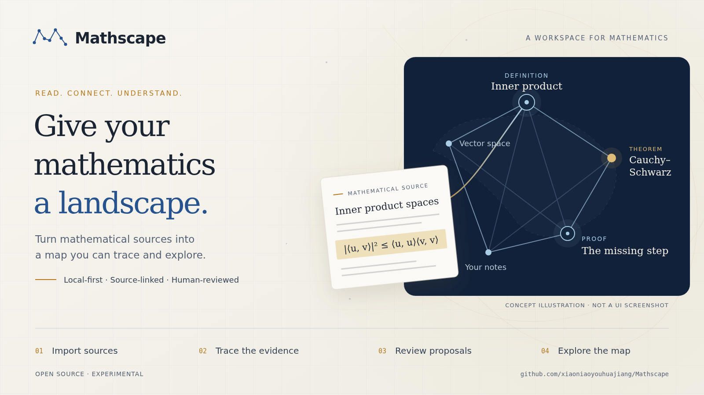
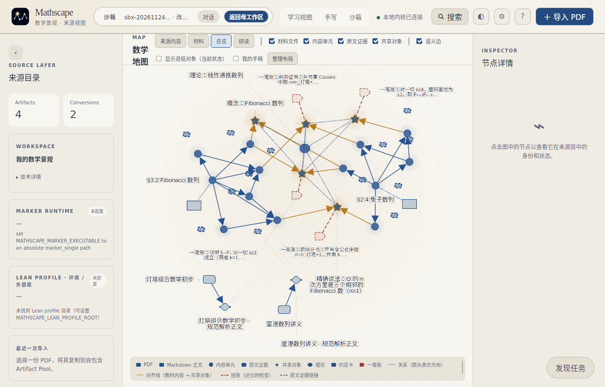

<p align="center">
  
</p>

<h1 align="center">Mathscape</h1>

<p align="center">
  <strong>A local-first workspace for connected mathematical understanding.</strong><br>
  Read sources. Trace connections. Build your map.
</p>

<p align="center">
  <a href="https://github.com/xiaoniaoyouhuajiang/Mathscape/actions/workflows/ci.yml"></a>
  <a href="LICENSE"></a>
  
</p>

<a id="中文"></a>

<p align="center">
  <a href="README.zh-CN.md">简体中文</a> ·
  <a href="#what-you-can-do-today">Capabilities</a> ·
  <a href="#quick-start">Quick start</a> ·
  <a href="#documentation">Documentation</a> ·
  <a href="CONTRIBUTING.md">Contributing</a>
</p>

---

## Mathematics is connected. Your reading should be, too.

A definition in one book. A proof in another. A connection you almost remember.

Mathscape is a desktop tool for turning mathematical sources into a **traceable hypergraph**: a map of material and relationships you can revisit alongside their evidence. It is designed for learners and researchers who want to organize notes, understand proofs, and explore connections across fields.

**Sources stay central. AI proposes; you review.** LLM-assisted discovery produces candidates, while program validation and human review control registration. Accepting a proposal does not make it mathematically verified.

> **Experimental software, actively taking shape.** The source-to-graph workflow is available today; complete mathematical understanding and automated proof verification are not. The header is a concept illustration, not an application screenshot.

## What you can do today

| Bring in your material | Keep the evidence | Build connections deliberately |
| --- | --- | --- |
| Import PDFs and optionally convert them with Marker. | Read material, select passages, and inspect source-linked discoveries. | Review candidates before registering them and browse the source graph. |

### From a document to a navigable map

1. **Import** a mathematical source into your local workspace.
2. **Read and discover** with reader selections and LLM-assisted source discovery.
3. **Review and register** candidates with their source evidence.
4. **Explore** the resulting graph and return to the material behind it.

### Inside the workspace

<p align="center">
  
  <br><em>Native desktop capture · Warm Parchment theme · two-book Fibonacci sample data.</em>
</p>

The first **EMIR semantic workflow** also supports proposals and human acceptance for shared objects, alignments, debts, and a minimal dialect scope, with map and study views. Acceptance **does not increase trust**.

**Not yet end to end:** full proof workflows, R/D/T/X construction, and Lean orchestration. See [architecture and current capabilities](docs/architecture.md) for the implementation boundary.

## Quick start

### Prerequisites

- **Rust 1.99.1** and **Node.js 24** with npm, matching [CI](.github/workflows/ci.yml). The workspace declares Rust 1.92 as its minimum.
- The [Tauri platform prerequisites](https://v2.tauri.app/start/prerequisites/) for your operating system.
- Optional PDF conversion: **Marker 2.x**, installed in a separate Python environment using the [installation guide](scripts/install/README.md).

### Run the desktop app

From the repository root, in a POSIX shell:

```sh
npm --prefix frontend install
npm --prefix frontend run tauri:dev:local_1
```

This uses the Git-ignored **`.mathscape-dev/workspace/`** directory, keeping development data inside the checkout. Standard `tauri:dev` uses the operating system's app-data directory; set `MATHSCAPE_WORKSPACE_ROOT` to choose another location.

<details>
<summary><strong>Enable optional Marker PDF conversion</strong></summary>

Point Mathscape at your installation's `marker_single` before launching:

```sh
MATHSCAPE_MARKER_EXECUTABLE=/absolute/path/to/marker/bin/marker_single \
  npm --prefix frontend run tauri:dev:local_1
```

The app uses that environment's Python to detect the `marker-pdf` version; the fixed profiles currently support Marker 2.x. Select a PDF artifact in the material graph to parse a consecutive page range from the right-hand panel.

Marker is **not distributed with Mathscape**. [Marker 2.x](https://pypi.org/project/marker-pdf/) licenses its code under Apache-2.0 and its model weights separately under a modified AI Pubs Open Rail-M license with usage restrictions.

</details>

## Documentation

| If you want to… | Start here |
| --- | --- |
| Understand the goals and current implementation | [Architecture and capabilities](docs/architecture.md) |
| Work with the graph and its invariants | [Data model](docs/data-model.md) |
| Understand persistence and external tools | [Storage and integrations](docs/storage-and-integrations.md) |
| Set up development and run checks | [Development and verification](docs/development.md) |
| Follow design proposals and their status | [Proposal index](docs/proposals/README.md) |

The engineering guides are currently written primarily in Chinese.

<details>
<summary><strong>Repository at a glance</strong></summary>

```text
apps/        Desktop application and CLI entry points
crates/      Rust domain kernel, storage, queries, graph algorithms, orchestration
frontend/    Web interface embedded in the desktop app
prompts/     Versioned LLM prompts and structured output contracts
migrations/  SQLite schema migrations
docs/        Engineering documentation and visual assets
testdata/    Small, versioned fixtures used by default tests
```

Large PDFs and experimental corpora live outside the repository and are located through `MATHSCAPE_CORPUS_ROOT`. Default tests must not depend on that variable. `testdata/` contains only small derived artifacts and source summaries needed to reproduce parsing and scanning behavior.

For Rust workspace checks:

```sh
cargo check --workspace
cargo test --workspace
```

For targeted tests and prerequisites, including building InkPad before the full test suite, follow the [development guide](docs/development.md).

</details>

## Contribute

Help shape a more traceable way to work with mathematics. Read the [contribution guide](CONTRIBUTING.md) and [code of conduct](CODE_OF_CONDUCT.md); discuss substantial changes in an issue before implementing them. Report vulnerabilities through the [security policy](SECURITY.md).

## License

Mathscape is licensed under [Apache-2.0](LICENSE). See [NOTICE](NOTICE) for the copyright notice. The [editable promotional artwork](docs/assets/README.md) is included in this repository.
