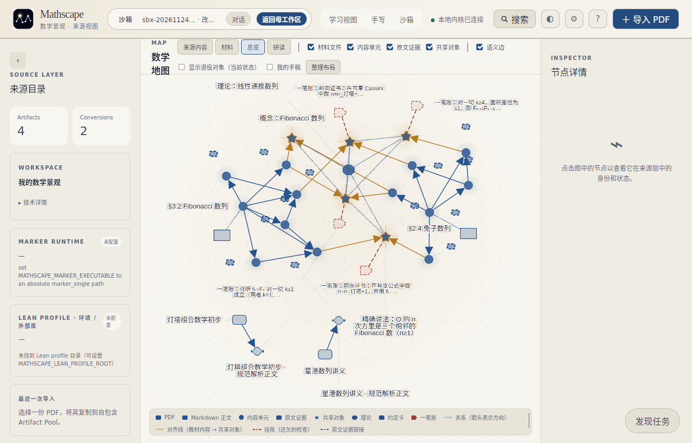

<p align="center">
  
</p>

<h1 align="center">Mathscape · 数学景观</h1>

<p align="center">
  <strong>让散落的数学材料，成为可以探索的知识景观。</strong><br>
  阅读材料，追溯关联，构建自己的数学地图。
</p>

<p align="center">
  <a href="https://github.com/xiaoniaoyouhuajiang/Mathscape/actions/workflows/ci.yml"></a>
  <a href="LICENSE"></a>
  
</p>

<p align="center">
  <a href="README.md">English</a> ·
  <a href="#现在可以做什么">当前能力</a> ·
  <a href="#快速开始">快速开始</a> ·
  <a href="#文档导航">文档</a> ·
  <a href="CONTRIBUTING.md">贡献</a>
</p>

---

## 数学本就相连，阅读不必孤立。

一本书里的定义，另一篇论文里的证明，还有那个似曾相识、却一时想不起的联系。

Mathscape 是面向数学学习者和研究者的**本地优先桌面工具**，目标是将数学材料转成**可追溯的超图**：在材料与关系之间来回探索，组织笔记、理解证明，逐步看清跨领域的关联。

**以来源为依据，让 AI 提议，由人来审核。** LLM 提出候选，程序验证与用户审核控制登记；接受一条提案，不等于它已经获得数学验证。

> **当前处于实验阶段。** 材料到来源图的流程已经可用，但这不等于完整数学理解或自动证明验证已经实现。页首宣发图是概念插画，并非应用截图。

## 现在可以做什么

| 带入自己的材料 | 保留可追溯的依据 | 审慎建立关联 |
| --- | --- | --- |
| 导入 PDF，按需使用 Marker 转换。 | 阅读材料、选取片段，查看带有来源的发现结果。 | 审核候选后再登记，在来源图中浏览关联。 |

### 从一份材料，到一张可以探索的地图

1. **导入材料**：把数学来源放进本地工作区。
2. **阅读与发现**：结合阅读选区与 LLM 辅助来源发现，产生候选。
3. **审核与登记**：对照来源依据审阅候选，再决定是否登记。
4. **探索与回看**：浏览关联图，返回关系背后的原始材料。

### 看看实际工作区

<p align="center">
  
  <br><em>真实桌面截图 · 暖宣手稿主题 · 双教材 Fibonacci 示例数据。</em>
</p>

首条 **EMIR 语义工作流**还支持共享对象、对齐线、Debt 与最小 DialectScope 的提案、人工接受，以及地图 / 学习视图。接受**不会提升可信状态**。

**尚未端到端实现**：完整证明工作流、R/D/T/X 构建和 Lean 编排。实现边界详见[架构与当前能力](docs/architecture.md)。

## 快速开始

### 环境要求

- **Rust 1.99.1** 与 **Node.js 24**（含 npm），与 [CI](.github/workflows/ci.yml) 一致。工作区声明的最低 Rust 版本为 1.92。
- 对应操作系统的 [Tauri 平台依赖](https://v2.tauri.app/start/prerequisites/)。
- 可选的 PDF 转换工具：独立 Python 环境中的 **Marker 2.x**，参见[安装指南](scripts/install/README.md)。

### 启动桌面应用

在仓库根目录的 POSIX shell 中运行：

```sh
npm --prefix frontend install
npm --prefix frontend run tauri:dev:local_1
```

开发数据保存在已被 Git 忽略的 **`.mathscape-dev/workspace/`** 目录，便于检查 SQLite、对象池与调试状态。普通 `tauri:dev` 使用操作系统的应用数据目录，也可通过 `MATHSCAPE_WORKSPACE_ROOT` 指定其他工作区。

<details>
<summary><strong>启用可选的 Marker PDF 转换</strong></summary>

启动前，将 `MATHSCAPE_MARKER_EXECUTABLE` 设置为自己安装的 `marker_single` 的绝对路径：

```sh
MATHSCAPE_MARKER_EXECUTABLE=/absolute/path/to/marker/bin/marker_single \
  npm --prefix frontend run tauri:dev:local_1
```

应用会使用该环境的 Python 探测 `marker-pdf` 版本，当前固定 profiles 支持 Marker 2.x。选中材料图中的 PDF Artifact 后，可在右栏触发连续页码范围解析。

Mathscape **不分发 Marker**。[Marker 2.x](https://pypi.org/project/marker-pdf/) 的代码采用 Apache-2.0 协议，模型权重单独采用带使用限制的 modified AI Pubs Open Rail-M 协议。

</details>

## 文档导航

| 你想了解什么 | 从这里开始 |
| --- | --- |
| 项目目标与当前实现 | [架构与当前能力](docs/architecture.md) |
| 图模型与核心约束 | [数据模型与不变量](docs/data-model.md) |
| 持久化与外部工具 | [存储与集成](docs/storage-and-integrations.md) |
| 开发环境与验证方法 | [开发与验证](docs/development.md) |
| 设计提案与推进状态 | [提案索引](docs/proposals/README.md) |

<details>
<summary><strong>仓库结构与开发检查</strong></summary>

```text
apps/        桌面应用与 CLI 入口
crates/      Rust 领域内核、存储、查询、图算法与编排
frontend/    嵌入桌面应用的 Web 前端
prompts/     有版本的 LLM prompt 与结构化输出契约
migrations/  SQLite schema migration
docs/        工程文档与视觉素材
testdata/    默认测试使用的轻量固定材料
```

大型 PDF 与实验语料位于仓库外部，通过 `MATHSCAPE_CORPUS_ROOT` 定位；默认测试不得依赖该变量。`testdata/` 只保存足以复现解析和扫描行为的小型派生产物及其来源摘要。

Rust 工作区检查：

```sh
cargo check --workspace
cargo test --workspace
```

定向测试与前置条件见[开发指南](docs/development.md)，包括全量测试前需要先构建 InkPad。历史工程草案已合并，原文可从 Git 历史查阅；版本化 Prompt、Schema 和回归材料继续保留。

</details>

## 参与贡献

欢迎一起探索更可追溯的数学工作方式。请先阅读[贡献指南](CONTRIBUTING.md)与[行为准则](CODE_OF_CONDUCT.md)，较大的改动请先通过 issue 讨论。安全问题请按[安全策略](SECURITY.md)反馈。

## 开源协议

Mathscape 采用 [Apache-2.0 协议](LICENSE)，版权声明见 [NOTICE](NOTICE)。[可编辑的宣发图源文件](docs/assets/README.md)一并保存在仓库中。
