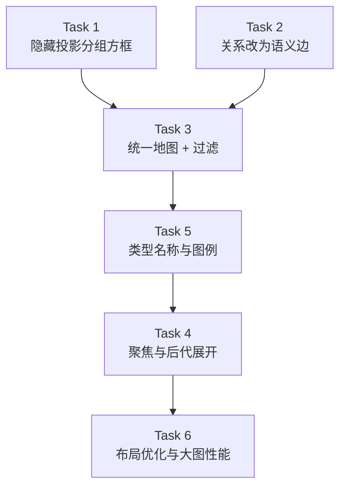

# 前端地图展示优化规划

## 背景

当前 Mathscape 前端存在"内部实现结构外露"的问题：`ProjectionGroup` 渲染为可见方框、超边关系节点直接呈现为菱形节点、三种视图没有给用户传达清晰的信息架构。

`frontend_opt.md` 提出了 6 项改进，并给出了采纳优先级。本规划将其分解为独立可交付的开发任务。

---

## 进度

| Task | 状态 | 说明 |
|---|---|---|
| Task 1 隐藏投影分组方框 | ✅ 已完成 | `toCytoscapeElements` 直接过滤 `element_kind === "group"` |
| Task 2 关系改为语义边 | ✅ 已完成 | `renderMode` + `buildSemanticEdges`（二元直连、多元 junction、证据虚线边） |
| Task 3 统一地图 + 过滤 | ✅ 已完成 | 单一 `landscape_graph` + 预设按钮 + 节点类型 checkbox，状态持久化到 localStorage |
| Task 5 类型名称与图例 | 🔜 下一步 | 执行顺序已调整到 Task 4 之前，理由见下 |
| Task 4 聚焦与后代展开 | ⏳ 待办（已修订） | 原方案低估了工作量，修订版见对应章节 |
| Task 6 布局与大图性能 | ⏳ 待办 | 吸收了原 4b 的载荷精简议题 |

---

## 现状速览

| 层 | 当前状态 |
|---|---|
| **Rust 后端** | `DesktopSnapshot` 同时返回 `graph`（材料图）、`source_graph`、`landscape_graph` 三张 `IncidenceGraph`；Task 3 之后前端只消费 `landscape_graph`，另外两张是冗余载荷 |
| **`IncidenceGraph::project`** | 仍把 `ProjectionGroup` 序列化为节点（`element_kind = "group"`），但前端已不再渲染 |
| **关系渲染** | 后端仍产出关系节点；前端默认在语义边模式下折叠为边（`cytoscape.ts`） |
| **前端** | `main.ts` 统一渲染 `landscape_graph`，通过预设 + checkbox 过滤 |
| **过滤** | 三类节点 checkbox（`SourceArtifact` / `SourceSemanticUnit` / `SourceSpan`）+ 三个预设 + 渲染模式切换 |

---

## 总体方案

> 保留后端 `ProjectionLens` / `ViewLayer` / `IncidenceGraph` 数据契约不变；所有用户可见的重组均在前端完成。后端投影数据已包含足够的语义字段（`element_kind`、`domain_kind`、`layer`、`summary`）供前端过滤与分类。

把三种视图页面改为：
- 一张**统一数学地图**（默认使用景观图数据）
- 一组**过滤控件**（节点层 + 关系层 checkbox 组 + 渲染模式切换）
- **聚焦入口**（Inspector 按钮 / 双击 / 右键菜单）

---

## 任务拆解

### Task 1 — 隐藏投影分组方框（可用性修复 · 最小改动）✅

**范围**：纯前端，只改 `cytoscape.ts` 样式

**问题**：`node[elementKind = "group"]` 被渲染为可见的 compound node，出现巨大包围矩形。

**方案**：将 `group` 节点默认设为不可见（`display: none` 或 `opacity: 0` + `events: no`），同时把其子节点从 compound 归属中剥离——在 `toCytoscapeElements` 中，对 `element_kind === "group"` 的节点跳过输出 `parent` 字段（或直接过滤掉 group 节点）。

**变更文件**：
- [`cytoscape.ts`](file:///Users/wangjiajie/software/lean4_exp/mathscape/frontend/src/graph/cytoscape.ts) — 在 `toCytoscapeElements` 中过滤 `group` 节点，或将其样式设为 `visibility: hidden` + `display: none`

**风险**：无 Rust 变更；如果后续有意使用 compound 来表示真实的来源区域，需要回溯。

**落地结果**：选择了直接过滤 group 节点（不输出 `parent`），后端投影不变。

---

### Task 2 — 关系节点改为语义边模式（可用性修复 · 前端中等改动）✅

**范围**：前端 `cytoscape.ts` + `main.ts` 过滤逻辑

**问题**：每个 `ProjectionRelation` 被转换为一个菱形节点，用户会误认为是数学对象。

**方案**：在 `toCytoscapeElements` 中增加一个 `renderMode: "semantic" | "hyperedge"` 参数。

- **语义边模式（默认）**：跳过 `element_kind === "relation"` 的节点；对于每条 incidence edge，若其 `source` 或 `target` 是关系节点，则改为端点间直接连边，边的 `label` 取关系的 `label`（需从关系节点 map 中查找）。
  - 二元关系（恰好 2 个端点）：直接画一条有向边。
  - 多元关系（≥3 端点）：用一个隐藏的 junction 节点 + 多条边，或直接画边束。
- **超边调试模式**：保留现有行为（菱形节点）。

在 UI 控制栏中添加 "渲染模式" 切换（图标按钮或 toggle），持久化到 localStorage。

**变更文件**：
- [`cytoscape.ts`](file:///Users/wangjiajie/software/lean4_exp/mathscape/frontend/src/graph/cytoscape.ts) — `toCytoscapeElements` 接受 `options` 参数，实现语义边转换逻辑
- [`projection.ts`](file:///Users/wangjiajie/software/lean4_exp/mathscape/frontend/src/graph/projection.ts) — 无需改动（数据结构不变）
- [`main.ts`](file:///Users/wangjiajie/software/lean4_exp/mathscape/frontend/src/main.ts) — 添加渲染模式切换 UI 和状态

**风险**：语义边模式下点击边时 Inspector 需要能显示关系详情，需要把关系节点的 `domain_id` / `label` 挂在边的 `data` 上。

**落地结果**：多元关系采用了隐藏 junction 节点方案；证据端点（`SourceSpan`）被单独识别并画成虚线 `evidence-edge`，避免证据把二元关系的主干方向搅乱。

---

### Task 3 — 统一数学地图 + 节点/关系层过滤（信息架构重构）✅

**范围**：前端重构，不涉及 Rust

**问题**：三个视图实为同一张图的投影，应合并为一张图 + 过滤预设。

**方案**：

1. 取消"材料图 / 来源图 / 景观图"三个独立切换按钮，改为统一使用 `landscape_graph` 数据。

2. 在画布工具栏添加"显示节点"和"显示关系"两组 checkbox。

3. 添加"显示预设"快捷按钮（总览 / 材料 / 来源内容）：每个预设本质上是一组 checkbox 的预置组合。

4. 默认预设：**来源内容**（仅 `SourceSemanticUnit` + `SourceArtifact`），不默认展示全量景观图（避免"毛线团"）。

**变更文件**：
- [`main.ts`](file:///Users/wangjiajie/software/lean4_exp/mathscape/frontend/src/main.ts) — 视图切换逻辑重构；`visibleNodeKinds` + `filterGraph`
- [`styles.css`](file:///Users/wangjiajie/software/lean4_exp/mathscape/frontend/src/styles.css) — 过滤面板样式
- [`cytoscape.ts`](file:///Users/wangjiajie/software/lean4_exp/mathscape/frontend/src/graph/cytoscape.ts) — 渲染前过滤

**落地结果与遗留约束**（Task 4 必须知道）：

- 关系节点的可见性由节点可见性**推导**：勾选 `SourceArtifact` 才放行 `ConversionRun`，勾选 `SourceSemanticUnit` 才放行 `SourceUnitRelation`。
- `filterGraph` 会丢弃任一端点不可见的边。默认预设 `source` 隐藏了 `SourceSpan`，而 `SourceSpan` 是材料侧与内容侧**唯一**的桥梁，因此默认视图下 PDF 与内容单元在图上并不连通。
- `located-in` 这类合成关系的 `domain_kind` 是 `Evidence`，不在 `knownRelationKinds` 中，只有 `overview` 预设靠 `allowUnknownKinds` 放行。

---

### Task 5 — 统一类型名称与图例

**范围**：前端文案 + 样式，不涉及 Rust

**问题**：

1. 图例标签（"来源材料"、"转换任务"）与 Inspector 中显示的 `domain_kind` 名称不统一，且图例在 Task 3 重构后已从工具栏中消失，只剩 `styles.css` 里的死样式。
2. 更关键的是：PDF 和解析产出的 Markdown 在 `landscape_graph` 中**都是 `SourceArtifact`**（`artifact_graph.rs`），当前用同一种形状和颜色渲染，用户无法区分。而"从 PDF 聚焦"与"从 Markdown 聚焦"的结果完全不同，所以这是 Task 4 的前置条件。

**方案**：

1. 新建 `frontend/src/graph/taxonomy.ts`，作为**唯一**的类型名称与视觉编码来源，供 Cytoscape 样式、图例、Inspector、过滤控件共用，杜绝三处各写一份中文名。

2. 在该模块中把 `SourceArtifact` 细分为具体材料类型。后端 `project_artifact_catalog` 写入的 `summary` 形如 `"{media_type} · {bytes} bytes · {status}"`，前端按首段 media type 判定 PDF / Markdown 正文 / 解析元数据 / 解析图片 / 附件；无法判定时回落到通用"材料文件"。这是一处对后端 `summary` 格式的约定依赖，需在代码中标注；若将来后端在投影节点上补充显式的媒体类型字段，此处应改为直接读取。

3. `toCytoscapeElements` 为每个节点写入 `nodeType` 数据字段，Cytoscape 样式表按 `node[nodeType = "..."]` 分配形状与配色，取代当前按 `domainKind` 硬编码的三条规则。

4. 图例改为**按当前实际渲染内容动态生成**：渲染后统计可见节点的 `nodeType` 与边类别，只列出真正出现的条目。图例放在画布左下角浮层，不再挤占工具栏。

5. Inspector 的 `kind-pill` 与"类型"行、过滤 checkbox 文案全部改用 `taxonomy.ts` 的名称。

**变更文件**：
- `frontend/src/graph/taxonomy.ts` — 新建：类型键推导、中文名、图例形状与配色
- [`cytoscape.ts`](file:///Users/wangjiajie/software/lean4_exp/mathscape/frontend/src/graph/cytoscape.ts) — 写入 `nodeType`；样式表由 taxonomy 生成
- [`main.ts`](file:///Users/wangjiajie/software/lean4_exp/mathscape/frontend/src/main.ts) — 图例渲染；Inspector 与过滤文案统一
- [`styles.css`](file:///Users/wangjiajie/software/lean4_exp/mathscape/frontend/src/styles.css) — 图例浮层与形状化图例点样式；清理 Task 3 遗留的死样式

**验收**：导入一份 PDF 并解析后，PDF 节点与 Markdown 节点在形状/颜色上可区分；图例条目数量随过滤条件变化；图例、Inspector、checkbox 对同一类型使用同一个中文名。

---

### Task 4 — 按来源聚焦与后代展开（交互增强 · 已修订）

**范围**：纯前端。原方案中的后端 `get_neighborhood`（4b）已删除，理由见下。

**问题**：用户无法快速聚焦"某个 PDF 贡献了哪些内容单元和语义对象"。这是 `frontend_opt.md` 中用户价值最高的一条。

> [!WARNING]
> **对原方案的修正**：原方案把 Task 4 描述为"在内存中对 `landscape_graph` 做 BFS/DFS"，这低估了工作量。在当前代码状态下，朴素 BFS 会返回一个**只包含 PDF 自己**的子图。Task 4 的难点不在遍历算法，而在遍历之前必须解决的三个语义问题。

#### 4.0 必须先解决的三个语义前提

**(a) 图的方向性是不一致的，有向 BFS 走不通。**

材料侧 `ConversionRun` 关系中 `input` 是 `IntoRelation`、`output` 是 `OutOfRelation`，即 PDF → ConversionRun → Markdown 顺着派生方向。但来源侧相反：`located-in`（`SourceSpan` → Markdown）与 `SourceSemanticUnit` → `SourceSpan` 都是**溯源方向**，指回上游。从 PDF 沿有向后继遍历走到 Markdown 就会断掉。

因此不能实现为有向 BFS。方案是在前端显式定义一张"关系类型 → 派生方向"映射表，按语义方向遍历，而不是按拓扑方向。

**(b) Task 3 的过滤恰好切断了聚焦所需的链路。**

`SourceSpan` 是材料侧与内容侧唯一的桥梁，但默认预设把它隐藏，`filterGraph` 又会丢弃端点不可见的边。所以：

> 聚焦遍历必须在**未过滤的** `landscape_graph` 上进行，然后把途经隐藏节点的路径**收缩**成一条虚拟边（如 PDF ⇢ 内容单元，标注"派生自"），最后再叠加用户的过滤条件。

这条路径收缩逻辑是 Task 4 的核心，原方案完全没有提及。做不做它，决定了"聚焦此来源"是能用还是一片空白。

**(c) 无向遍历下"全部后代"等于整个连通分量。**

`SourceUnitRelation` 包含 `cites`、`proves` 这类跨文献关系。一旦无向遍历，从内容单元会顺着引用关系跑到别的 PDF 去，"展开全部"实际等于展开连通分量，正好回到我们想避免的毛线团。

因此聚焦遍历必须限定**可穿越的关系类型集合**：只走 `ConversionRun`、`located-in`、`对应原文` 这类溯源关系，不走 `cites` / `proves`。这一点写入验收标准。

#### 4.1 遍历放在 IncidenceGraph 层，不是 cytoscape 层

原方案写"从 `cytoscape.ts` 导出 BFS 邻域提取工具函数"，层次放错了。语义边模式下 cytoscape 元素是合成出来的（`sem~` / `junc~` / `evidence~`），跳数语义与超边结构对不上，切换 `renderMode` 会让"2 跳"的含义发生变化。

新建 `frontend/src/graph/focus.ts`：

- 输入：`IncidenceGraph`（未过滤）+ 根节点 id + 深度 + 允许穿越的关系类型集合
- 输出：子 `IncidenceGraph`，其中关系节点作为透明超边处理（entity → relation → entity 记作 1 跳），途经隐藏节点的路径收缩为虚拟边
- 纯函数，无 DOM 依赖，可独立测试

这样聚焦结果与渲染模式完全解耦。

#### 4.2 交互入口（顺序已调整）

按"成本低、可发现性高、不引入新交互机制"排序，逐个交付：

1. **Inspector 按钮**"以此来源为中心查看"——最先做。
2. **双击节点**进入邻域模式——注意与现有 `tap` 处理器冲突：单击已会打开 Inspector 并触发 `sourceNodeDetail` 异步请求，双击会先放出一次单击，需要去抖。
3. **右键菜单**（`聚焦此来源` / `展开一层` / `展开全部后代`）——最后做。

#### 4.3 聚焦状态与出口

- 聚焦状态**不持久化**到 localStorage（与 filter / renderMode 不同），刷新后回到全图。
- 必须有明确的"返回全图"出口。
- 空状态文案要区分"过滤后为空"与"聚焦范围为空"，当前 `main.ts` 只有前者。
- 深度控件：1 层 / 2 层 / 全部。

#### 4.4 增量渲染

当前 `renderCurrentGraph` 每次都 `graphCore?.destroy()` 并重跑 `cose` 且 `fit: true`。聚焦、退出聚焦、调深度都会触发整图重排，用户的空间记忆每次清零，对"逐层展开"体验很差。

聚焦时改为不销毁 core：用 `cy.batch` 增删元素，只对新增节点跑布局，保留已有节点坐标。

#### 4.5 关于原 4b（后端 `get_neighborhood`）：删除

理由不是"数据量还小"，而是投入产出不对。真正的性能问题在于 `get_desktop_snapshot` 每次序列化三张全量 `IncidenceGraph`，而前端只用其中一张。而且按 `architecture.md` 的边界，query 层职责是"从权威快照构建只读视图"，新增邻域 API 意味着存储层要支持图遍历，成本远高于收益。

该议题改写为"精简 `DesktopSnapshot` 载荷"并入 Task 6。

#### 4.6 交付拆分

| 子任务 | 内容 | 可独立验收 |
|---|---|---|
| 4a-1 | `focus.ts`：方向映射、可穿越关系集合、超边透明遍历、路径收缩 | 纯逻辑 |
| 4a-2 | 聚焦状态模型、深度控件、"返回全图"出口、空状态文案区分 | 是 |
| 4a-3 | Inspector 入口按钮 | 是 |
| 4a-4 | 增量渲染 + 双击 / 右键菜单 | 是 |

**变更文件**：
- `frontend/src/graph/focus.ts` — 新建：聚焦遍历与路径收缩
- [`main.ts`](file:///Users/wangjiajie/software/lean4_exp/mathscape/frontend/src/main.ts) — 聚焦状态、入口、空状态、增量渲染
- [`cytoscape.ts`](file:///Users/wangjiajie/software/lean4_exp/mathscape/frontend/src/graph/cytoscape.ts) — 收缩虚拟边的样式；增量挂载 API
- [`styles.css`](file:///Users/wangjiajie/software/lean4_exp/mathscape/frontend/src/styles.css) — 聚焦状态条与深度控件样式

---

### Task 6 — 全景布局优化与大图性能（收尾）

**范围**：前端 + 可选 Rust

**问题**：数据量增长后全量景观图会成为不可读的"毛线团"；`cose` 布局在节点多时性能较差；`DesktopSnapshot` 载荷冗余。

**方案**：
- Task 3 的默认预设与 Task 4 的聚焦已缓解最坏情况
- 可引入 `cytoscape-fcose`（比 cose 快数倍）或 `dagre`（层次布局）
- 节点数超过阈值时自动降级到聚合视图（仅显示 PDF 级别）
- **精简 `DesktopSnapshot` 载荷**（原 4b 转入）：Task 3 之后前端只消费 `landscape_graph`，`graph` 与 `source_graph` 是纯冗余序列化开销，应从快照中移除或改为按需请求

**变更文件**：
- [`cytoscape.ts`](file:///Users/wangjiajie/software/lean4_exp/mathscape/frontend/src/graph/cytoscape.ts) — 替换 layout；添加节点数阈值检查
- [`package.json`](file:///Users/wangjiajie/software/lean4_exp/mathscape/frontend/package.json) — 新增 `cytoscape-fcose` 依赖（需评估体积）
- `apps/mathscape-desktop/src/lib.rs` — 精简 `DesktopSnapshot` 字段

---

## 执行顺序与依赖关系

> [!IMPORTANT]
> **Task 5 已提前到 Task 4 之前**。`landscape_graph` 中 PDF 与 Markdown 同为 `SourceArtifact`，但"从 PDF 聚焦"和"从 Markdown 聚焦"结果完全不同。用户若分不清这两种节点，聚焦交互的结果就是不可预期的。此外 Task 4 引入的收缩虚拟边本身也需要新的图例说明。

**建议分批交付**：
- **Sprint 1（可用性修复）**：Task 1 + Task 2 ✅
- **Sprint 2（信息架构）**：Task 3 ✅ + Task 5
- **Sprint 3（交互增强）**：Task 4，按 4a-1 → 4a-4 逐步交付
- **Sprint 4（规模化）**：Task 6 ← 待数据量增长后处理

---

## 开放问题

> [!IMPORTANT]
> **Q1（仍开放）：关系类型枚举**。Task 4 的"可穿越关系集合"需要区分 `SourceUnitRelation` 的子类型（`cites` / `proves` / `contains`）。目前前端只能看到 `domain_kind === "SourceUnitRelation"`，只能靠关系 `label` 的中文字面量近似判断，这很脆弱。建议在 `IncidenceGraph` 的关系节点上增加 `relation_subkind` 字段。**这是 Task 4 唯一可能需要后端配合的点。**

> [!NOTE]
> **Q2（已解决）：景观图数据完整性**。Task 1 直接过滤 group 节点后，`source-map-landscape` 分组未产生副作用。

> [!NOTE]
> **Q3（已解决）：多元关系的语义边处理**。Task 2 采用了隐藏 junction 节点方案，保留了全部端点与方向。

> [!NOTE]
> **Q4（已决定）：右键菜单方案**。采用**自行实现** `contextmenu` 事件 + 绝对定位 `
`。当前前端没有任何 UI 框架，全部是原生 DOM 与模板字符串；`cytoscape-cxtmenu` 的环形菜单与暗色面板风格不符，且为几十行功能引入额外依赖不划算。另外交互入口顺序调整为 Inspector 按钮 → 双击 → 右键菜单（见 4.2）。

---

## 验证计划

每个 Task 完成后均可在开发环境中目视验证：

- **Task 1**：打开景观图，不再出现大方框包围整个图区域 ✅
- **Task 2**：关系以带标签的边呈现，切换到超边模式后恢复菱形节点 ✅
- **Task 3**：勾选/取消 checkbox 后图实时更新；预设按钮切换效果符合文档描述 ✅
- **Task 5**：PDF 与 Markdown 节点视觉可区分；图例随过滤条件动态变化；图例 / Inspector / checkbox 名称一致
- **Task 4**：
  - 在默认"来源内容"预设下（`SourceSpan` 隐藏）聚焦某个 PDF，仍能看到其内容单元——验证路径收缩生效
  - 聚焦后不出现经 `cites` 跨到其他 PDF 的节点——验证可穿越关系集合生效
  - 调整深度和退出聚焦时已有节点位置不跳变——验证增量渲染生效
- **Task 6**：导入多份 PDF 并解析后，图仍可交互；切换 layout 对比布局质量
