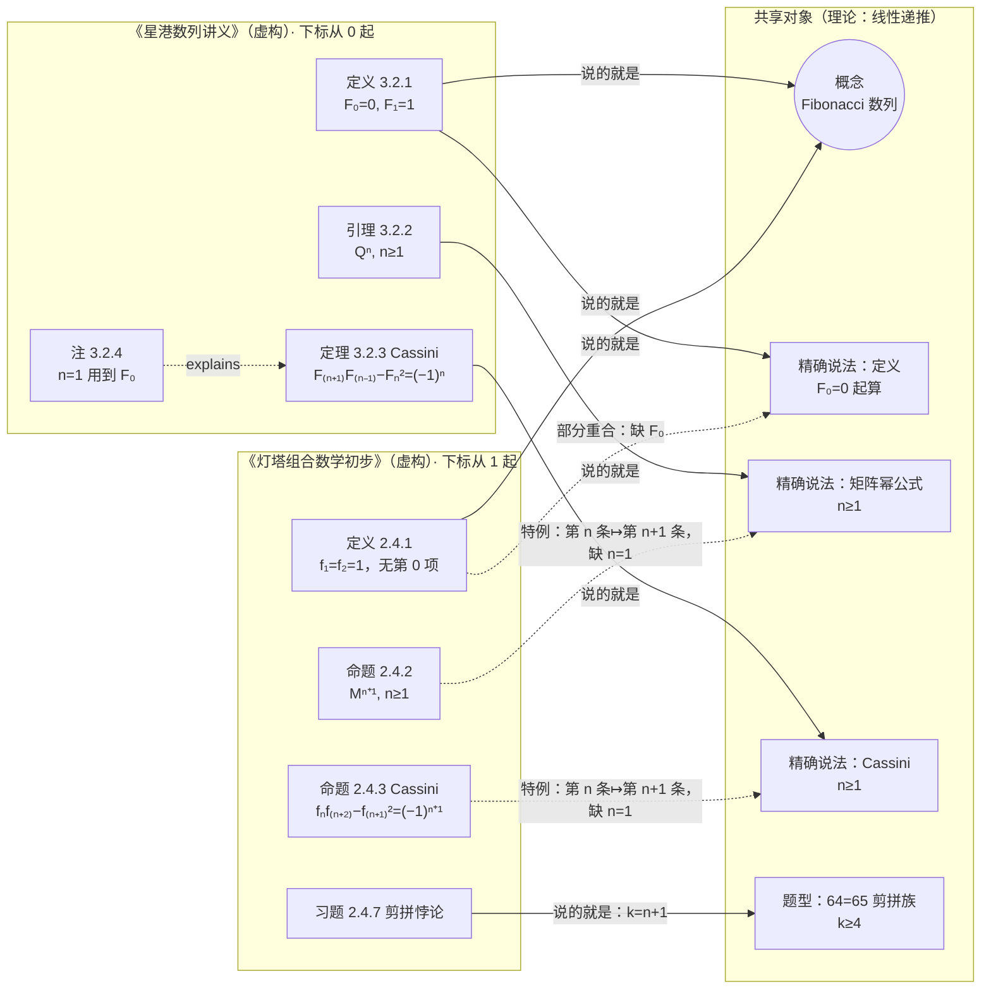

# EMIR 示例夹具：两本书讲的是不是同一个东西？（v0.4）

> **v0.4（2026-11-13，PR #50 第一轮修改）**：面向软件用户去掉开发视角的说法：材料文件改名为 `星港数列讲义.md`、`灯塔组合数学初步.md`；所有白话字段里的“甲 / 乙”改为“星港 / 灯塔”；“概念星 / 星区”改为“概念 / 理论”；材料开头的“示例材料（虚构教材）”说明改成 HTML 注释（不渲染）；`revision_history` 增加 `user_feedback`（教程第 8 镜用）。

> **v0.3（2026-11-13，进仓库）**：随语义层第一条 PR 进入仓库，作为契约 `docs/semantic-write-contract.md` S11 的示例与测试夹具。相对 v0.2：mathlib 基线按三态（unchecked / confirmed / not_found）改写，Agent 只写 `unchecked`（`e.qpow` 名称留空，`e.puzzle` 不写基线）；“特例”对齐的 `parameter_map.map` 改为白话“灯塔的第 n 条 ＝ 共享的第 n+1 条”，公式移到 `note`；新增只读教程投影 `tutorial-projection.json`。
>
> **v0.2**：(a) 共享对象写法以 mathlib 为基线，对象上带 `conventions` / `mathlib_baseline`；(b) Debt 成为地图对象（`kind = debt`，共 4 个，status 为 open）；(c) 增加最小 DialectScope（`ds.jia`、`ds.yi`）。change set 按“每个围绕一个目标对象”重分为 6 个。

> 所有教材段落都是**示例材料（虚构教材）**：书名、章节号是编的，内容是自己写的，不摘录、不模仿任何真实教材。

## 1. 这份夹具做什么

它是已批准计划的第 1 步：先造出一组具体对象，后面三步都用它。

1. **教程素材**：引导动画结尾的续集预告是这样一句话：“两本教材，一本从 F₀＝0 开始，一本从 F₁＝1 开始，矩阵的下标也不一样。它们讲的是同一个东西吗？”这份夹具给出这个问题在数据上的答案，可以扩成应用内的一小段教程。
2. **测试夹具**：给第一条语义层领域模型 PR 用。范围包括 DomainPayload、SemanticEntity（concept / declaration / theory / problem_schema）、Declaration 扩展、Alignment、TrustRecord 和 Debt。
3. **契约草案的样例**：`objects.json` 按 `propose_changes` 的提交格式分成 6 个 change set（每个围绕一个目标对象），并标明哪些字段超出了现行契约。契约见 `docs/semantic-write-contract.md`。

一句话答案：**说的是同一颗“概念”，但不是同一句“精确说法”，所以不能合并，只能各自连一条带说明的对齐线。**

## 2. 两段材料

| 文件 | 虚构书名 | 约定 | 内容 |
|---|---|---|---|
| `materials/星港数列讲义.md` | 《星港数列讲义》§3.2（星港） | $F_0=0,\ F_1=1$，下标从 0 起 | 定义、矩阵幂引理（$Q^n$，$n\ge1$）和证明、Cassini $F_{n+1}F_{n-1}-F_n^2=(-1)^n$（$n\ge1$）和证明、注：$n=1$ 的情形要用到 $F_0$ |
| `materials/灯塔组合数学初步.md` | 《灯塔组合数学初步》§2.4（灯塔） | $f_1=f_2=1$，**不使用第 0 项** | 定义（“兔子数列”）、$M^{n+1}$ 命题（$n\ge1$）、Cassini $f_nf_{n+2}-f_{n+1}^2=(-1)^{n+1}$（$n\ge1$）、剪拼悖论习题（$n\ge3$，$n=5$ 时就是 8×8→5×13）和提示 |

每段原文都用 `<!-- span:… -->` 和 `<!-- /span -->` 包起来。标记之间的字节范围就是 `source_span` 的 `md_byte_range`，由 `build_objects.py` 计算，`quote` 与范围内的原文逐字节相同。

## 3. 总览图



（实线是 `expresses`，虚线是 `specializes` 或 `overlaps_with`。按 EMIR §8.6 的稀疏原则，星港、灯塔之间不建直接边。“第 n 条↦第 n+1 条”移动的是命题参数 n，即第几条恒等式；数列本身没有错开，f_k = F_k 的项下标是对齐的。）

## 4. 关键对齐，以及为什么不合并

| 对齐 | 关系 | 下标或记号对照 | 对不上的部分 | 一笔账（Debt） |
|---|---|---|---|---|
| 星港定义 → 共享定义 | expresses | n ↦ n | 无 | 无 |
| 灯塔定义 → 共享定义 | **overlaps_with**（partially_aligned） | f_k ↦ F_k，仅对 k ≥ 1 | 共享定义有 F₀ = 0，灯塔没有 | f_k = F_k 还要一个归纳证书 |
| 灯塔命题 2.4.2 → 矩阵幂公式 | **specializes** | n_共享 = n_灯塔 + 1 | 共享的 n = 1（Q¹ 里有 F₀） | 前向证书：代入后改写 |
| 灯塔命题 2.4.3 → Cassini | **specializes** | n_共享 = n_灯塔 + 1 | 共享的 n = 1：F₂F₀ − F₁² = −1（就是星港的注 3.2.4） | 前向证书：代入后改写 |
| 灯塔习题 2.4.7 → 剪拼题型 | expresses | k = n + 1，n ≥ 3 ⇔ k ≥ 4 | 无 | 无（依赖 f_k = F_k） |
| 星港、灯塔定义 → 概念 | expresses | — | — | — |

**为什么不能把星港、灯塔合并成一个对象：**

- 如果按星港的写法合并，灯塔就“被加上”了一个它从没定义过的 F₀，这等于替原文补写内容（违反 EMIR §5.2 第 7 条）。
- 如果按灯塔的写法合并，星港的 n = 1 那一条（注 3.2.4）就没地方放了，信息会丢失。
- 两个 Cassini 式子表面上不一样：一个指数是 n，一个是 n+1；一个写 F_{n+1}F_{n-1}，一个写 f_n f_{n+2}。但灯塔的第 n 条恰好是共享 Cassini 的第 n+1 条。这里移动的是命题参数 n（第几条恒等式），不是数列本身：两本书的数列项 f_k = F_k 下标完全对齐。参数这样对应以后，灯塔还少了共享的 n = 1 那一条。这种“同中有异”只能写在对齐线上（binder_map 和 lost_information），合并后就看不见了。
- 对齐是一个可以单独审查、修订和撤回的主张。合并以后，以后发现错了，也没法只撤回其中一半。

**修订示例**（`revision_history`）：v0.2 拆成两个 change set 后，`e.fib` 和 `e.cassini` 两批各有一次 v1 → v2。v1 里，Agent 把灯塔的两条分别写成了 `definitionally_equivalent` 和 `logically_equivalent`。用户在对话里指出“灯塔没有第 0 项”，Agent 用 `supersedes` 提交了 v2，改成 `overlaps_with` 和 `specializes`。两版的 `local_ref` 相同，所以 id 也相同。

**接受 ≠ 可信**：用户接受以后，对象写进地图，但 trust 各轴不变，对齐状态仍是 `retrieved_candidate` 或 `partially_aligned`，四笔账（v0.2 起是地图上的 Debt 对象）也还挂着。

## 5. 白话术语表（教程、地图、审核页统一用这一套）

和引导动画的说法对齐：动画里的“星”“一笔账”“证书”在这里沿用同样的意思。

| 对象 / 字段 | 白话说法 | 画法建议（沿用动画配色） |
|---|---|---|
| SourceSpan | 原文片段：“书上这一段” | 书页上的高亮条 |
| SourceSemanticUnit | 来源单元：“书里的一条定义、定理或习题” | 小文档卡片（动画里的“来源锚点”图标） |
| SourceRelation（proves / hints / cites / explains） | 书内关系：“这段证明那条”“这条提示那题” | 卡片之间的细灰线 |
| SemanticEntity · concept | 概念：“大家都在说的那个东西” | 星（STAR `#e8f1ff`） |
| SemanticEntity · declaration | 精确说法：“带前提、带下标范围的那一句” | 星旁的小铭牌 |
| SemanticEntity · theory（home_theory） | 理论：“它属于哪一片” | 背景分区 |
| SemanticEntity · problem_schema | 题型：“一族题，带参数” | 带参数槽的卡片 |
| Alignment | 对齐线：“这段话说的就是那个共享对象，以及哪里不一样” | 候选是虚线（LINE `#9eb6ff`），接受后是实线；**颜色和线型不表示可信度** |
| relation：expresses / specializes / overlaps_with | 说的就是它 / 是它的特例 / 部分重合 | 线上的小标签 |
| binder_map / symbol_map | 参数对照 / 记号对照：“灯塔的第 n 条是共享的第 n+1 条”（移的是命题参数，数列项 f_k = F_k 不错位） | 线中点的对照条 |
| lost_information | 对不上的部分：“灯塔这里没有” | 灰掉的格子（MUTED `#7f8db3`） |
| Debt | 一笔账：“还欠一个证明或检查” | 金色虚线小标签（未还清 `#c9a86a`） |
| TrustRecord | 可信度徽章（分好几项，不是一个分数） | 卡片角标 |
| change set / 接受 | 提案批次 / 接受（写进地图 ≠ 证明正确） | 审核页 |
| `same_as` | （禁止）“一模一样”——系统里不存在这种线 | 教程里用红 ✕（RED `#d0626a`）演示“合并”为什么不行 |

## 6. 对照表：预告段教程镜头 → 对象 → 第一条 PR 后能否用真实数据

| # | 镜头构想 | 对象 | 第一条 PR 之后 |
|---|---|---|---|
| 1 | 两本书从左右飞入，各翻到一页 | 两份 artifact，SourceSpan，SourceUnit（sec / def） | **能**（来源层已有） |
| 2 | 每本书各射出一条虚线，指向同一颗“Fibonacci 数列”星 | concept 实体，`a.jia.def.fib` / `a.yi.def.fib`（expresses，候选） | **能** |
| 3 | 放大定义：星港的 0, 1, 1, 2…，灯塔的 1, 1, 2…；星港的第 0 格在灯塔那边是空的 | `a.yi.def`（overlaps_with），symbol_map，lost_information（F₀） | **能** |
| 4 | 两个 Cassini 并排，“第几条”编号条滑动一格后两边逐条对上（滑动的是命题参数 n，上方数列 f_k = F_k 的项保持对齐不动）；灯塔缺的共享 n = 1 那一条变灰，旁边亮起星港的注 3.2.4 | `a.yi.thm`（specializes），binder_map n ↦ n+1，lost_information，`jia.u.rem` | **能** |
| 5 | 矩阵命题同理：灯塔的 Mⁿ⁺¹（第 n 条）对应共享的第 n+1 条，移的是命题参数，矩阵里的数列项不错位（呼应旁白“矩阵的下标也不一样”） | `a.yi.lem`（specializes） | **能** |
| 6 | 尝试“合并”：要么给灯塔硬塞一个 F₀，要么星港的 n = 1 掉出去，红 ✕；镜头退回“两条线连一颗星” | Alignment ≠ 合并；`same_as` 不存在 | **能**（纯展示，靠的是模型约束） |
| 7 | 金色“一笔账”标签：f_k = F_k 还要证明 | 4 个地图 Debt 对象（`d.yi.f_eq_F`、`d.yi.lem.forward`、`d.yi.thm.forward`、`d.puzzle.all_k`） | **能**（v0.2：Debt 已是地图对象） |
| 8 | 用户点“接受”，线变成实线，但可信度徽章仍是“候选” | 接受与 TrustRecord 分离 | **能** |
| 9 | 灯塔的习题里 n = 5，飞回动画里的 8×8（k = 6；换的是题型参数，正方形边长 f₆ = F₆ = 8 不变） | problem_schema，`a.yi.ex`（k = n+1） | **能** |
| 10 | 与动画角落小网连起来：概念落到“递推”R 星、Cassini 徽章（D） | R/D/T/X | **之后**（R/D/T/X 模型） |
| 11 | “本书下标从 1 开始”作为灯塔的约定卡，从封面展开 | 最小 DialectScope `ds.yi` | **能**（v0.2：第一条 PR 提前做最小版本） |
| 12 | Cassini 带一枚形式化证书徽章 | FormalArtifact / Lean | **之后** |

## 7. 文件

| 文件 | 说明 |
|---|---|
| `materials/星港数列讲义.md`、`materials/灯塔组合数学初步.md` | 示例原文，带片段标记 |
| `objects.json` | 6 个 change set：星港来源 + 约定卡、灯塔来源 + 约定卡、`e.fib`（v2）、`e.qpow`、`e.cassini`（v2）、`e.puzzle`；另含修订记录和地图 Debt 列表 |
| `build_objects.py` | 由材料生成 `objects.json`：字节范围和各类 id 都由程序计算 |
| `verify_fixtures.py` | 数学核对（精确整数）和结构不变量核对，共 1602 条断言 |
| `tutorial-projection.json` | 只读教程投影：Desktop 测试把 `objects.json` 走一遍真实的暂存 → 接受 → 地图投影后写出；应用内教程只读它 |
| `tutorial-storyboard.md` | 应用内教程分镜（11 镜，约 112 秒） |

重新生成：

```sh
python3 build_objects.py && python3 verify_fixtures.py
MATHSCAPE_UPDATE_TUTORIAL_PROJECTION=1 cargo test -p mathscape-desktop --lib emir_fixture
```

接入的测试：MCP `emir_fixture_change_sets_all_stage_in_order`、Desktop `emir_fixture_accepts_and_learning_view_marks_seen_material`、vitest `tests/unit/tutorial-projection.spec.ts`、Playwright `tests/app-tutorial.spec.ts`。
