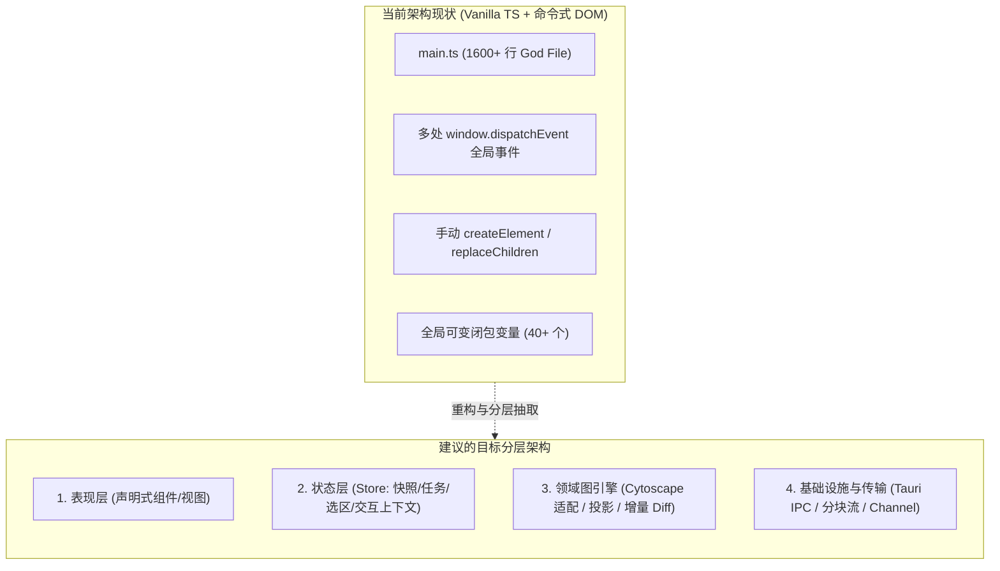

Viewed architecture.md:1-63
Listed directory frontend
Viewed package.json:1-31
Listed directory src
Listed directory graph
Listed directory map-edit
Listed directory reader
Listed directory review
Listed directory llm
Viewed index.html:1-14
Viewed README.md:1-24
Viewed main.ts:1-100
Viewed main.ts:101-250
Viewed main.ts:251-400
Searched for "^(function|const|let|async function|type|interface) "
Viewed main.ts:400-550
Searched for "^(async )?function \w+"
Viewed main.ts:1480-1639
Viewed cytoscape.ts:1-120
Viewed cytoscape.ts:121-300
Viewed cytoscape.ts:301-450
Viewed cytoscape.ts:451-647
Viewed workspace.ts:1-150
Viewed index.ts:1-14
Viewed types.ts:1-191
Viewed selection.ts:1-100
Viewed discovery-task.ts:1-100
Viewed reader.ts:1-100
Listed directory tests
Viewed tsconfig.json:1-14
Viewed vite.config.ts:1-39
Viewed api.ts:1-38
Viewed commit-status.ts:1-116
Viewed inspector-edit.ts:1-100
Viewed inspector-edit.ts:101-250
Viewed impact-preview.ts:1-100
Viewed markdown.ts:1-100
Viewed settings.ts:1-100
Ran command: `npm run typecheck`

这是一份以**前端高级架构师**视角对当前 `mathscape` 前端代码库（`frontend/`）的全面代码评审与架构推演报告。

---

# Mathscape 前端代码质量审视与架构演进建议

## 一、 总体评价与架构定位（Executive Summary）

`mathscape` 定位于面向数学学习者与研究者的**本地优先（Local-First）桌面知识工坊**。从整体工程素养来看，当前前端实现**远超一般业务前端的平均水平**，呈现出高度的“系统级”工程风格：
- **领域契约极其严谨**：前端类型定义（如三态编辑 `FieldChange<T>`、`IncidenceGraph` 拓扑、`ImpactPlan` 影响分析）与 Rust 领域模型高度契合，没有随意使用 `any` 或弱类型逃逸。
- **职责边界清晰**：严格遵守后端的渲染中立原则（Renderer-neutral），前端不擅自重新解释复杂的数学语义超图，专注投影为 Cytoscape incidence/semantic 元素。
- **底层功底扎实**：包含自定义 PDF 范围传输通道（`ArtifactPdfTransport` 分块流式读取）、KaTeX 占位标记防破坏渲染、Cytoscape 增量 Diff（锁定未变更节点布局）等高难度交互细节。

**然而，当前前端代码处于“典型的重度原型到企业级工业软件的过渡拐点”**。最核心的结构性矛盾是：**用传统的命令式原生 DOM（Vanilla TS + 手动拼接 HTML/Element）去支撑一个交互复杂度已经逼近专业 CAD/IDE 级别的专业知识图谱应用**。随着后续 Lean4 形式化、证明状态流、RDTX 对齐等新模块的加入，现有的代码组织形式将难以维系。

---

## 二、 代码质量与工程亮点（What Works Well）

### 1. 严格契合 Rust 领域语义的模型契约
- 在 [map-edit/types.ts](file:///Users/wangjiajie/software/lean4_exp/mathscape/frontend/src/map-edit/types.ts) 中，定义了三态编辑信号：
  ```typescript
  export type FieldChange<T> =
    | { action: "keep" }
    | { action: "set"; value: T }
    | { action: "clear" };
  ```
  这精准对应了 Rust Option-of-Option 的反序列化语义，杜绝了常规前端开发中“传 `undefined` 还是传 `null`”的隐式歧义。
- [graph/projection.ts](file:///Users/wangjiajie/software/lean4_exp/mathscape/frontend/src/graph/projection.ts) 中包含显式的 `GRAPH_PROJECTION_SCHEMA_VERSION` 校验，有良好的接口向前兼容意识。

### 2. 优秀的图渲染抽象与局部布局优化
- [graph/cytoscape.ts](file:///Users/wangjiajie/software/lean4_exp/mathscape/frontend/src/graph/cytoscape.ts) 中对多元超边的处理非常精彩：通过 `buildSemanticEdges` 在 $\ge 3$ 顶点的超边中引入轻量的 `junction`（汇合点）和轮辐边，既消除了庞杂的菱形节点视觉噪音，又保全了数学关系的超图拓扑。
- `syncCytoscapeGraph` 没有暴力 `cy.elements().remove()`，而是实现了轻量的元素增量 Diff：对已存在的节点打上 `settled.lock()`，仅对新加入的节点运行 `cose` 布局，保障了用户在图上探索时的**视觉稳定性和上下文连续性**。

### 3. 稳健的异步竞态防御（Race-Condition Defense）
- 在 [reader/reader.ts](file:///Users/wangjiajie/software/lean4_exp/mathscape/frontend/src/reader/reader.ts) 与 [review/workspace.ts](file:///Users/wangjiajie/software/lean4_exp/mathscape/frontend/src/review/workspace.ts) 中，普遍设计了递增的 `this.generation` 令牌机制。在用户快速切换 PDF 或阅读位置时，滞后的 IPC 结果返回会自动作废，避免了悬挂 promise 污染当前视图。

### 4. 严谨的双阶段编辑防错（Two-Phase Commit）
- [map-edit/](file:///Users/wangjiajie/software/lean4_exp/mathscape/frontend/src/map-edit) 没有采用常见的前端直接提交变更的粗放方式，而是完整实现了：
  `编辑上下文获取 (EditContext) → 影响分析规划 (plan_map_change / ImpactPlan) → 级联预览与冲突阻断 → 确认提交 (commit_map_change)`。这种专业级 CAD 系统的稳健交互极大地降低了误操作破坏图拓扑的风险。

---

## 三、 核心架构痛点与潜在风险（Architecture Smells & Debt）

### 1. “神级文件（God File）”与失控的命令式 DOM 拼接
- **现象**：
  - [main.ts](file:///Users/wangjiajie/software/lean4_exp/mathscape/frontend/src/main.ts) 高达 **1639 行**，单文件超过 62KB。它同时承担了：全局 HTML 骨架挂载、20 余

以**前端高级架构师**的视角，对当前 `mathscape` 前端代码库（`frontend/`）进行全面审视，分析当前的代码质量、架构隐患，并给出可落地的渐进式演进与优化建议。

---

# Mathscape 前端代码质量审视与架构演进指南



---

## 一、 总体评价（Executive Summary）

`mathscape` 的前端代码具有非常鲜明的**“系统程序员写的严谨前端”**风格：
- **优点极其突出**：数学领域模型建模深刻、类型契约极为严谨、底层 IPC 分块流与图增量 Diff 逻辑精巧，远超常规业务前端水平；
- **架构瓶颈同样显著**：前端正处于**“从原型期向大型专业 IDE/CAD 级应用过渡”**的关键阵痛期。核心矛盾是：**用命令式原生 DOM 操作（`createElement` / `innerHTML` / `replaceChildren`）管理着极端复杂的树状状态和联动流程**。

如果后续继续接入 Lean 4 证明树、DialectScope、形式化状态流等功能，现有的代码组织形式将导致维护成本呈指数级上升。

---

## 二、 代码质量深度审视（Quality Review）

### 亮点与工程功底（Strengths）

#### 1. 契约定义与 Rust 领域模型高度同构
- 在 [map-edit/types.ts](file:///Users/wangjiajie/software/lean4_exp/mathscape/frontend/src/map-edit/types.ts) 中，设计了三态编辑信号：
  ```typescript
  export type FieldChange<T> =
    | { action: "keep" }
    | { action: "set"; value: T }
    | { action: "clear" };
  ```
  精准映射 Rust `Option<Option<T>>` 反序列化语义，杜绝了常规前端开发中“传 `undefined` 还是传 `null`”的隐式歧义。
- 完整的两阶段变更设计（`EditContext` $\to$ `ImpactPlan` $\to$ `CommitReceipt`），阻断校验、级联影响、撤销保护非常完备。

#### 2. 精准的图拓扑投影与视觉稳定性
- 在 [graph/cytoscape.ts](file:///Users/wangjiajie/software/lean4_exp/mathscape/frontend/src/graph/cytoscape.ts) 中，巧妙地将 $\ge 3$ 个端点的超边转化为微型 `junction`（汇合点）和轮辐边，既消除了庞杂的菱形节点视觉噪音，又保全了数学关系的超图拓扑。
- `syncCytoscapeGraph` 实现了**图元素增量 Diff**：对已稳定节点使用 `settled.lock()`，仅对新加入节点执行 `cose` 局部排布，保障了用户在图上探索时的视口连贯性与心智连续性。

#### 3. 稳健的并发与竞态防护
- [reader/reader.ts](file:///Users/wangjiajie/software/lean4_exp/mathscape/frontend/src/reader/reader.ts) 与 [review/workspace.ts](file:///Users/wangjiajie/software/lean4_exp/mathscape/frontend/src/review/workspace.ts) 中广泛采用了递增的 `generation` 令牌机制。用户快速连续点击节点或翻页时，过期的异步 IPC 结果自动作废，有效防范了异步悬挂导致的视图污染。

---

### 核心架构痛点与异味（Code Smells & Architectural Debt）

#### 1. “神级文件（God File）”与失控的生命周期
- [main.ts](file:///Users/wangjiajie/software/lean4_exp/mathscape/frontend/src/main.ts) 高达 **1639 行**，在全局顶层作用域堆砌了 **40 多个可变状态**（`let activeParse`, `let inspectorLocked`, `let displayedGraph`, `let focusRootId`, `let visibleNodeKinds` 等）。
- 状态散落在各个闭包函数中，导致难以单测、难以预测状态重置时机。例如：
  ```typescript
  // main.ts: 状态重置与视图恢复全靠散落的手工标记
  let inspectorLocked = false;
  let activeParse: ParseRequest | null = null;
  let submittingParse = false;
  let pollingParse = false;
  ```
  如果某个异步流程中抛出未捕获异常，`submittingParse` 或 `inspectorLocked` 将永远锁死，导致 Inspector 界面假死。

#### 2. 原始 DOM 命令式拼装的维护泥潭
- [review/workspace.ts](file:///Users/wangjiajie/software/lean4_exp/mathscape/frontend/src/review/workspace.ts) (972 行) 与 [map-edit/inspector-edit.ts](file:///Users/wangjiajie/software/lean4_exp/mathscape/frontend/src/map-edit/inspector-edit.ts) (653 行) 充斥着大量命令式代码：
  ```typescript
  const wrapper = document.createElement("div");
  wrapper.className = "form-field span-list-field";
  wrapper.append(makeText("span", "", "原文证据（至少选择一段）"));
  // 嵌套循环手动 append
  ```
  - **问题**：UI 与数据绑定完全依赖脆弱的手动关联。任何条件分支渲染、列表局部更新、表单校验高亮都需要几十行 DOM 操作；
  - **风险**：事件监听器容易出现内存泄漏（缺乏显式的 dispose/unmount 机制）。

#### 3. 隐式的字符串事件总线（Event Bus Chaos）
- 当前不同子系统之间通过浏览器原生 `window.dispatchEvent` 进行广播式通信：
  - `mathscape:source-map-changed`
  - `mathscape:discovery-runs-changed`
  - `mathscape:open-source`
  - `mathscape:open-review`
  - `mathscape:reader-opened`
  - `mathscape:workspace-settings-changed`
- **问题**：全局自定义事件无统一类型安全约束，payload 结构通过 `(event as CustomEvent<T>).detail` 强行转换；事件触发来源与响应逻辑分布在各处，形成了隐式依赖网络，调试追踪困难。

#### 4. 轮询（Polling）反模式
- 在 [main.ts:505](file:///Users/wangjiajie/software/lean4_exp/mathscape/frontend/src/main.ts#L505)：
  ```typescript
  window.setInterval(() => void syncParseState(), 1000);
  ```
  利用 1 秒一次的定时器轮询 `invoke("get_active_parse")`。而在桌面应用（Tauri）中，**轮询是反模式**。Tauri 原生支持基于事件的单向广播（`app_handle.emit` / `listen`）或者 `Channel`。定时轮询白白消耗 CPU 时间片与电池，且有 1 秒的交互延迟。

#### 5. 测试金字塔严重倒置
- 当前前端没有单元测试（Jest / Vitest），仅有少量高成本的 Playwright 端到端测试（[tests/](file:///Users/wangjiajie/software/lean4_exp/mathscape/frontend/tests)）。
- `toCytoscapeElements`、`buildSemanticEdges`、`planMapChange`、`filterGraph` 等大量属于**高确定性、纯函数/纯逻辑**的模块，本可以通过毫秒级的 Vitest 单元测试覆盖率达到 100%，现在却必须启动浏览器跑端到端测试，严重制约了重构的信心。

---

## 三、 架构演进与优化建议（Actionable Recommendations）

针对上述痛点，不建议“推倒重来”，而应采取**渐进式、高性价比的架构重构方案**：

### 建议 1：解耦 `main.ts`，建立统一的分层状态管理

将全局状态从 `main.ts` 的顶层闭包中剥离，按领域划分为独立的 Store。

推荐在纯 TypeScript 环境下引入轻量级状态库（如 **Zustand**，无需绑定 React，纯 Vanilla TS 即可使用）：
```text
src/
├── store/
│   ├── workspace-store.ts     # Workspace 快照、Artifact 计数、运行环境状态
│   ├── graph-store.ts         # 节点过滤 visibleNodeKinds、聚焦节点 focusRootId、渲染模式
│   ├── inspector-store.ts     # 当前选中节点、Inspector 编辑/预览/退役状态机
│   └── task-store.ts          # 活跃任务、Marker 解析、LLM 运行状态
```
**收益**：
- 消除 `main.ts` 中的全局变量互锁问题；
- 状态变更自带可观察性（Subscriber 模式），界面只在关心的状态变更时刷新，不需要到处手动调用 `renderSnapshot`。

### 建议 2：将 `window` 全局事件重构为强类型事件中心（Typed Event Bus）

定义统一的事件协议，替代松散的 CustomEvent：

```typescript
// src/core/events.ts
export interface MathscapeEvents {
  "source-map:changed": { reason: string };
  "discovery:open-review": { outcome: DiscoveryOutcome; meta?: ReviewRunMeta };
  "reader:open": { artifactId: string; title: string; focus?: ReaderFocus };
  "task:parse-updated": { task: ParseRequest | null };
}

class TypedEventEmitter {
  emit<K extends keyof MathscapeEvents>(event: K, payload: MathscapeEvents[K]): void;
  on<K extends keyof MathscapeEvents>(event: K, handler: (payload: MathscapeEvents[K]) => void): () => void;
}
```
**收益**：所有跨模块调用全部受 TypeScript 编译期强类型检查，重构时改名或修改参数可以全局自动跳转与纠错。

### 建议 3：IPC 通信全面转向事件驱动，剔除轮询

替换 `window.setInterval(syncParseState, 1000)`：
- 后端（Rust）：在任务状态迁移（如 Marker 解析启动、阶段完成、异常失败）时，通过 `app_handle.emit("mathscape://parse-state-changed", task)` 广播；
- 前端：使用 `@tauri-apps/api/event` 的 `listen("mathscape://parse-state-changed", ...)` 订阅更新。
**收益**：实现零延迟 UI 响应，消除空闲状态下的 CPU 唤醒。

### 建议 4：表现层渐进演进为轻量声明式框架

目前应用包含复杂的表单（编辑/新建单元/新建关系）、多 Tab 审查工作台（Overview/Units/References/Diagnostics）、实时流式任务监控窗口。如果继续用命令式 DOM 拼接，代码量将随着 Lean4 证明状态树的引入膨胀数倍。

**技术选型建议**：
1. **首选方案（极简过渡）**：引入 **Svelte 5** 或 **Preact**。
   - **理由**：极致轻量、零运行时损耗（尤其是 Svelte 的 Runes 响应式，与本地优先架构完美契合），可以局部挂载在已有的 DOM 容器上（如将 `review-workspace` 和 `map-edit` 分批改写，而保留 Cytoscape 画布的独立性）。
2. **保守方案（若坚持无第三方 UI 框架）**：
   - 至少引入轻量安全的模板引擎（如 `lit-html`），将命令式 `document.createElement` + `append` 替换为声明式模板：
     ```typescript
     html`
       <div class="edit-form">
         <span class="eyebrow">${title}</span>
         ${fields.map(f => html`<input .value=${f.val} />`)}
       </div>
     `
     ```

### 建议 5：完善纯逻辑模块的单元测试

在 `package.json` 中配置 **Vitest**：
- 为纯函数建立单元测试基石：
  - `graph/cytoscape.ts` 的 `buildSemanticEdges`（验证超边转化为 junction 点与轮辐边的拓扑正确性）；
  - `graph/focus.ts` 的子图提取深度算法；
  - `reader/markdown.ts` 的数学公式保留与补丁高亮算法；
  - `map-edit/inspector-edit.ts` 的变更请求构建器。
**收益**：将构建和重构反馈周期从几十秒的 Playwright E2E 缩减到 200 毫秒的本地 Vitest。

---

## 四、 阶段化重构路线图（Roadmap）

| 阶段 | 重点任务 | 目标产出 | 预期周期 |
| :--- | :--- | :--- | :--- |
| **Phase 1** <br>*(治理与拆解)* | 1. 拆解 `main.ts`：将 Topbar、SourcePanel、Canvas、Inspector 控制器独立成文件。<br>2. 引入 `events.ts` 强类型事件总线，收拢事件分发。<br>3. 剔除 1 秒轮询，改用 Tauri Event。 | `main.ts` 体积缩减至 200 行以内，消除全局变量污染。 | 2-3 天 |
| **Phase 2** <br>*(测试体系)* | 1. 接入 Vitest，配置与 Vite 复用的测试环境。<br>2. 对 `graph/`、`reader/markdown.ts`、`map-edit/` 核心转换函数补齐单元测试。 | 纯逻辑算法单元测试覆盖率 > 85%。 | 2 天 |
| **Phase 3** <br>*(表现层升级)* | 1. 引入轻量声明式方案（Preact/Svelte 或 lit-html）。<br>2. 优先重构最具交互复杂度的 [review/workspace.ts](file:///Users/wangjiajie/software/lean4_exp/mathscape/frontend/src/review/workspace.ts) 与 [map-edit/inspector-edit.ts](file:///Users/wangjiajie/software/lean4_exp/mathscape/frontend/src/map-edit/inspector-edit.ts)。 | 减少 40% 的 DOM 样板代码，表单状态联动完全声明化。 | 1-2 周 |
| **Phase 4** <br>*(面向未来扩展)* | 1. 抽象统一的“检查点/快照观察机制”，为 Lean 4 证明树（Proof Tree）与形式化状态预留专有视口容器。 | 架构具备支撑 Lean 4 形式化验证与证明交互的扩展力。 | 长期持续 |

---

## 结语

`mathscape` 的前端底层逻辑非常扎实，无论是与 Tauri 的契约交互还是对超图的语义投影都极具水平。当前的主要瓶颈集中在**表现层架构滞后于业务复杂度**。通过**状态抽取 $\to$ 类型化事件总线 $\to$ 声明式组件化**的路径进行渐进式重构，能够在不破坏现有业务稳定性的前提下，将其演进为支撑复杂形式化数学研究的专业级工坊前端。
