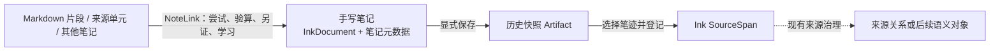

# 手写笔记融入 Mathscape 笔记体系提案 v1

状态：开发提案草案。本文从《核心工作流接入前的模型与基础设施扩展草案 v0.1》中拆出第一条可独立交付的工作线，优先让手稿成为 Mathscape 数学笔记本的一等内容。Agent 调查、自动识别和语义抽取不属于本提案交付范围。

## 1. 目标与判断

Mathscape 的长期能力包括 Agent 帮助用户理解数学，但用户每天直接使用的仍是“阅读材料、写下推导、回到上下文继续思考”的笔记本能力。手写输入已经解决了采集、同步、保存、快照和证据回链；当前问题是手稿还没有进入用户的阅读与地图工作流。

本阶段目标是让用户能够：

1. 从正在阅读的题目、定理、证明或任意 Markdown 片段直接开始一份手稿；
2. 在地图和阅读器中看到某个对象有哪些相关手稿，并从手稿回到原题；
3. 使用可读的自动标题，也能在桌面或平板上改名；
4. 把废稿、空白稿和临时计算纸移出活动视图，必要时恢复；
5. 在不改变历史快照和来源证据含义的前提下保持界面整洁。

这一工作线完成后，核心工作流可以直接使用“用户围绕某个对象写下的手稿”作为输入，而不需要另造一套手稿上下文。

## 2. 当前事实与缺口

| 领域 | 当前能力 | 缺口 |
| --- | --- | --- |
| 手稿主体 | `ink_documents` 保存可编辑文档、页面、标题和操作 head；会话与操作历史可恢复 | 手稿只在“手写”工作区列表中出现，地图上看不到当前可编辑手稿 |
| 快照与证据 | 显式保存快照生成受管 Artifact；选区可登记为 Ink `SourceSpan`，并在地图中通过 `located_in` 连到快照 | 快照证据表达“这份笔迹存在”，不能表达“这份手稿是在尝试解哪道题” |
| 关联材料 | 手写基础提案已有候选 `InkContextRef` 概念 | 当前代码没有持久化关联，也没有从阅读器或地图创建手稿的入口 |
| 命名 | 新建手稿默认叫“数学手稿”，桌面标题框只读 | 多份手稿难以区分；后端每次接收笔迹操作时会用操作附带的 metadata 写回标题，平板旧标题可能覆盖桌面改名 |
| 删除 | 手写提案和核心工作流草案已记录删除约束 | 没有用户可用的删除、回收站或空白稿清理入口 |
| 地图编辑 | 已能人工创建来源单元和来源关系 | 来源关系表示材料中的数学关系，不适合承载用户的工作区关联，例如“我在这份手稿里尝试证明” |

## 3. 设计原则

### 3.1 区分笔记关联与数学关系

用户把手稿关联到定理时，表达的是“这份笔记与该对象有关”，例如解题尝试、另证、验算或学习笔记。它不说明手稿已经证明定理，也不应自动生成 `proves`、`solves` 或 `explains` 来源关系。

因此新增的关联属于用户笔记层。它可以在地图上展示，也可以作为后续 Agent 输入的上下文，但不进入来源层 revision，不经过 `MapPatch`，也不改变任何对象的可信状态。

用户若要声明某段笔迹支持某个数学结论，仍应先保存快照，选择笔迹，登记为 Ink `SourceSpan`，再通过现有来源编辑或后续语义流程建立带证据的关系。

### 3.2 当前手稿与历史快照承担不同职责

- **当前手稿**：可编辑工作对象，用于继续书写、改名、关联和清理。
- **历史快照**：固定内容版本，用于证据、回链、Agent 输入和复现。
- **Ink SourceSpan**：快照中的明确选区，用于来源层证据。

笔记关联默认指向当前手稿。只有需要稳定证明“当时写了什么”时才使用快照或 Ink SourceSpan。这样用户继续修改笔记不会破坏历史证据，也不必为每次笔记整理都生成快照。

### 3.3 先保证整洁，再考虑物理清除

用户需要尽快把废稿移出视线，但首版不承诺释放磁盘空间或永久擦除私人数据。删除入口先实现可恢复的回收站：活动列表、地图、搜索和默认关联显示都排除已移到回收站的手稿，历史证据仍可解析。

## 4. 首版对象模型

### 4.1 产品上的“笔记”与存储上的 InkDocument

产品层将可编辑手稿称为“手写笔记”。首版不新增独立的通用笔记正文类型，继续以 `InkDocument` 作为手写内容的权威记录，并在其外层补充笔记元数据：显示标题、标题来源、生命周期、主关联和最近使用时间。

关联记录使用带类型的笔记引用，首版只有 `{ kind: "ink_document", id }`。以后增加文字笔记时可以复用关联和回收站语义，但本提案不提前实现文字笔记编辑器。

### 4.2 NoteLink

候选字段：

| 字段 | 含义 |
| --- | --- |
| `link_id` / `request_id` | 稳定身份与幂等提交 |
| `note_ref` | 首版为 `ink_document` 引用 |
| `target_ref` | 关联目标的类型化引用 |
| `role` | 用户意图，例如尝试、另证、验算、学习笔记、疑问、参考 |
| `is_primary` | 是否用于自动标题、默认上下文和平板题目提示；每份笔记最多一个 |
| `target_revision` | 创建时看到的对象 revision 或 Artifact 版本 |
| `target_label` | 创建时的显示文本，用于目标不可读时提示 |
| `state` | `active` 或 `removed`；解除关联不物理删除记录 |
| `created_at` / `removed_at` | 审计与排序 |

首版目标类型：

1. **来源对象**：`SourceSemanticUnit` 等已有地图对象，保存 `stable_id` 和当时 revision。
2. **Markdown 片段**：保存 Markdown Artifact、现有选区 selector、选中文字摘要和指纹。它不自动创建 `SourceSemanticUnit`。
3. **其他笔记**：用于“这份是上一份的整理稿”或“这份是同一题的第二种方法”。

PDF 页、Agent 产物和学习计划条目可以在相应能力落地后再加入目标类型。

关联规则：

- 同一笔记、目标和角色只能有一条活动关联；重复请求返回已有记录。
- 解除关联将状态改为 `removed`，后续回放或审计仍能看到原关联。
- 来源对象被退役或替代时，关联继续保留并显示目标状态，不自动迁移到新对象。
- Markdown 后续出现新版本时，关联仍指向原 Artifact。阅读器可以提示“材料已有新版本”，但不能按文字猜测并静默重绑。
- 关联只表达笔记组织关系。任何数学关系仍需单独的证据与审核。

### 4.3 生命周期

首版生命周期只有：

| 状态 | 用户看到的含义 | 行为 |
| --- | --- | --- |
| `active` | 正常笔记 | 可编辑、可关联、可配对平板 |
| `trashed` | 已移到回收站，可恢复 | 不出现在活动列表、地图关联和默认搜索中；不能书写或保存新快照 |

首版不提供永久删除。回收站文案应明确说明“可恢复，存储空间尚未释放”。永久清除放入系统级删除设计，与 Artifact 引用枚举、快照留存、Agent 输入记录和垃圾回收一起定义。

## 5. 命名

### 5.1 标题权威来源

显示标题和标题来源属于笔记元数据，改名使用独立请求，不进入笔迹操作历史。改名不会被撤销/重做，也不应改变手稿的 head。

迁移后，笔迹操作中的 metadata 不再有权修改标题。为兼容现有平板和 outbox，后端应保留当前标题，并在镜像、会话状态或单独的笔记元数据推送中返回最新标题；旧客户端提交不同标题时不能覆盖桌面改名，也不能因此让笔迹提交失败。ACK 不携带标题（见 §13.2）。

快照 manifest 继续保存创建快照时的标题。之后改名只影响当前手稿和活动列表，历史快照仍显示原标题，并可以附带“当前笔记名”。

### 5.2 自动标题规则

每份笔记保存 `title_mode = auto | manual`。

- 有主关联时，自动标题为“角色 · 目标短名”，例如“尝试 · 定理 3.2”“验算 · 例 4”。
- Markdown 片段没有可用标签时，使用规范化后的前 24 个可读字符；公式保留原 LaTeX 摘要，不在首版做 OCR 或公式语义命名。
- 没有主关联时，使用“手稿 · 10月17日 14:30”这类本地时间标题。
- 自动标题允许重复；列表通过关联目标、最近修改时间和页数辅助区分，不用 `(2)`、`(3)` 这类会随删除顺序变化的序号。
- 用户手动改名后切换到 `manual`。之后更改主关联不会覆盖标题；界面可以提供“恢复自动命名”。

标题需去除首尾空白并限制长度（N1 定为 100 个字符，见 §13.1 D5）。空标题提交视为恢复自动命名。

### 5.3 改名入口

- 桌面手稿页标题可直接编辑，失焦或回车提交。
- 笔记库和手稿列表提供“重命名”。
- 平板标题可编辑；连接到桌面时走同一个改名请求，离线时可暂存一个最新改名意图，恢复连接后以 `expected_title_revision` 提交。若桌面已改名，提示用户选择保留哪个名称。

## 6. 关联入口与地图中的位置

### 6.1 从上下文开始一份手稿

提供三个创建入口：

1. **Markdown 阅读器**：右键段落或选中的文字，选择“新建关联手稿”；也可点击选区工具栏中的“手写这段”。系统创建手稿、建立 Markdown 片段主关联，并打开桌面画板或平板书写面板。详细交互见 §6.5。
2. **地图检查器**：选中来源对象后点击“新建手稿”，选择“尝试 / 另证 / 验算 / 学习笔记”等角色。
3. **手写工作区**：独立新建自由手稿，稍后再关联。

从上下文创建时，手稿、主关联和自动标题必须在一次后端事务中提交，避免出现有手稿但丢失原题的半成品。

### 6.2 从手稿关联已有内容

手稿页增加“关联”面板：显示主关联和其他关联，支持搜索已有来源对象、最近阅读的 Markdown 片段和其他笔记。手稿页可以并排打开主关联原文；打开原文不会改变当前写入者。

### 6.3 地图展示

地图不默认把所有手稿都展开成独立节点，以免笔记数量增长后遮挡数学结构。

- 有关联笔记的来源对象显示小型笔记标记和数量。
- 选中对象时，检查器显示“相关笔记”，按角色和最近修改时间分组，并提供打开、改名、解除关联和移到回收站。
- 打开“我的笔记”显示开关后，地图在当前可见对象附近展开笔记节点与笔记关联边。
- 笔记节点打开当前可编辑手稿；快照节点继续打开只读历史版本。
- 回收站中的笔记及其关联不进入默认地图。

地图读取的是由 SQLite 当前笔记元数据和活动 NoteLink 构造的只读投影，不把笔记关联写入来源图。

### 6.4 Markdown 阅读器回显

阅读器在有关联的块旁显示笔记标记。点击后列出相关手稿，并可直接继续书写。若关联原 Artifact 已有 Markdown patch 派生版本，阅读器只在原 Artifact 精确显示该标记，并提示新版本中可能有对应内容。

### 6.5 Markdown 右键关联手稿

右键菜单是桌面阅读时的主要入口，选区工具栏保留同一功能，用于触屏、触控板和键盘操作。两个入口使用同一份目标解析和创建请求。

#### 右键目标

- **有文字选区且右键位置在选区内**：目标是当前选区，菜单显示简短摘要，例如“已选：设 $f$ 在 $[a,b]$ 上连续…”。
- **没有文字选区**：目标是右键位置所属的完整 Markdown block。菜单打开时高亮该 block，让用户确认将要关联的范围。
- **右键位置在选区外**：放弃旧选区并使用当前 block，避免将用户看不到的旧选区关联到手稿。
- **分页提示或无法定位的区域**：不显示手稿菜单项。跨越多个 block 的选区按现有 block/quote selector 精确保存，不自动扩大到整节或整份文档。

#### 菜单结构

手稿相关菜单放在一个分组中：

1. **新建关联手稿…**：始终显示。
2. **关联到已有手稿…**：存在可用的活动手稿时显示。
3. **查看相关手稿（N）**：当前目标已有关联手稿时显示。

复制、内容发现、Markdown 修订等已有操作保持原分组。菜单不加入删除、快照或来源证据登记等操作，这些在手稿页或相关手稿列表中执行。

#### 新建关联手稿

选择“新建关联手稿…”后，在右键位置附近打开小型弹层：

- **关联内容**：只读显示目标摘要，可展开查看完整选区。
- **用途**：尝试、另证、验算、学习笔记、疑问、参考。默认使用上次选择；首次使用默认“尝试”。
- **标题**：预填自动标题，例如“尝试 · 例 4”。用户修改后以 `manual` 标题创建；留空则使用自动标题。
- **在哪里书写**：“在电脑上书写”“用平板书写”和“对照原文书写”。N2 默认在电脑上打开，若平板服务已启用则记住上次选择。对照书写属于 N3，尚未实现时不显示。
- **操作**：“创建并打开”与“取消”。Enter 提交，Esc 取消，弹层打开时焦点在用途选择器。

点击“创建并打开”后，前端生成 `request_id`，提交目标 selector、用途、标题意图和打开方式。后端重新校验 Markdown Artifact、selector 和文字指纹，在同一事务中创建手稿、主 NoteLink 和标题元数据。前端只有收到成功回执后才打开手稿。

- 选择电脑书写时，进入手写工作区并打开新手稿，顶部显示主关联和“返回原文”。
- 选择平板书写时，打开新手稿的平板面板。服务未启用时先引导开启服务；已启用时直接生成该手稿的配对二维码。
- 重复点击或网络重试使用同一 `request_id`，只打开同一份手稿。
- 目标 Artifact 已失效、selector 不再匹配或文字指纹不一致时，不创建手稿；弹层保留用户输入并提示重新选择。

#### 关联到已有手稿

选择“关联到已有手稿…”后打开搜索弹层。默认按最近使用列出活动手稿，可按标题和已有关联搜索。每项显示标题、主关联、页数和最近修改时间。

用户选择手稿和用途后提交关联。当手稿尚无主关联时，可勾选“设为主关联”；已有主关联时默认作为普通关联，替换主关联需要用户明确选择。成功后保持当前阅读位置，并显示“已关联 · 打开手稿”。

同一手稿、目标和用途已存在时，直接提示“已关联”并提供打开入口，不创建重复记录。回收站中的手稿不出现在候选列表中。

#### 查看相关手稿

“查看相关手稿（N）”打开当前 block 的关联列表，等同点击块旁的笔记标记。列表按用途分组，提供打开、改名、解除关联和移到回收站。解除关联只影响这一条 NoteLink；移到回收站作用于整份手稿，并按 §7.5 显示影响。

对子范围选区右键时，先显示精确匹配该选区的手稿，再显示关联到包含它的 block 的手稿。首版不根据文字相似度显示其他版本或其他文档中的候选手稿。

## 7. 删除与回收站

### 7.1 操作语义

首版用户入口称为“移到回收站”，而不是“永久删除”。它执行以下动作：

1. 将手稿生命周期改为 `trashed`；
2. 从活动手稿列表、地图关联、阅读器回显和默认搜索中移除；
3. 停止接收新的笔迹、改名、关联和快照请求；
4. 撤销该手稿的待配对二维码和设备凭据，结束活动书写会话；
5. 保留操作历史、快照、关联记录和 Ink SourceSpan。

已登记为来源证据的快照仍可从证据节点打开。界面标明“来源手稿已移到回收站”，并提供“恢复手稿”。快照本身不随当前手稿进入回收站，也不会被静默删除。

### 7.2 未同步内容

- 桌面本机仍有待提交 outbox 时，默认先完成同步再移到回收站。若用户选择立即处理，需要先导出恢复草稿或明确放弃这些待提交笔迹。
- 平板仍可能保存未同步内容。移到回收站后，旧设备的写入请求返回 `document_trashed`，画板保留本机内容并提供导出恢复草稿。
- 延迟重试、旧 epoch 或重连不能把已移到回收站的手稿恢复为活动状态。

### 7.3 恢复

恢复后手稿回到活动列表，原关联恢复显示。恢复不重新启用旧设备凭据或旧 epoch；用户需要重新开始桌面会话或生成新的平板配对。

若原关联目标已退役，关联仍按 §4.2 显示目标状态。

### 7.4 空白稿与批量清理

打开手写工作区时不再在没有手稿的情况下自动创建空白稿，而是显示空状态和“新建手稿”。从上下文创建的空白手稿保留关联，便于稍后继续。

没有笔迹、没有手动标题、没有关联和快照的手稿可直接移到回收站，不需要影响确认。手稿列表提供“清理空白稿”，只处理满足上述条件且没有活动设备会话的手稿。

批量清理不自动处理有笔迹的废稿。用户可以多选普通手稿移到回收站；首版不根据时间或内容猜测废稿。

### 7.5 影响确认

有内容的手稿移到回收站前，确认框显示：

- 页数和最近修改时间；
- 活动关联数量；
- 历史快照数量；
- 已登记来源证据数量；
- 是否仍有本机待同步内容或活动平板。

确认完成后显示“已移到回收站”及短时“撤销”。这个撤销调用恢复操作，不依赖前端缓存旧状态。

## 8. 笔记本体验的后续特性

以下特性有价值，但不应阻塞关联、命名和回收站：

| 特性 | 用户收益 | 建议阶段 |
| --- | --- | --- |
| 笔记库 | 按最近使用、关联材料、角色和状态查找手稿 | N1 提供最小列表；N2 加关联筛选 |
| 平板题目卡片 | 在平板上看到当前手稿主关联的题目文本 | N3；只暴露当前手稿主关联的已授权摘要 |
| 并排阅读 | 桌面左侧原文、右侧手稿 | N3 |
| 笔记状态 | 标记“进行中 / 已完成 / 暂停” | N3；状态仅属于笔记管理，不代表数学正确 |
| 命名快照 | 将快照标为“第一次尝试”“整理稿” | N3；标签可改，快照字节不变 |
| 页面管理 | 页面缩略图、重排、隐藏页面 | 单独评估；需要定义页面引用与历史快照影响 |
| 文字备注与搜索 | 为手稿补充一句摘要并搜索 | 后续；OCR/公式识别应作为派生内容保存 |
| 纸张模板 | 空白、横线、方格、点阵 | 后续；模板不得混入笔迹数据 |

## 9. 分阶段实施

### N1：笔记身份、命名和回收站

交付：

- 笔记元数据迁移：标题来源、标题 revision、生命周期、移入回收站时间和最近使用时间；
- 修复操作 metadata 写回标题的问题，增加独立改名请求；
- 桌面和平板改名；
- 活动手稿列表、回收站视图、移到回收站、恢复和撤销；
- 空白稿不再自动创建，提供“清理空白稿”；
- 已移到回收站手稿拒绝书写、改名、配对和快照，设备凭据失效；
- 已登记证据可打开原快照并显示来源手稿状态。

验收：

1. 新建手稿显示时间型自动标题；桌面改名后，平板继续提交旧 metadata 不会覆盖新标题。
2. 已连接平板改名后，桌面列表和标题即时更新；离线改名恢复后能识别冲突。
3. 空白稿可一键清理，有笔迹手稿不会被清理。
4. 有快照证据的手稿移到回收站后，活动列表消失，证据节点仍能打开当时快照；恢复后可重新配对并继续书写。
5. 旧平板在手稿进入回收站后提交笔迹，收到明确提示并能导出恢复草稿；重启应用后手稿仍在回收站。

### N2：笔记关联、阅读器入口和地图投影

交付：

- NoteLink 存储、幂等创建、主关联切换和解除关联；
- Markdown 右键菜单：新建关联手稿、关联到已有手稿、查看相关手稿；选区工具栏“手写这段”作为等价入口；
- 地图检查器“新建手稿”；
- 手稿页关联面板和原文跳转；
- 地图对象的相关笔记标记、检查器列表和“我的笔记”显示开关；
- Markdown 阅读器关联标记；
- 带主关联的自动标题。

验收：

1. 在 Markdown 题目上右键并创建关联手稿，手稿、主关联和标题同时出现；退出重开后仍能从题目和手稿相互跳转。
2. 未选中文字时右键会高亮并关联当前 block；在已有选区内右键只关联该选区；在选区外右键不会误用旧选区。
3. 右键“关联到已有手稿”后保持阅读位置，重复关联不会生成重复记录；“查看相关手稿”与块旁标记列出相同内容。
4. 选择“用平板书写”后直接进入新手稿的配对流程；重复提交或重试只产生一份手稿。
5. 从地图上的定理创建“另证”手稿，检查器在该定理下显示这份笔记；打开“我的笔记”后出现笔记节点和关联边。
6. 关联不会生成来源关系，也不会改变来源对象 revision。
7. 目标对象退役后，手稿关联显示目标已退役；用户可解除关联。
8. 手稿移到回收站后，地图和阅读器标记消失；恢复后重新出现。

### N3：笔记本工作体验

在 N1/N2 实际使用后选择优先级，首选平板题目卡片和桌面并排阅读。随后评估笔记状态和命名快照。页面管理、模板、OCR 搜索与 Agent 输入另行拆分。

## 10. 实施约束

- 新状态和关联必须进入后端事务及迁移测试，前端不能只靠本地筛选实现删除或关联。
- 所有写请求带 `request_id`，同 request_id 同内容重放原结果，异内容拒绝。
- 改名、关联和生命周期操作都检查手稿当前状态和预期 revision，避免旧窗口覆盖新状态。
- LAN 服务只读取当前授权手稿需要的标题、状态和主关联摘要，不开放 Workspace 搜索或任意来源读取。
- 笔记关联查询需要支持“按笔记列关联”和“按目标列笔记”，避免地图打开时扫描全部手稿内容。
- 未来系统级删除提案必须把 NoteLink、快照引用和 Ink SourceSpan 纳入引用枚举；在此之前不得物理删除回收站中的手稿或快照。

## 11. 与核心工作流的关系

本提案先完成核心工作流草案中最贴近日常使用的一小部分：用户手稿作为可组织、可关联、可清理的笔记对象。后续核心工作流可以直接复用：

- NoteLink 提供“用户在哪个材料或对象上写了这份手稿”；
- 快照提供 Agent 输入时固定的手稿版本；
- Ink SourceSpan 提供可审计的局部证据；
- 回收站和恢复规则成为系统级生命周期设计的第一个真实样例。

Agent 读取手稿、生成解释或建立语义对象时，应把当前 NoteLink 视为用户意图上下文，而不是已验证的数学关系。

## 12. 需要在实现前确认的产品决定

N1 已确认的决定和实现澄清见 §13，本节保留原始建议。

| 问题 | 建议 |
| --- | --- |
| 删除入口名称 | 首版使用“移到回收站”和“恢复”；永久删除留到系统级删除设计 |
| 回收站保留期限 | 首版不自动清空，避免在引用规则落地前丢失证据 |
| 地图默认显示 | 默认显示对象上的笔记数量标记，不默认展开全部笔记节点 |
| 关联角色 | 首版提供尝试、另证、验算、学习笔记、疑问、参考；每份笔记最多一个主关联 |
| 改名冲突 | 在线时按 revision 立即判断；离线改名恢复后若冲突，由用户选择保留的标题 |

## 13. N1 实施决定与澄清

本节记录 N1 实施前风险审查（H1–H6、M1–M10）之后用户确认的决定，以及对上文歧义的解释。实现以本节为准；与上文冲突时以本节为准。

### 13.1 已确认的决定

| # | 决定 |
| --- | --- |
| D1 | 笔记元数据作为 `ink_documents` 的新列：`title_mode`、`title_revision`、`lifecycle`、`lifecycle_revision`、`trashed_at`、`last_used_at`。所有 `INSERT INTO ink_documents` 路径（新建、恢复草稿导入）显式写出新列，不依赖列默认值。 |
| D2 | `title_revision` 与 `lifecycle_revision` 分开计数。“回收→恢复”不会让平板的离线改名被误判为冲突。 |
| D3 | 自动标题物化存进 `title` 列，基准为手稿的创建时间（`created_at`），按电脑本机时区格式化为“手稿 · 10月17日 14:30”；创建年份与生成标题时的年份不同时显示年份，例如“手稿 · 2025年10月17日 14:30”。快照 manifest 和 Artifact 名因此带有可读标题。 |
| D4 | 迁移时，标题恰好为默认值“数学手稿”的行改为 `title_mode = auto`，并改写为按创建时间生成的自动标题；`created_at` 无法解析时保留原标题并记为 `manual`。其他标题一律记为 `manual`。恢复草稿（“… · 恢复草稿”）虽由系统生成，但带有“这是恢复内容”的明确含义，也记为 `manual`，因此不会被“清理空白稿”处理，也不会被自动标题覆盖。已有快照中的“数学手稿”保持不变。 |
| D5 | 标题去除首尾空白后最多 100 个字符，拒绝控制字符；空标题等于“恢复自动命名”（重新按创建时间生成，`title_mode` 回到 `auto`）。存储层仍接受 ≤200 UTF-16 的历史标题（例如恢复草稿后缀）。 |
| D6 | 移到回收站前必须先同步本机 outbox；同步失败时只能在“重试同步 / 导出恢复草稿后继续 / 明确放弃待同步笔迹”中选择。有已配对或在线的平板时一律弹出确认，并写明“平板将断开，恢复后需要重新配对”。 |
| D7 | 不升级 `mathscape-ink-lan-1`。回收站相关的拒绝使用旧平板已经会锁定的码：实时连接收到 `session_closed`，新的写入或重连收到 `operation_conflict{code:"writer_revoked", reason:"document_trashed"}`。新页面读取 `reason` 显示专门文案；旧页面按 `writer_revoked` 锁定，不会无限重连。新增的消息类型（`note_metadata`、`rename_request`、`rename_receipt`）对旧页面都是可选的。 |
| D8 | 回收站中手稿的历史快照仍可打开、可读，已登记的证据照常解析；但**不能**从这些快照新登记来源证据。恢复手稿后才能继续登记。 |
| D9 | 改名不更新 `updated_at`（“最近修改”），也不更新 `last_used_at`。`last_used_at` 只在笔迹操作写入时更新（新建和恢复草稿导入时初始化为当时时间）；打开、镜像轮询、列表读取都不更新。活动列表按 `last_used_at` 倒序。 |
| D10 | “清理空白稿”跳过当前在桌面打开的手稿，也跳过有活动远程会话、有效平板凭据或待领取配对的手稿。桌面本机会话（`desktop-local`）不算“活动设备会话”。 |
| D11 | 回收站中的手稿不能改名，恢复后再改。 |
| D12 | `create_ink_document` 在 N1 即支持可选的 `request_id`：同 request_id 同内容重放原回执，异内容拒绝。 |
| D13 | 修复 `start_session` 以旧 epoch 复活已关闭会话的问题：复活旧 session 时要求其 epoch 等于当前 `writer_epoch`，且手稿必须是 `active`。新列一律用整数毫秒时间戳；旧列（`updated_at`、`last_seen_at`）ISO 与 `unix:N` 混用的问题不在 N1 修复，因为排序已改用 `last_used_at`。 |

### 13.2 标题权威与兼容

- `InkLabDocument`、`InkLabDocumentMetadata` 的结构和请求指纹算法**不变**。笔迹操作 metadata 里的 `title` 仍需是合法文本，但只“接收、校验、忽略”：后端写回时保留库中的标题，其余字段（`pages`、`capture_segments`、`exported_at`）仍按现状由客户端整体提交。只有 `title` 被剥夺了权威。
- 升级前已入队、但 ACK 丢失的请求在升级后用同一 request_id 重放，指纹仍然一致，返回原 ACK；不会被报成 `idempotency_conflict`。
- ACK（`InkOperationReceipt`）不携带标题。ACK 会被原样存进 `ink_requests.response_json` 并在重放时返回，若带标题，重放时会把旧标题当成新状态。最新标题通过三条通道下发：镜像增量（`note` 与 `metadata.title`）、`session_context` 顶层的 `note` 键、以及服务端推送 `note_metadata`。`note` 只包含 `document_id`、`title`、`title_mode`、`title_revision`、`lifecycle`、`lifecycle_revision`，不放进 `document`，快照 manifest 格式不变。
- 已入队的 outbox 项 metadata 不能被改写（会改变指纹），客户端只能接受“队列里的旧标题由后端忽略”。平板和桌面恢复本地队列时，标题以服务端下发的 `note.title` 为准，不再用队列项 metadata 覆盖。

### 13.3 改名请求

- 改名是独立请求：`{request_id, document_id, title, expected_title_revision}`。不写操作历史，不改 head、`updated_at`、`last_used_at`、writer 状态。改名与书写权无关：桌面随时可以改（包括平板持有书写权时）；平板只能凭当前有效的设备凭据改自己这份手稿。
- 预期 revision 不一致时返回 `title_conflict`，并附带当前标题、`title_mode` 和 `title_revision`；结果与当前状态相同时视为成功但不增加 revision。`title_conflict` 不会让平板锁定。
- 平板离线时只保存“最新一次”改名意图，存在现有 IndexedDB `meta` store（键 `rename:<binding.key>`），**不升级** IndexedDB 版本。意图发出后若 ACK 丢失，下次连接用原 request_id 重放；用户选择“保留本机标题”时用新的 request_id 和最新 revision 重新提交。

### 13.4 回收站事务与凭据

- “移到回收站”是单个后端事务：lifecycle 改为 `trashed`、写 `trashed_at`、`lifecycle_revision + 1`；该手稿所有活动会话关闭；`writer_epoch + 1` 且清空活动会话；该手稿未撤销的设备凭据全部撤销；未领取的配对立即过期；写入幂等记录。桌面服务随后向该手稿的实时连接推送 `session_closed`，清理预览与状态报告，若平板设置正绑定这份手稿则结束设置。
- 恢复只改 lifecycle（`active`、清空 `trashed_at`、`lifecycle_revision + 1`），不新建会话、不恢复凭据。桌面再次打开时找不到同 epoch 的会话，会以新的 session 开始写入（epoch 再 + 1）；平板必须重新配对。
- 回收站中的手稿拒绝：新笔迹、改名、开始会话、签发或领取配对、设备认证、新建快照预留、新登记证据。已经落盘的笔迹请求重放仍返回原 ACK（先查重放再查 lifecycle），减少误报的“未同步内容”。快照只在**新建预留**时检查 lifecycle；回收前已受理的预留允许完成记录，避免产生孤儿 Artifact。
- 同 request_id 重放回收、恢复、清理时直接返回原回执，不重新检查当前状态。目标状态已经达成（例如对已恢复的手稿再次恢复）时按幂等成功处理。

### 13.5 “撤销”的含义

“撤销”等于用新的 request_id 调用恢复，预期 revision 取回收回执里的值。撤销不会恢复平板凭据或旧会话，平板仍需重新配对，平板上未同步的内容只能通过导出恢复草稿找回。确认框和撤销提示都会说明这一点。

### 13.6 空白稿

空白稿 = `lifecycle = active`、`head_seq = 0`（从未提交过任何操作，包括新增页面）、`title_mode = auto`、没有快照、没有未完成的快照预留、没有活动远程会话、没有未撤销的平板凭据、没有未过期的待领取配对（N2 起再加“没有活动 NoteLink”）。写了又全部擦掉的手稿**不算**空白。前端在清理前先同步，并排除当前打开的手稿和本机仍有待提交项的手稿；后端在事务内对每份候选重新检查，返回实际回收和跳过的列表。

### 13.7 桌面 outbox 按文档隔离

桌面 outbox 仍是一个 IndexedDB store，但提交时按文档隔离：某份手稿的项失败时，只跳过这份手稿余下的项，继续提交其他手稿。遇到终态错误（`document_trashed`、`writer_epoch_conflict`、`idempotency_conflict`、`document_not_found`）时，该文档该会话的项被标记为“已隔离”，保留在本机，不再自动重试，可导出恢复草稿；其他手稿的保存、快照和平板交接不受影响。

### 13.8 结构化错误码

桌面 Tauri 命令（手写相关）返回 `{code, message, details}`。N1 使用的稳定码：`document_trashed`、`title_conflict`（details 含 `current_title`、`current_title_mode`、`current_title_revision`）、`lifecycle_conflict`（details 含 `lifecycle`、`lifecycle_revision`）、`title_invalid`、`idempotency_conflict`、`writer_epoch_conflict`、`writer_conflict`、`head_conflict`、`sequence_conflict`、`document_not_found`。LAN 线协议沿用旧码并以 `reason` 区分（D7）。

### 13.9 N1 暂缓的内容

- 多选批量移到回收站（单份回收与“清理空白稿”已提供）。
- 回收站的永久删除与自动清空（与上文一致）。
- 旧时间列 ISO/`unix:N` 混用的修复（D13）。
- 地图快照节点显示“当前笔记名”。
- 桌面 outbox 中被隔离（quarantined）条目的导出/恢复界面：N1 只保证这些条目留在本机 IndexedDB、不阻塞其他手稿，并在状态栏提示数量。
- 平板端回收站入口：平板只会被隔离并提示，回收与恢复都在电脑上操作。
