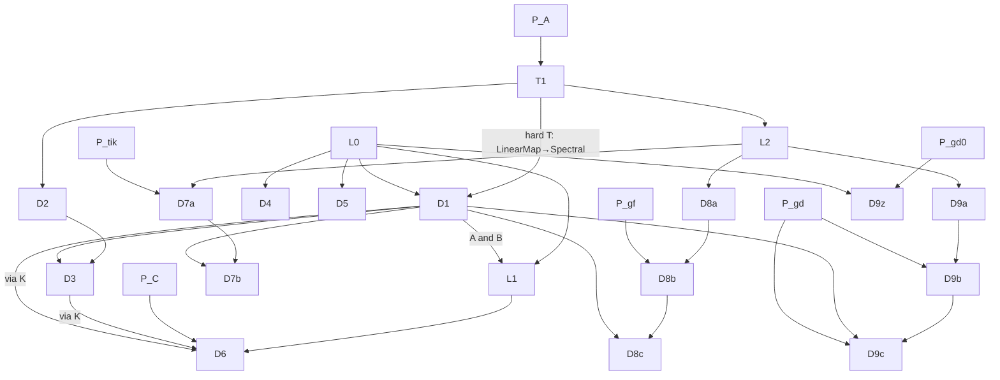

# T04 工作网 α（SVD / 谱路线）v2.2（round4 补丁 P19–P21，依据 layer-a/round4-astra.md；v2.1 = round3 补丁 P16–P18，备份 work-net-v2.1.md；v2 = round2 补丁 P10–P15，备份 work-net-v2.md；v1 = round1b 补丁 P1–P9，备份 work-net-v1.md；v0 备份 work-net-v0.md）
- object_ref: /workspace/rdtx-criteria/objects/T04-pseudoinverse/object.md (v2.1)
- criteria_ref: /workspace/rdtx-criteria/criteria/v0.2.md（v0.1 保留）
- 变体网：work-net-beta.md（投影 / 勾股路线）。两网是**候选路线**，签名不同；只有两者均判为合格后，才据 v0.2 I3 判断是否属不同等价类（D2；R2 C28）。
- 分支：A / B-svd / B-row / B-col（B-row 与 B-col **overlap**）/ C / D-tik / D-gf / D-gd（r≥1）/ D-gd0（r=0）/ opt
- 全局前提：ℝ、有限维（object.md v1）

## 补丁索引（round1b）
| 补丁 | 内容 | 来源 |
|---|---|---|
| P1 | 删除 T2；R_dyn 并入 R_lin（轨迹是 R_lin 中以 t/k 为参数的向量族）；D8/D9 拆为「经 T1 进入 R_spec 后的 R_spec 内 D 链」 | D1；C03、C04 |
| P2 | R_spec 的 semantic payload 显式含核分量 $x_{\ker}=P_{\ker A}x$ 与残差分量 $b_\perp$；T1 补齐 typed certificate | C02；checklist |
| P3 | carrier_type 改为 (base carrier, semantic payload, operator set) 三元组 + C0–C5 临时类 | D3 |
| P4 | Debt 表补 scope/consumer/量词/debt_kind/failure_target/failure_type/具体反例；Debt-fd 补全消费者与 ℓ² 反例；新增 α 专属 route-Debt | C06、C16；D6、D8 |
| P5 | vec 列主序与维度、t/k/η 量词、r=0 分支（D-gd0）、B-row/B-col overlap | C05、C12、C13；D4、D7 |
| P6 | 偏序取传递闭包，标出跨分支消费者 | C04；D8 |
| P7 | 端点按 I5 传递覆盖规则重标；Penrose 唯一性改为自包含引理 L0 | C09、C17；D5 |
| P8 | 补 mermaid 简图 | C18 |
| P9 | 登记与 β 的语义消费者映射 | C11；D6 |

## 补丁索引（round2，依据 layer-a/round2-astra.md）
| 补丁 | 内容 | 来源 |
|---|---|---|
| P10 | L1 显式前置 D1(A)、D1(B)（$A^\dagger,B^\dagger$ 的存在） | C19 |
| P11 | Debt-fd 补齐消费者 D6、量词，依赖表补 Debt-fd ≺ T1、D2、D6、D7b、D8c、D9c | C20 |
| P12 | 端点：T1(ii)(iii)、L1、L2 传递消费外部 SVD 存在，改标 partial·待核（传递） | C24；RQ2 |
| P13 | 符号：核分量改为 $x_{\ker}$，GD 初值 / 迭代改为 $x^{(0)}$ / $x^{(k)}$ | C25；RQ3 |
| P14 | RX-α-rank 移出核心 Debt 表，改记为「对象外路线扩展条件」，补量词 | C27 |
| P15 | 映射表：C 分支与共享消费者闭合；β 侧新增 RX-β-fd 对照 | P9 部分；C22 |

## 补丁索引（round3，依据 layer-a/round3-astra.md）
| 补丁 | 内容 | 来源 |
|---|---|---|
| P16 | C 分支的有限维假设从 Debt-fd（theorem-Debt）拆出为 Debt-fd-C：statement_applicability / premise_inapplicable | C30；RQ-C-debt |
| P17 | RX-α-rank 改名 RX-α-rank，类别改为 `route-extension note`（不参加核心 I2/I6）；补 Hilbert 量词与 C 兼容例 | C31；RQ-route-note |
| P18 | 映射表同步 P16、P17 | C30、C31 |

## 补丁索引（round4，依据 layer-a/round4-astra.md）
| 补丁 | 内容 | 来源 |
|---|---|---|
| P19 | Debt-fd-C 的 debt_kind 改为 v0.2 I2(f) 新增的 statement-Debt | C34；RQ-I2-kind |
| P20 | 删除 Debt-fd 行残留的「C 中另……」量词 | C35；RQ-fd-scope |
| P21 | RX-α-rank：显式 Hilbert 全称量词、B/X/C 类型、C 分支要求 A、B 均有限秩 | C32；RQ-route-quantifier |

## R 节点（carrier 三元组，v0.2 I3）
| id | 分支 | 临时类 | base carrier | semantic payload | operator set |
|---|---|---|---|---|---|
| R_lin | 全部 | C0 原生对象 | $\mathbb R^n,\mathbb R^m,\mathbb R^{m\times n}$（欧氏）；以及 $[0,\infty)\to\mathbb R^n$ 的 $C^1$ 轨迹、$\mathbb N_0\to\mathbb R^n$ 的序列 | A、b、x、$x(t)$、$x^{(k)}$、ran、ker | 矩阵代数、转置、内积、正交投影、Penrose 条件验证、$d/dt$、递推移位 |
| R_spec | A, B-svd, C（经 K）, D-tik, D-gf, D-gd | C2 结构化分解 | x 侧 $\mathbb R^r\oplus\ker A$；b 侧 $\mathbb R^r\oplus(\operatorname{ran}A)^\perp$ | 奇异系统 $(\sigma_i,u_i,v_i)_{i\le r}$；x 坐标 $c_i=v_i^Tx$ 与**核分量** $x_{\ker}=x-\sum c_iv_i\in\ker A$；b 坐标 $\beta_i=u_i^Tb$ 与**残差分量** $b_\perp=b-\sum\beta_iu_i\in(\operatorname{ran}A)^\perp$ | 逐坐标标量运算、Parseval、对角作用 $c_i\mapsto\sigma_ic_i$（A）、$\beta_i\mapsto\sigma_i\beta_i$ 且 $b_\perp\mapsto0$（$A^T$）、标量线性 ODE / 递推求解 |
| R_mat | C | C0 原生对象 | $(\mathbb R^{n\times p},\|\cdot\|_F)$ | 未知 X、$\mathcal L(X)=AXB$、C | 左右乘、Frobenius 内积 |
| R_app | opt | — | — | NTK、岭回归统计意义 | —（非核心） |

隐含载荷检查：R_spec 不携带 A 之外的对象；核分量与残差分量现已**显式**进入 payload（P2）。R_dyn 已撤销（P1）：轨迹不换载体，只是 R_lin 中的参数族。

## X 宏
| id | 分支 | 类型 / 临时类 | 展开 |
|---|---|---|---|
| X1 | D | 定义：滤波宏（M1） | $x_\phi=\sum_{i\le r}\phi(\sigma_i)\sigma_i^{-1}\beta_iv_i$ |
| X2 | C | 换元：向量化（C1 表示同构，不算载体改变） | $\operatorname{vec}$ 列主序；$X\in\mathbb R^{n\times p}\mapsto\operatorname{vec}X\in\mathbb R^{np}$；∀X：$\operatorname{vec}(AXB)=(B^T\otimes A)\operatorname{vec}X$，$K:=B^T\otimes A\in\mathbb R^{mq\times np}$；$\|X\|_F=\|\operatorname{vec}X\|_2$；$\operatorname{vec}C\in\mathbb R^{mq}$。定义性计算，按 v0.1/v0.2 I3 为 X |
| X3 | A, D | 切分 | $x=\sum_{i\le r}c_iv_i+x_{\ker}$，$b=\sum_{i\le r}\beta_iu_i+b_\perp$ |

## 派生引理（L，非 Debt）
| id | R | 内容与证明 |
|---|---|---|
| L0 | R_lin | **Penrose 唯一性（自包含）**：若 G、H 都满足 A 的四条件，则 $G=GAG=G(AG)^T=GG^TA^T=GG^T(AHA)^T=GG^TA^TH^TA^T=G(AG)^T(AH)^T=GAGAH=GAH$；$H=HAH=(HA)^TH=A^TH^TH=(AGA)^TH^TH=A^TG^TA^TH^TH=(GA)^T(HA)^TH=GAHAH=GAH$。故 G=H |
| L1 | R_lin | **前置：D1 分别作用于 A、B 给出 $A^\dagger,B^\dagger$ 存在（P10）。** $(B^T)^\dagger=(B^\dagger)^T$（转置四条件即得，L0 给唯一性）；$K^\dagger=(B^\dagger)^T\otimes A^\dagger$：由混合积 $(P\otimes Q)(R\otimes S)=PR\otimes QS$、$(P\otimes Q)^T=P^T\otimes Q^T$，$KG=(B^\dagger B)^T\otimes AA^\dagger$、$GK=(BB^\dagger)^T\otimes A^\dagger A$ 均对称，$KGK=K$、$GKG=G$，再用 L0 |
| L2 | R_spec | T1 的坐标映射 Φ 是**与 t、k 无关的固定线性等距同构**，故对 $C^1$ 轨迹 $\Phi(\dot x)=\frac{d}{dt}\Phi(x)$，对序列与递推移位交换。并且 $A^T(Ax-b)\in\operatorname{ran}A^T$ ⇒ 其核分量为 0 |

## D 边（每条只在一个 R 内）
| id | 分支 | R | 前提 → 结论 |
|---|---|---|---|
| D1 | B-svd | R_spec | 令 $G=\sum_{i\le r}\sigma_i^{-1}v_iu_i^T$。由正交关系 $AG=\sum u_iu_i^T$、$GA=\sum v_iv_i^T$，均对称；$AGA=A$，$GAG=G$。故 G 满足四条件（**存在性**），由 L0 得 $G=A^\dagger$。r=0：G=0=A，四条件平凡成立 |
| D2 | A | R_spec | 由 T1（含残差分量）与 X3：$Ax=\sum\sigma_ic_iu_i$，$b_\perp\perp\operatorname{span}\{u_i\}$ ⇒ $\|Ax-b\|^2=\sum_{i\le r}(\sigma_ic_i-\beta_i)^2+\|b_\perp\|^2$ ⇒ LS(b) = $\{c_i=\beta_i/\sigma_i\ (i\le r),\ x_{\ker}\in\ker A\ 任意\}$，非空 ⇒ 由 Parseval $\|x\|^2=\sum c_i^2+\|x_{\ker}\|^2$，在 LS(b) 上最小 ⇔ $x_{\ker}=0$ ⇒ 唯一最小元 $\sum\sigma_i^{-1}\beta_iv_i$ |
| D3 | A | R_spec | 由 D1，D2 的最小元等于 $Gb=A^\dagger b$；它属于 $\operatorname{span}\{v_i\}=\operatorname{ran}A^T=(\ker A)^\perp$（T1 保持引理 (ii)）；$b\in\operatorname{ran}A=\operatorname{span}\{u_i\}$ ⇔ $b_\perp=0$ ⇔ 最小残差为 0 ⇒ LS(b) = 解集 |
| D4 | B-row | R_lin | rank A=m ⇒ $AA^T$ 可逆（$AA^Ty=0$ ⇒ $\|A^Ty\|^2=0$ ⇒ $y\perp\operatorname{ran}A=\mathbb R^m$ ⇒ y=0）。$G=A^T(AA^T)^{-1}$：AG=I 对称，$GA=A^T(AA^T)^{-1}A$ 对称，AGA=A，GAG=G ⇒ 由 L0，$G=A^\dagger$ |
| D5 | B-col | R_lin | 同理：rank A=n ⇒ $A^TA$ 可逆，$G=(A^TA)^{-1}A^T$，GA=I ⇒ L0 |
| D6 | C | R_lin | 由 X2：$AXB=C$ ⇔ $K\operatorname{vec}X=\operatorname{vec}C$，且 $\|X\|_F=\|\operatorname{vec}X\|$。Debt-cons ⇒ $\operatorname{vec}C\in\operatorname{ran}K$。对 K 用 (A)（D2、D3 以 K 代 A，∀A 量词覆盖）：解集 = LS，唯一最小范数元 $K^\dagger\operatorname{vec}C$；由 L1 与 $\operatorname{vec}(PYQ)=(Q^T\otimes P)\operatorname{vec}Y$，$K^\dagger\operatorname{vec}C=\operatorname{vec}(A^\dagger CB^\dagger)$ |
| D7a | D-tik | R_spec | 由 T1：$A^TA+\alpha^2I$ 在 $v_i$ 上作用为 $\sigma_i^2+\alpha^2$，在 $\ker A$ 上为 $\alpha^2>0$（可逆）；$A^Tb=\sum\sigma_i\beta_iv_i$，核分量为 0（L2）⇒ $x_\alpha$ 的核分量为 0，$c_i=\frac{\sigma_i\beta_i}{\sigma_i^2+\alpha^2}$ ⇒ $x_\alpha=x_{\phi_\alpha}$ |
| D7b | D-tik | R_spec | α→0⁺：有限和（r<∞）逐项 $c_i\to\beta_i/\sigma_i$ ⇒ $x_\alpha\to\sum\sigma_i^{-1}\beta_iv_i=A^\dagger b$（D1） |
| D8a | D-gf | R_spec | 由 T1、L2：ODE $\dot x=-A^T(Ax-b)$ ⇔ $\dot c_i=-\sigma_i^2c_i+\sigma_i\beta_i$（i≤r），$\dot x_{\ker}=0$ |
| D8b | D-gf | R_spec | 初值 $c_i(0)=0$、$x_{\ker}(0)=0$（Debt-x0）。积分因子：$\frac{d}{dt}(e^{\sigma_i^2t}c_i)=\sigma_i\beta_ie^{\sigma_i^2t}$ ⇒ 唯一 $C^1$ 解 $c_i(t)=(1-e^{-t\sigma_i^2})\beta_i/\sigma_i$，$x_{\ker}(t)\equiv0$ ⇒ $x(t)=x_{\phi_t}$（∀t∈[0,∞)）。坐标解唯一 ⇒ 由 Φ 为同构，原 ODE 解唯一 |
| D8c | D-gf | R_spec | t→∞：$e^{-t\sigma_i^2}\to0$（σ_i>0），有限和逐项 ⇒ $x(t)\to A^\dagger b$（D1）。r=0：空和，$x(t)\equiv0=A^\dagger b$ |
| D9a | D-gd | R_spec | 由 T1、L2：$c_i^{(k+1)}=(1-\eta\sigma_i^2)c_i^{(k)}+\eta\sigma_i\beta_i$，$x_{\ker}^{(k+1)}=x_{\ker}^{(k)}$（∀k∈ℕ₀） |
| D9b | D-gd | R_spec | 初值 0（Debt-x0）⇒ 归纳得 $c_i^{(k)}=[1-(1-\eta\sigma_i^2)^k]\beta_i/\sigma_i$，$x_{\ker}^{(k)}=0$ ⇒ $x^{(k)}=x_{\phi_k}$ |
| D9c | D-gd | R_spec | r≥1，$0<\eta<2/\sigma_1^2$（Debt-η）⇒ ∀i：$0<\eta\sigma_i^2\le\eta\sigma_1^2<2$ ⇒ $|1-\eta\sigma_i^2|<1$ ⇒ 有限和逐项 ⇒ $x^{(k)}\to A^\dagger b$（D1） |
| D9z | D-gd0 | R_lin | r=0 ⇒ A=0 ⇒ $A^T(Ax^{(k)}-b)=0$ ⇒ $x^{(k)}\equiv x^{(0)}=0$（∀η>0）；0 满足 A=0 的四条件 ⇒ 由 L0，$A^\dagger=0$ ⇒ $x^{(k)}\equiv x^\dagger$ |

## T 边（typed certificate，v0.1/v0.2 I3）
| 字段 | T1 |
|---|---|
| 源载体 | R_lin（C0：$\mathbb R^n,\mathbb R^m$ 与 A） |
| 目标载体 | R_spec（C2：奇异系统 + 坐标 + 核分量 + 残差分量） |
| 保持引理（精确陈述） | ∀A∈ℝ^{m×n}（秩 r≥0）：(i)【SVD 存在，外部】存在 $\sigma_1\ge\dots\ge\sigma_r>0$、标准正交 $u_1..u_r\in\mathbb R^m$、$v_1..v_r\in\mathbb R^n$，使 $A=\sum\sigma_iu_iv_i^T$。(ii)【由 (i) 自包含推出】$\operatorname{ran}A=\operatorname{span}\{u_i\}$（$Av_j=\sigma_ju_j$）；$\ker A=\operatorname{span}\{v_i\}^\perp$（$Ax=\sum\sigma_i(v_i^Tx)u_i$，$u_i$ 线性无关、σ_i>0）；$\operatorname{ran}A^T=\operatorname{span}\{v_i\}=(\ker A)^\perp$。(iii) 映射 $\Phi:x\mapsto((c_i),x_{\ker})$ 是 $\mathbb R^n\to\mathbb R^r\oplus\ker A$ 的等距同构（Parseval），$\Psi:b\mapsto((\beta_i),b_\perp)$ 是 $\mathbb R^m\to\mathbb R^r\oplus(\operatorname{ran}A)^\perp$ 的等距同构；A、$A^T$ 在坐标下为对角作用 |
| 量词 | ∀A（含 r=0；含 C 分支中的 $K=B^T\otimes A$）、∀x∈ℝ^n、∀b∈ℝ^m |
| 适用分支 | 直接：A、B-svd、D-tik、D-gf、D-gd；**传递**：C（D6 经 (A) 对 K 消费 T1） |
| 重建映射 | $x=\sum c_iv_i+x_{\ker}$，$b=\sum\beta_iu_i+b_\perp$；矩阵 $\sum\sigma_i^{-1}v_iu_i^T$ 由奇异系统直接写回 |
| 证据端点 | (i) Golub & Van Loan《Matrix Computations》4th ed. Thm 2.4.1（实矩阵 SVD 存在），partial·待核；(ii)(iii) 本行内推导可逐行核验，但前提消费 (i)，按 I5 传递覆盖标 partial·待核（传递）（P12） |
| 判定（作者，待 Astra 复核） | 硬 T（R1 §2：两问均满足）；最小不可消除性：删去 T1 后 α 路线内无已有硬 T 可重建 |

已删除：**T2**（D1 决议：可由 T1 + R_spec 内 D 重建，违反最小不可消除性）。

## 非核心
| id | 类型 | 内容 |
|---|---|---|
| view-1 | view | M1 谱滤波宏：伪逆 φ=1、TSVD φ∈{0,1}、Tikhonov、梯度流、GD 是同一个模板。证明不消费它（X1 只作定义缩写） |
| view-2 | view | α 与 t 的对应：$\alpha^2\approx1/t$ 时 $\phi_\alpha$ 与 $\phi_t$ 同阶 |
| App-1 | App | Bartlett 定义 2：$\hat\theta=X^T(XX^T)^{-1}y$ 是 (B-row) 加 (A) 的实例。App-Debt：X 满行秩。不声称：风险界、良性过拟合条件、噪声下的任何性质 |

## Debt 闭包（v0.2 I2/I6 字段）
| id | 分支 / scope | 假设 | 量词 | debt_kind | consumer（α） | failure_target | failure_type | 具体反例（其余前提不变） |
|---|---|---|---|---|---|---|---|---|
| Debt-cons | C | $AXB=C$ 相容 | ∃X₀ | theorem-Debt（陈述前提） | D6 | statement_applicability | no_solution_or_minimum_absent | $A=B=0\in\mathbb R^{1\times1}$，C=1：无解，「最小范数解」无对象。（附注：$A^\dagger CB^\dagger=0$ 仍是 $\|AXB-C\|_F$ 的最小范数最小化元，不属本对象承诺） |
| Debt-x0 | D-gf, D-gd, D-gd0 | 初值 $x(0)=0$ / $x^{(0)}=0$ | 固定初值 | theorem-Debt | D8b、D9b、D9z | theorem_conclusion | limit_nonexistent_or_wrong | $A=(1\ 0)$，b=1，初值 z=(0,1)：核分量保持 (0,1)，极限 (1,1)≠$x^\dagger$=(1,0)（gf；gd 取 η=1 同样） |
| Debt-η | D-gd | $0<\eta<2/\sigma_1^2$ | ∀k | theorem-Debt | D9c | theorem_conclusion | limit_nonexistent_or_wrong | A=1（1×1，r=1），b=1，$x^{(0)}=0$：η=2 ⇒ $x^{(k)}=1-(-1)^k$ 振荡；η=3 ⇒ $x^{(k+1)}=-2x^{(k)}+3$ 发散 |
| Debt-fd | A、B-svd、B-row、B-col、D-tik、D-gf、D-gd、D-gd0（C 已拆出为 Debt-fd-C，P16） | 有限维 | ∀m,n∈ℕ≥1、∀A∈ℝ^{m×n}、∀b∈ℝ^m；D 中 ∀α>0 / ∀t≥0 / ∀k∈ℕ₀、η 按分支守卫 | theorem-Debt | T1（有限奇异系统）、D2（LS 非空）、D7b、D8c、D9c（有限和逐项极限）（P11） | theorem_conclusion | A：no_solution_or_minimum_absent；D：limit_nonexistent_or_wrong | 在 $\ell^2$ 上取 $Ae_j=j^{-1}e_j$，$b=(j^{-1})_j\in\ell^2$。A 单射、值域稠密不闭；$Ax=b$ 需 $x=(1,1,\dots)\notin\ell^2$，而截断给出 $\inf\|Ax-b\|=0$ ⇒ **LS(b)=∅**，(A) 失败。同一对：$\|x_\alpha\|^2=\sum_j(1+\alpha^2j^2)^{-2}\to\infty$（α→0⁺）、$\|x(t)\|^2=\sum_j(1-e^{-t/j^2})^2\to\infty$（t→∞）、$\eta\in(0,2)$ 时 $\|x^{(k)}\|^2=\sum_j[1-(1-\eta/j^2)^k]^2\to\infty$ ⇒ D 分支极限不存在 |
| Debt-fd-C | C | 有限维（使 $A^\dagger,B^\dagger$ 为处处定义的矩阵、$K$ 为有限矩阵） | ∀m,n,p,q∈ℕ≥1、∀A、B、C（Debt-cons 下） | statement-Debt（v0.2 I2(f)；P16、P19） | D6（经 K、L1） | statement_applicability | premise_inapplicable | $\ell^2$ 上 $D=\operatorname{diag}(1/j)$，$A=B=D$，任取 Hilbert–Schmidt 算子 $X_0$，$C=DX_0D$：相容性保持（Debt-cons 不变），且解集是非空闭仿射集，最小 HS 范数解仍存在唯一（结论的自然扩展成立）；但 $A^\dagger=B^\dagger=D^\dagger$ 无界、只在稠密子空间 $\operatorname{ran}D\oplus(\operatorname{ran}D)^\perp$ 上有定义，不是 object.md 所规定的「满足 Penrose 四条件的矩阵」，公式 $A^\dagger CB^\dagger$ 未声明闭包或延拓即不适用 |
| （RX-α-rank） | 已移出核心表并改为 route-extension note RX-α-rank，见下节（P14、P17） | | | | | | | |
| （守卫） | B-row / B-col（overlap） | rank A=m / rank A=n | — | 守卫 | D4、D5 | — | — | 不需反例；可同时成立 |
| （守卫） | D-gd / D-gd0 | r≥1 / r=0 | — | 守卫（互斥且覆盖） | D9c / D9z | — | — | — |
| （定义域） | D-tik | α>0 | — | 守卫 / 定义域 | D7a | — | — | — |

## route-extension note（对象外路线扩展记录；不入核心 I2 Debt 闭包、不参加 I6 跨网失败比较；R2 C27、R3 C31，P14、P17）
说明：下列条目的反例落在有限维之外，必然同时去掉 Debt-fd，不满足 I2「其余 Debt 不变」，故不作核心 Debt；只记录「若把对象推广到无穷维，本路线在哪里先失效」。
| id | 路线 | 条件 | 量词 | 类别 | 路线上的位置 | failure_target | failure_type | 反例（对象外） |
|---|---|---|---|---|---|---|---|---|
| RX-α-rank | α（A、B-svd、C、D） | A 分支：A 有有限奇异系统（r<∞，T1 (i) 的有限和形式）；C 分支：A、B **均**有限秩（使 $K=B^T\otimes A$ 有有限奇异系统） | ∀ 实 Hilbert 空间 $H_1,H_2$，∀A∈$\mathcal B(H_1,H_2)$，∀b∈$H_2$；C 分支另 ∀ 实 Hilbert 空间 $H_3,H_4$，∀B∈$\mathcal B(H_4,H_3)$，X∈$\mathcal S_2(H_3,H_1)$、C∈$\mathcal S_2(H_4,H_2)$（Hilbert–Schmidt；推广对象，非本对象） | route-extension note | T1，并经 T1 传至 D1–D3、D6–D9c | proof_route | route_failure | A：$A=I$ 于 $\ell^2$（值域闭，非有限秩）：(A) 的结论仍成立（LS(b)={b}，$x^\dagger=b$），但 T1 (i) 的有限和 SVD 不适用。C：$A=B=I_{\ell^2}$、$C=X_0$（HS）：(C) 结论仍成立（$X^*=X_0$），但 K 的有限和 SVD 不适用。α 路线在 T1 失效 |
| （对照）RX-β-fd | β（A、C） | 见 work-net-beta.md | — | route-extension note | E0 | proof_route | route_failure | 同一 $A=I$ 于 $\ell^2$（及 C 例 $A=B=I_{\ell^2}$）：E0 的有限秩满秩分解不存在 |

## 语义消费者映射（α ↔ β，v0.2 I6 五层；β 侧见 work-net-beta.md）
| Debt | 语义消费者（分支 + 结论） | α 位置 | β 位置 | failure_target | failure_type | 一致性 |
|---|---|---|---|---|---|---|
| Debt-cons | C：「相容时最小 Frobenius 解存在且唯一」 | D6 | E4 | statement_applicability | no_solution_or_minimum_absent | 一致 |
| Debt-fd | A：「LS(b) 非空、唯一最小范数元」 | T1、D2 | E0、L3/E1、E2 | theorem_conclusion | no_solution_or_minimum_absent | 一致（同一 ℓ² 反例）；字面位置不同（I6 第 4 层不要求） |
| Debt-fd-C | C：「相容时最小 Frobenius 解存在且唯一，且等于 $A^\dagger CB^\dagger$」 | D6（经 K、L1） | E4（经 E0、E1） | statement_applicability | premise_inapplicable | 一致（P16、P18）；同一 $D=\operatorname{diag}(1/j)$ 例 |
| Debt-fd | B、D（共享） | T1、D1、D7b、D8c、D9c | 共享 α | theorem_conclusion | limit_nonexistent_or_wrong（D） | β 不独立提供 |
| （不比较）RX-α-rank / RX-β-fd | route-extension note | T1 | E0 | — | — | 按 v0.2 I2/I6【route-extension note】条不参加 I6 跨网比较，仅作记录（P17、P18） |

## 关键依赖偏序（传递闭包；X 只作边注记；L 计为节点）
- 前提节点：P_A =「A∈ℝ^{m×n}、b∈ℝ^m 任意，r≥0」；P_C =「A、B、C 任意 + Debt-cons」；P_tik =「α>0」；P_gf =「Debt-x0，t∈[0,∞)」；P_gd =「Debt-x0，r≥1，Debt-η，k∈ℕ₀」；P_gd0 =「Debt-x0，r=0，η>0」
- Debt-fd 为全局前提节点：Debt-fd ≺ T1、D2、D7b、D8c、D9c（P11）；Debt-fd-C ≺ D6（P16）
- **B-svd**：P_A ≺ T1 ≺ D1；L0 ≺ D1
- **A**：P_A ≺ T1 ≺ D2 ≺ D3；Debt-fd ≺ D2；D1 ≺ D3；T1(ii) ≺ D3（注记：X3）
- **B-row**：P_A + 守卫 rank=m ≺ D4；L0 ≺ D4。**B-col**：P_A + 守卫 rank=n ≺ D5；L0 ≺ D5（overlap）
- **C**：P_C ≺ D6；L0 ≺ L1 ≺ D6；D1(A)、D1(B) ≺ L1（P10）；Debt-fd-C ≺ D6；[T1 ≺ D2 ≺ D3，D1]（**以 K 为实例，跨分支消费者 = C**）≺ D6（注记：X2）
- **D-tik**：P_A, P_tik ≺ T1 ≺ L2 ≺ D7a ≺ D7b；D1 ≺ D7b；Debt-fd ≺ D7b（注记：X1）
- **D-gf**：P_A, P_gf ≺ T1 ≺ L2 ≺ D8a ≺ D8b ≺ D8c；D1 ≺ D8c；Debt-fd ≺ D8c（注记：X1）
- **D-gd**：P_A, P_gd ≺ T1 ≺ L2 ≺ D9a ≺ D9b ≺ D9c；D1 ≺ D9c；Debt-fd ≺ D9c（注记：X1）
- **D-gd0**：P_gd0 ≺ D9z；L0 ≺ D9z

## 证据端点（v0.2 I5 传递覆盖规则）
| 边 | 端点（唯一定位） | 覆盖声明 | 等级 | 来源 |
|---|---|---|---|---|
| T1 (i) | Golub & Van Loan《Matrix Computations》4th ed. Thm 2.4.1 | 实矩阵 SVD 存在；∀A；不含 (ii)(iii) | partial·待核 | 外部 |
| L0、D4、D5、D9z | 本网行内证明 | 全部结论与量词；只消费定义与有限维线性代数 | complete | 非外部·自包含 |
| T1 (ii)(iii)、L1、L2 | 本网行内证明 + 传递消费 T1 (i)（L1 经 D1；L2 经 T1 坐标映射） | 行内推理可逐行核验；但传递消费外部 SVD 存在 | **partial·待核**（传递，P12） | 非外部（本边）+ 外部（T1 (i)） |
| D1、D2、D3、D6、D7a/b、D8a/b/c、D9a/b/c | 本网行内证明 + 传递消费 T1 (i) | 行内推理可逐行核验；但传递消费外部 SVD 存在 | **partial·待核**（传递：由 T1 (i) 端点决定） | 非外部（本边）+ 外部（T1 (i)） |
| D6、L1（方法旁证） | MSE 2713697 copper.hat 答案 | 方法：SVD 加 Kronecker | partial（未逐行核对） | 外部 |
| D7（方法旁证） | MSE 1084677 Syed Alam Abbas 答案 | Tikhonov 滤波因子与 α→0 | partial（未逐行核对） | 外部 |
| Debt 反例 | 本网行内反例 | 具体矩阵 / ℓ² 对角算子 | complete | 非外部·自包含 |

## 简图

（X1–X3 不入图，只作边注记。）
