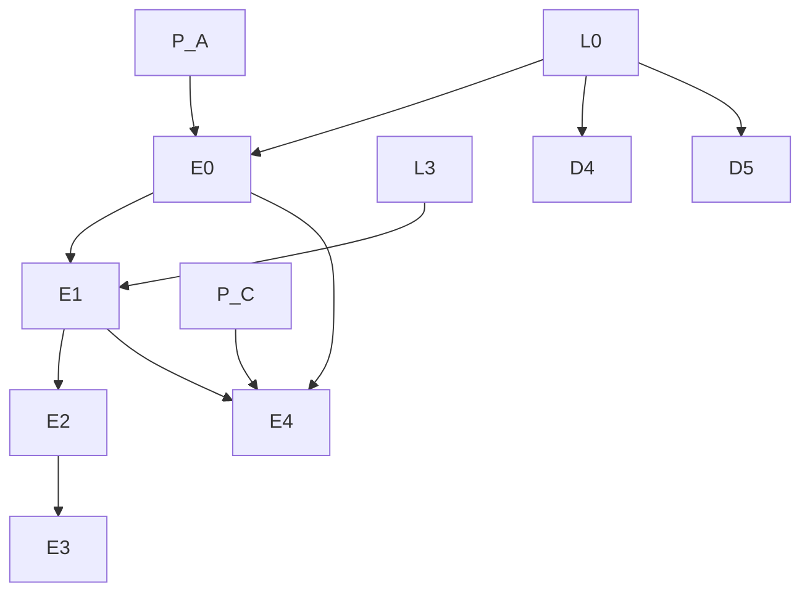

# T04 工作网 β（正交投影 / 勾股路线）v2.2（round4 补丁 Q15–Q17，依据 layer-a/round4-astra.md；v2.1 = round3 补丁 Q12–Q14，备份 work-net-beta-v2.1.md；v2 = round2 补丁 Q7–Q11，备份 work-net-beta-v2.md；v1 = round1b 补丁 Q1–Q6，备份 work-net-beta-v1.md；v0 备份 work-net-beta-v0.md）
- object_ref: /workspace/rdtx-criteria/objects/T04-pseudoinverse/object.md (v2.1)
- criteria_ref: /workspace/rdtx-criteria/criteria/v0.2.md
- 与网 α（work-net.md）是**签名不同的候选路线**（v0.2 I3 等价关系定义在 $(O,\rho)$ 上，D2；是否属不同等价类待两者均判合格后再定，R2 C28）。β 的路线签名比较范围为分支 A、C（以及 B-row/B-col，见覆盖表）。
- 全局前提：ℝ、有限维

## 补丁索引（round1b）
| 补丁 | 内容 | 来源 |
|---|---|---|
| Q1 | Debt 表补 debt_kind、failure_target、failure_type、量词、具体反例；闭合 debt_closure（E1、E2、E4 与共享分支） | C07、C08；D6、D8 |
| Q2 | 不再只写「照搬 α」：显式覆盖表（自有 / 共享）、carrier 三元组、分支字段 | C15；checklist |
| Q3 | Y2/E4 展开 Π 的自伴性、幂等性与 Frobenius 内积验证 | C14 |
| Q4 | 端点按 I5 传递覆盖规则重标；新增 E0（满秩分解给出 A† 存在，自包含），L0 共享 | C09；D5（作者补：β 原先默认 A† 存在，传递依赖 Penrose 1955 引用） |
| Q5 | 补 mermaid 简图 | C18 |
| Q6 | 语义失败映射与 route-Debt 区分 | C11；D6 |

## 补丁索引（round2，依据 layer-a/round2-astra.md）
| 补丁 | 内容 | 来源 |
|---|---|---|
| Q7 | Debt-fd 消费者补 E0，量词补全；C 与共享分支的失败映射补全 | C21 |
| Q8 | 撤回「β 无专属 route-Debt」，新增 RX-β-fd（对象外路线扩展条件，与 α 的 RX-α-rank 同处理） | C22；RQ1；C27 |
| Q9 | Debt-fd 反例改为「到 ran A 的正交投影不存在，且 LS(b)=∅」，不再改写成闭包投影 | C23 |
| Q10 | I3 N/A 的分支边界写清：只对自有子网 A、C、B-row、B-col | C26 |
| Q11 | 符号：$x_0$ → $x_{\ker}$（签名对照中） | C25 |

## 补丁索引（round3，依据 layer-a/round3-astra.md）
| 补丁 | 内容 | 来源 |
|---|---|---|
| Q12 | C 分支的有限维假设拆为 Debt-fd-C：statement_applicability / premise_inapplicable | C30；RQ-C-debt |
| Q13 | RX-β-fd 改名 RX-β-fd，类别 `route-extension note`；补 Hilbert 量词与 C 兼容例 | C31、C32；RQ-route-note、RQ-beta-scope |
| Q14 | 映射表同步 | C30、C31 |

## 补丁索引（round4，依据 layer-a/round4-astra.md）
| 补丁 | 内容 | 来源 |
|---|---|---|
| Q15 | Debt-fd-C 的 debt_kind 改为 statement-Debt | C34；RQ-I2-kind |
| Q16 | 删除 Debt-fd 行残留的 C 量词 | C35；RQ-fd-scope |
| Q17 | RX-β-fd：显式 Hilbert 全称量词、B/X/C 类型、C 分支要求 A、B 均有满秩分解 | C32；RQ-route-quantifier |

## 分支覆盖表
| 分支 | β 状态 | 说明 |
|---|---|---|
| A | 自有：E0、E1、E2、E3 | 无 T |
| C | 自有：E4（消费 E0、E1） | 无 T |
| B-row / B-col（overlap） | 自有：沿用 α 的 D4、D5 原文（只在 R_lin 内，消费 L0） | 无 T；与 α 同文，签名相同（∅） |
| B-svd、D-tik、D-gf、D-gd | **共享 α**（T1、D1、D7a–D9c，id 引用 work-net.md）| 这些结论要用奇异值说出，β 无独立路线；共享项**不计入** β 的路线签名比较，也不在 β 中重复判定 |
| D-gd0 | 共享 α 的 D9z（R_lin 内，无 T） | — |
| opt | 共享 α 的 view/App | 非核心 |

## R 节点（carrier 三元组）
| id | 临时类 | base carrier | semantic payload | operator set |
|---|---|---|---|---|
| R_lin | C0 原生对象 | $\mathbb R^n,\mathbb R^m,\mathbb R^{m\times n}$（欧氏） | A、b、x、子空间、正交投影 $P_U$、满秩分解因子 F、R | 矩阵代数、内积、正交补、Gram 矩阵求逆 |
| R_mat | C0 原生对象 | $(\mathbb R^{n\times p},\|\cdot\|_F)$ | X、$\mathcal L(X)=AXB$、C、Π | 左右乘、Frobenius 内积 $\langle X,Y\rangle=\operatorname{tr}(X^TY)$ |

## X 宏
| id | 类型 | 展开 |
|---|---|---|
| Y1 | 切分 | $\mathbb R^n=\operatorname{ran}A^T\oplus\ker A$（正交）；$x=Px+(I-P)x$，$P=A^\dagger A$ |
| Y2 | 切分（矩阵版） | $X=\Pi X+(X-\Pi X)$，$\Pi X:=A^\dagger AXBB^\dagger$ |

## 派生引理
| id | 内容 |
|---|---|
| L0 | Penrose 唯一性（与 α 同文，自包含） |
| L3 | 有限维：$\ker A=(\operatorname{ran}A^T)^\perp$（$Ax=0$ ⇔ ∀y：$y^TAx=(A^Ty)^Tx=0$），故 $(\ker A)^\perp=\operatorname{ran}A^T$（有限维子空间的双正交补等于自身） |

## D 边（全部在 R_lin 或 R_mat 内，没有 T）
| id | 分支 | R | 前提 → 结论 |
|---|---|---|---|
| E0 | A（亦供 C） | R_lin | **A† 存在（自包含）**：r=0 时 G=0。r≥1：取 ran A 的一组基为 $F\in\mathbb R^{m\times r}$ 的列，A 的各列在该基下的坐标组成 $R\in\mathbb R^{r\times n}$，A=FR，rank F=rank R=r ⇒ $F^TF$、$RR^T$ 可逆。令 $G=R^T(RR^T)^{-1}(F^TF)^{-1}F^T$：$AG=F(F^TF)^{-1}F^T$、$GA=R^T(RR^T)^{-1}R$ 对称；AGA=FR=A；GAG=G。由 L0，$G=A^\dagger$ |
| E1 | A | R_lin | 由 Penrose 条件：$AA^\dagger$ 对称、幂等（$AA^\dagger AA^\dagger=AA^\dagger$），$\operatorname{ran}AA^\dagger=\operatorname{ran}A$（⊆ 显然；$A=AA^\dagger A$ 给 ⊇）⇒ $AA^\dagger=P_{\operatorname{ran}A}$。$A^\dagger A$ 对称、幂等，$\ker A^\dagger A=\ker A$（⊇ 显然；$A=A(A^\dagger A)$ 给 ⊆）⇒ $A^\dagger A=P_{(\ker A)^\perp}=P_{\operatorname{ran}A^T}$（L3） |
| E2 | A | R_lin | 勾股：$\|Ax-b\|^2=\|Ax-P_{\operatorname{ran}A}b\|^2+\|(I-P_{\operatorname{ran}A})b\|^2$ ⇒ LS(b) = $\{x:Ax=AA^\dagger b\}$，非空（$x^\dagger$ 属于它） |
| E3 | A | R_lin | 任取 x∈LS(b)：$Ax=Ax^\dagger$ ⇒ $x-x^\dagger\in\ker A$；$x^\dagger=A^\dagger AA^\dagger b\in\operatorname{ran}A^\dagger A=(\ker A)^\perp$ ⇒ $\|x\|^2=\|x^\dagger\|^2+\|x-x^\dagger\|^2$ ⇒ 唯一最小元 $x^\dagger$；$b\in\operatorname{ran}A$ ⇒ $AA^\dagger b=b$ ⇒ LS = 解集 |
| E4 | C | R_mat | 设 $AX_0B=C$（Debt-cons）。令 $P=A^\dagger A\in\mathbb R^{n\times n}$、$Q=BB^\dagger\in\mathbb R^{p\times p}$，二者对称幂等（Penrose 条件，对 A、B 各自）。$\Pi X=PXQ$。**自伴**：$\langle PXQ,Y\rangle=\operatorname{tr}(QX^TPY)=\operatorname{tr}(X^TPYQ)=\langle X,PYQ\rangle$；**幂等**：$P^2XQ^2=PXQ$ ⇒ Π 是 Frobenius 内积下的正交投影，$\langle X-\Pi X,\Pi X\rangle=\langle X,\Pi X\rangle-\langle X,\Pi^2X\rangle=0$。对任意解 X：$\Pi X=A^\dagger(AXB)B^\dagger=A^\dagger CB^\dagger$ ⇒ $\|X\|_F^2=\|A^\dagger CB^\dagger\|_F^2+\|X-\Pi X\|_F^2$，等号仅当 $X=A^\dagger CB^\dagger$。又 $A(A^\dagger CB^\dagger)B=AA^\dagger AX_0BB^\dagger B=AX_0B=C$ ⇒ (C) |

## T 边
无（A、C、B-row、B-col 分支）。**I3 N/A 的适用边界（Q10）**：只对 β 的自有子网 A、C、B-row、B-col 判 N/A；覆盖表中共享 α 的分支（B-svd、D-tik、D-gf、D-gd、D-gd0）不属 β 的 I3 判定范围，其 I3 判定（T1 为硬 T）直接继承 α，不在 β 中重判、也不计入 β 签名。N/A 理由：降级说明：投影 $A^\dagger A$、$AA^\dagger$、Π 都由 Penrose 条件和 E0 的满秩分解在 R_lin/R_mat 内直接构造，没有引入新语义载体；共享分支（B-svd、D）的 T1 属于 α，不计入 β。

## Debt 闭包
| id | 分支 / scope | 假设 | 量词 | debt_kind | consumer（β） | failure_target | failure_type | 具体反例（其余前提不变） |
|---|---|---|---|---|---|---|---|---|
| Debt-cons | C | $AXB=C$ 相容 | ∃X₀ | theorem-Debt（陈述前提） | E4（取 X₀） | statement_applicability | no_solution_or_minimum_absent | 同 α：$A=B=0\in\mathbb R^{1\times1}$，C=1 无解 |
| Debt-fd | A、B-row、B-col（自有；C 已拆出为 Debt-fd-C，Q12）；B-svd、D（共享 α，consumer 见 α） | 有限维 | ∀m,n∈ℕ≥1、∀A∈ℝ^{m×n}、∀b∈ℝ^m | theorem-Debt | E0（有限秩满秩分解，Q7）、L3/E1（$(\ker A)^\perp=\operatorname{ran}A^T$、$P_{\operatorname{ran}A}$ 存在）、E2（LS 非空） | theorem_conclusion | A：no_solution_or_minimum_absent | 同 α：$\ell^2$ 上 $Ae_j=j^{-1}e_j$，$b=(j^{-1})_j$。ran A 稠密不闭 ⇒ **到 ran A 的正交投影不存在**（E1 所需的 $P_{\operatorname{ran}A}$ 无定义），且 $\inf\|Ax-b\|=0$ 不可达 ⇒ **LS(b)=∅**（Q9）。 |
| Debt-fd-C | C | 有限维（使 $A^\dagger,B^\dagger$ 为处处定义的矩阵） | ∀m,n,p,q∈ℕ≥1、∀A、B、C（Debt-cons 下） | statement-Debt（v0.2 I2(f)；Q12、Q15） | E4（经 E0、E1） | statement_applicability | premise_inapplicable | $\ell^2$ 上 $D=\operatorname{diag}(1/j)$，$A=B=D$，任取 Hilbert–Schmidt 算子 $X_0$，$C=DX_0D$：相容性保持（Debt-cons 不变），且解集是非空闭仿射集，最小 HS 范数解仍存在唯一（结论的自然扩展成立）；但 $A^\dagger=B^\dagger=D^\dagger$ 无界、只在稠密子空间 $\operatorname{ran}D\oplus(\operatorname{ran}D)^\perp$ 上有定义，不是 object.md 所规定的「满足 Penrose 四条件的矩阵」，公式 $A^\dagger CB^\dagger$ 未声明闭包或延拓即不适用 |
| （守卫） | B-row / B-col（overlap） | 同 α | — | 守卫 | D4、D5 | — | — | — |

β 的路线扩展记录（Q8 撤回 v1 的「无」；Q13 改为 `route-extension note`）：与 α 的 RX-α-rank 同样处理——反例在有限维之外，必然同时去掉 Debt-fd，故按 v0.2 I2/I6【route-extension note】条**不入核心 I2 Debt 闭包、不参加 I6 跨网比较**（R2 C27、R3 C31）。
| id | 路线 | 条件 | 量词 | 类别 | 路线上的位置 | failure_target | failure_type | 反例（对象外） |
|---|---|---|---|---|---|---|---|---|
| RX-β-fd | β（A，并经 E0 传至 E1–E4 与 C） | A 分支：A 有有限秩满秩分解 A=FR（F 列满秩、R 行满秩，r<∞）；C 分支：A、B **均**有此分解（E0 对两者各用一次） | ∀ 实 Hilbert 空间 $H_1,H_2$，∀A∈$\mathcal B(H_1,H_2)$，∀b∈$H_2$；C 分支另 ∀ 实 Hilbert 空间 $H_3,H_4$，∀B∈$\mathcal B(H_4,H_3)$，X∈$\mathcal S_2(H_3,H_1)$、C∈$\mathcal S_2(H_4,H_2)$（Hilbert–Schmidt；推广对象，非本对象） | route-extension note | E0 | proof_route | route_failure | A：$A=I$ 于 $\ell^2$：(A) 的结论仍成立（LS(b)={b}，$x^\dagger=b$），但 E0 的有限秩满秩分解不存在。C：$A=B=I_{\ell^2}$、$C=X_0$（HS）：(C) 结论仍成立（$X^*=X_0$），但对 A、B 的 E0 均不存在。β 路线在 E0 失效 |

## 语义消费者映射（与 α 对照，v0.2 I6 五层）
| Debt | 语义消费者 | β 位置 | α 位置 | failure_target | failure_type | 备注 |
|---|---|---|---|---|---|---|
| Debt-cons | C：相容时最小 Frobenius 解存在且唯一 | E4 | D6 | statement_applicability | no_solution_or_minimum_absent | 一致 |
| Debt-fd | A：LS(b) 非空、唯一最小范数元 | E0、L3/E1、E2 | T1、D2 | theorem_conclusion | no_solution_or_minimum_absent | 失败类型、目标、语义结论一致；字面位置不同（I6 第 4 层不要求） |
| Debt-fd-C | C：相容时最小 Frobenius 解存在且唯一，且等于 $A^\dagger CB^\dagger$ | E4（经 E0、E1） | D6（经 K、L1） | statement_applicability | premise_inapplicable | 一致（Q12、Q14）；见 Debt-fd-C 行 |
| Debt-fd | B-svd、D（共享） | 共享 α | T1、D1、D7b、D8c、D9c | theorem_conclusion | limit_nonexistent_or_wrong（D） | β 不独立提供，继承 α |
| （不比较）RX-β-fd / RX-α-rank | route-extension note | E0 | T1 | — | — | 不参加 I6 跨网比较，仅作记录（Q13、Q14） |

## 关键依赖偏序
- 前提节点：P_A、P_C（同 α）
- **A**：P_A ≺ E0 ≺ E1 ≺ E2 ≺ E3；L0 ≺ E0；L3 ≺ E1；Debt-fd ≺ E0、L3、E2（Q7）（注记：Y1）
- **C**：P_C ≺ E4；Debt-fd-C ≺ E4（Q12）；E0 ≺ E1 ≺ E4（对 A 与 B 各用一次 E0、Penrose 条件）（注记：Y2）
- **B-row / B-col**：同 α（L0 ≺ D4；L0 ≺ D5）

## 证据端点（v0.2 I5）
| 边 | 端点 | 覆盖 | 等级 | 来源 |
|---|---|---|---|---|
| L0、L3、E0–E4 | 本网行内证明 | 全部结论、量词；只消费定义与有限维线性代数（基的存在、Gram 矩阵可逆性） | complete | 非外部·自包含 |
| E4（方法旁证） | MSE 2713697 user1551 答案（正交投影 π₁、π₂ 加勾股） | 方法 | partial（未逐行核对） | 外部 |
| 共享分支 | 见 α | — | — | — |

## 简图

（Y1、Y2 不入图。）

## 与网 α 的规范化签名对照（作者自拟，待 Astra 判）
| 分支 | α 签名 | β 签名 |
|---|---|---|
| A | {T1: (C0 LinearMap → C2 Spectral, SVD 存在+(ii)(iii), ∀A, A, $x=\sum c_iv_i+x_{\ker}$)} | ∅ |
| C | {T1（以 K 为实例，传递）} | ∅ |
| B-row / B-col | ∅ | ∅ |
| B-svd、D | {T1} | 共享 α，不比较 |
α 与 β 在 A、C 上签名不同；只有在两者均判为合格（Layer B）后，才据 v0.2 I3 判断其是否属于不同等价类（R2 C28）。
