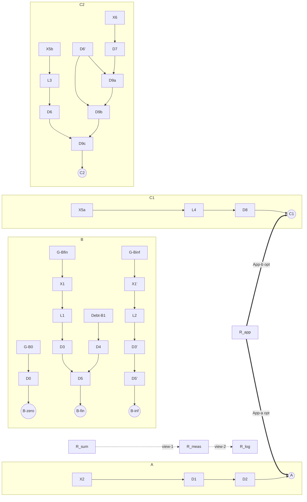

# T08 工作网 v2.1（work-net-v2.1）

> 对象见 object.md v2.1，范围决策见 scope-decisions.md（含 Round2b 节）。备份：work-net-v1.md、work-net-v2.md。
> 本版按 Astra 的 Round 2b 决定小补（layer-a/round2b-astra-decisions.md，P1–P7）。各条改动标为【v2.1 · Px】。
> 每个节点和关系都标了所属分支：A / B-zero / B-fin / B-inf / C1 / C2 / opt（应用，可选）。

## 关系类型【v2.1 · P4/P6，依据 q2/q5】
- **核心类型（参与等价类判定）**：R（表示）、D（表示内推理）、T（跨表示运输）、X（宏展开）。
- **非核心类型（不参与核心等价类判定，也不在核心证明链上）**：
  - **App**：从应用实例到本对象结论的套用。它带自己的 App-Debt，不计入 A/B/C 的证明义务。
  - **view**：统一视角或改写，不被任何证明步骤消费。
- 在 v2.1 中，T1、T2 改为 view，T4a、T4b 改为 App，T3 降级为 C2 内部的 X/D（见下文）。因此**本网 v2.1 的核心证明链不含 T 边**。（这一点直接影响 I3 在本对象上能判什么，留给准则起草时处理。）

## 符号与类型约定（同一个符号不兼作两种角色）【v2.1 · P7】
- 离散：$N$ = 项数（固定），$\beta>0$ = 渐近参数，$M_A=\max_i a_i$，$A^*$ = argmax 集合，$k=|A^*|$。
- 测度：$p\in(0,\infty)$ = 渐近参数（只取有限正数），$q\in(0,\infty)$ = 可积指数，$M_B=\operatorname{ess\,sup}|f|\in[0,\infty]$。扩展值约定：$\|f\|_p=(\int|f|^p)^{1/p}\in[0,\infty]$，$\infty^{1/p}=\infty$。
- 积分：$n$ = 渐近参数；**φ 取实值**；$M_C=\max_{[a,b]}\varphi$；$c=-\varphi''(t_0)>0$；$G:=g(t_0)\ne0$。其中 g 指在 $t_0$ 处连续的那个代表元（其它代表元只在零测集上不同，不影响积分）。

## 分支守卫（不是 Debt）【v2.1 · P7，依据 R2-C13】
| id | 守卫条件 | 分到 |
|---|---|---|
| G-B0 | $M_B=0$ | B-zero（D0） |
| G-Bfin | $0<M_B<\infty$ | B-fin（D3–D5） |
| G-Binf | $M_B=\infty$ | B-inf（D3'、D5'） |
（v2 的 Debt-B2 移到这里。三个守卫两两不交，合起来覆盖 $M_B\in[0,\infty]$。）

## R 节点
| id | 分支 | 合法对象 | 合法算子 |
|---|---|---|---|
| R_sum | A | 固定 $N\ge1$，$(a_i)_{i\le N}\subset\mathbb R$，$\beta>0$，$Z_\beta=\sum_i e^{\beta a_i}$ | 逐项比较，正项求和，计数 |
| R_meas | B | $(X,\mu)$；可测 f（实值或复值）；$p\in(0,\infty)$；$\|f\|_p\in[0,\infty]$。B-fin 另要求 $f\in L^q$（$0<q<\infty$），B-inf、B-zero 不要求可积性 | 单调性、Chebyshev 型下界、a.e. 点态控制、ess sup |
| R_int | C1, C2 | $a<b$ 有限；**φ 为实值**并在 $[a,b]$ 上连续；（仅 C2）g 可测，取实值或复值，$g\in L^1[a,b]$，取 $t_0$ 处连续的代表元 | 区间切分、**模**估计（$|\int h|\le\int|h|$）、Peano 形式的 Taylor 展开、换元 $s=t-t_0$。复值量之间**不用**序关系 |
| R_log | A, B, C1 | $\frac1\beta\log Z_\beta$，$\log\|f\|_p$，$\frac1n\log I_n$ | liminf / limsup |
| R_app | opt（非核心） | 见 App-a / App-b | — |
（v2 的 R_local 删掉了，内容并入 X6。依据 q2：高斯规范形只是 C2 内部的比较对象，不构成独立的表示。）

## 派生引理（由已列 Debt 或定义推出，**不算** Debt）
| id | 内容 | 依据 |
|---|---|---|
| L1 | $0<\delta<M_B<\infty$ ⇒ $\mu(S_\delta)>0$ | ess sup 的定义 |
| L2 | $M_B=\infty$，$K>0$ ⇒ $\mu(E_K)>0$ | ess sup 的定义 |
| L3 | (C2) 中，对每个 $\delta$ 有 $\eta(\delta):=M_C-\max_{[a,b]\setminus U_\delta}\varphi>0$ | φ 连续 + $[a,b]\setminus U_\delta$ 紧 + 最大点唯一 |
| L4 | (C1) 中，对每个 $\varepsilon>0$，$V_\varepsilon$ 含一段长度 $\ell_\varepsilon>0$ 的区间 | φ 连续 + $a<b$ |
注：B-fin 的下界不需要 $\mu(S_\delta)<\infty$，因为 $\mu(S_\delta)=\infty$ 时右边是 ∞。

## X 宏
| id | 分支 | 类型 | 展开 |
|---|---|---|---|
| X2 | A | 见证集 | argmax **集合** $A^*$（不挑单个代表）；$k\ge1$ |
| X1 | B-fin | 见证：水平集 | $S_\delta=\{|f|\ge M_B-\delta\}$，$0<\delta<M_B$ |
| X1' | B-inf | 见证：水平集 | $E_K=\{|f|\ge K\}$，$K>0$ |
| X5a | C1 | 见证：超水平集 | $V_\varepsilon=\{t\in[a,b]:\varphi(t)>M_C-\varepsilon\}$ |
| X5b | C2 | 切分：距离邻域 | $U_\delta=(t_0-\delta,t_0+\delta)$，$0<\delta<\min(t_0-a,b-t_0)$，所以 $U_\delta\subset(a,b)$ |
| X6 | C2 | 定义：高斯比较积分【v2.1 · P4，取代 v2 的 T3 与 R_local】 | $H_n(\kappa):=\int_{-\delta}^{\delta}e^{-n\kappa s^2/2}ds$（$\kappa>0$，δ 已固定），$J_n:=\int_{U_\delta}e^{n\varphi}dt$ |
| X4 | A,B,C1 | 定义：软最大 | $\mathrm{smax}_\beta(a)=\frac1\beta\log\sum e^{\beta a_i}$ |

## D 边
| id | 分支 | 前提 → 结论 |
|---|---|---|
| D1 | A | 由 X2：$k\,e^{\beta M_A}\le Z_\beta\le N e^{\beta M_A}$（每项都 $\le e^{\beta M_A}$；$A^*$ 中的项等于 $e^{\beta M_A}$；其余项为正） |
| D2 | A | 对 D1 取 $\frac1\beta\log$ ⇒ $M_A+\frac{\log k}\beta\le\mathrm{smax}_\beta\le M_A+\frac{\log N}\beta$ ⇒ (A)（N 固定，β→∞） |
| D0 | B-zero | 守卫 G-B0：$f=0$ a.e. ⇒ 对所有 $p\in(0,\infty)$ 有 $\|f\|_p=0$ |
| D3 | B-fin | 守卫 G-Bfin，加 X1、L1：$\|f\|_p\ge(M_B-\delta)\mu(S_\delta)^{1/p}$ ⇒ $\liminf_p\|f\|_p\ge M_B-\delta$ |
| D4 | B-fin | 由 Debt-B1（$0<q<\infty$）：当 $q<p<\infty$ 时，a.e. 有 $|f|^p\le M_B^{p-q}|f|^q$ ⇒ $\|f\|_p\le M_B^{1-q/p}\|f\|_q^{q/p}\to M_B$（这里 $0<\|f\|_q<\infty$） |
| D5 | B-fin | D3 + D4，令 $\delta\downarrow0$ ⇒ $\lim\|f\|_p=M_B$ |
| D3' | B-inf | 守卫 G-Binf，加 X1'、L2；对有限 $p>0$：$\|f\|_p\ge K\mu(E_K)^{1/p}$（$\mu(E_K)=\infty$ 时右边为 ∞，仍成立）⇒ $\liminf_p\|f\|_p\ge K$。**不用任何可积性** |
| D5' | B-inf | K 可以任意大 ⇒ $\lim\|f\|_p=\infty$ |
| D8 | C1 | 上界：$\int_a^b e^{n\varphi}\le(b-a)e^{nM_C}$；下界（X5a、L4）：$\ge\ell_\varepsilon e^{n(M_C-\varepsilon)}$ ⇒ $M_C-\varepsilon\le\liminf\le\limsup\le M_C$ ⇒ (C1) |
| D6 | C2 | 尾部估计（X5b、L3、Debt-C2.3）【v2.1 · P3】：$\left|\int_{[a,b]\setminus U_\delta}g e^{n\varphi}\right|\le\|g\|_{L^1}\,e^{n(M_C-\eta(\delta))}$ |
| D6' | C2 | 局部控制：任给 $\varepsilon_\varphi\in(0,c/2)$ 和 $\varepsilon_g>0$，取足够小的 δ，使 $U_\delta$ 上 $|\varphi(t)-M_C+\tfrac c2(t-t_0)^2|\le\varepsilon_\varphi(t-t_0)^2$（Debt-C2.2，Peano）且 $|g(t)-G|\le\varepsilon_g$（Debt-C2.4）。由此 g 在 $U_\delta$ 上有界 |
| D7 | C2 | 显式计算（X6）：对固定的 δ 和 $\kappa>0$，$H_n(\kappa)\sqrt{n\kappa/(2\pi)}\to1$（$n\to\infty$） |
| D9a | C2 | 【v2.1 · P2/P4，即 v2 的 T3 内容，改为 D】实值夹逼只用在实值量 $J_n$ 上：由 D6'，$U_\delta$ 上有 $-\tfrac{c+2\varepsilon_\varphi}2s^2\le\varphi-M_C\le-\tfrac{c-2\varepsilon_\varphi}2s^2$，所以 $e^{nM_C}H_n(c+2\varepsilon_\varphi)\le J_n\le e^{nM_C}H_n(c-2\varepsilon_\varphi)$ |
| D9b | C2 | 【v2.1 · P2，修 R2-C04】分解：$\int_{U_\delta}g e^{n\varphi}=G\,J_n+E_n$，其中 $E_n=\int_{U_\delta}(g-G)e^{n\varphi}$。用模估计，不用序关系：$|E_n|\le\varepsilon_g J_n\le\varepsilon_g e^{nM_C}H_n(c-2\varepsilon_\varphi)$ |
| D9c | C2 | 【v2.1 · P2，修 R2-C05】组合并写明极限次序。记 $\Lambda_n=G e^{nM_C}\sqrt{2\pi/(nc)}$，$I_n=\int_a^b g e^{n\varphi}$。**次序**：① 先选 $\varepsilon_\varphi,\varepsilon_g$；② 按 D6' 取定 δ（此后 δ 固定，$\eta=\eta(\delta)>0$ 也固定）；③ 令 $n\to\infty$；④ 最后令 $\varepsilon_\varphi,\varepsilon_g\to0$。按这个次序：$\frac{I_n}{\Lambda_n}-1=\left(\frac{J_n}{e^{nM_C}\sqrt{2\pi/(nc)}}-1\right)+\frac{E_n}{\Lambda_n}+\frac{\text{尾部}}{\Lambda_n}$。第一项由 D9a、D7 得 $\limsup_n|\cdot|\le\max\{\sqrt{c/(c-2\varepsilon_\varphi)}-1,\;1-\sqrt{c/(c+2\varepsilon_\varphi)}\}$。第二项**按 $|G|$ 归一化**：$\limsup_n|\cdot|\le\frac{\varepsilon_g}{|G|}\sqrt{c/(c-2\varepsilon_\varphi)}$（这里用到 Debt-C2.5）。第三项由 D6 得 $\le\frac{\|g\|_1}{|G|}\sqrt{nc/(2\pi)}\,e^{-n\eta}\to0$。所以 $\limsup_n|I_n/\Lambda_n-1|\le r(\varepsilon_\varphi,\varepsilon_g)$，且当 ε→0 时 $r\to0$；左边与 ε 无关，故为 0 ⇒ (C2) |

## 非核心关系：view（不参与证明，不参与核心等价类）【v2.1 · P6，依据 q5】
| id | 分支 | 源 ⇢ 目标 | 内容 |
|---|---|---|---|
| view-1（原 T1） | A↔B | R_sum ⇢ R_meas | 取 $\{1..N\}$ 上的计数测度，$f(i)=e^{a_i}$，$p=\beta$：$\log\|f\|_\beta=\mathrm{smax}_\beta$。注意 (B) 只给出极限，**没有** (A) 的 $(\log N)/\beta$ 速率，所以 (A) 不能被 view-1 加 (B) 替代 |
| view-2（原 T2） | B | R_meas ⇢ R_log | $\log\|f\|_p=\frac1p\log\int e^{p\log|f|}d\mu$，约定在 $\{f=0\}$ 上 $\log0=-\infty$、$e^{-\infty}=0$ |

## 非核心关系：App（应用实例，opt）【v2.1 · P6，依据 q5】
| id | 源 → 目标结论 | 内容 | App-Debt |
|---|---|---|---|
| App-a（原 T4a，Soudry） | R_app → (A) | β 对应 $g(t)\sim\log t$；$a_n=-w_\infty^Tx_n$；可以推出的是「非支持向量项的**范数**相对于支持向量项是指数级小」，**不能**推出支持向量项之和不为零 | Debt-App-a |
| App-b（原 T4b，Xie） | R_app → (C1)/(A) 型 | β 对应 n；$a=r_n(\theta)$，它**随 n 变化**；θ 空间上有先验 $p(\theta)$，还要归一化 | Debt-App-b |

## Debt 闭包（原子化，带分支作用域、消费者和失败模式）
| id | 分支 | 假设 | 消费者 | 去掉后怎么失败 |
|---|---|---|---|---|
| Debt-A1 | A | N 有限，并且在 β→∞ 之前固定。【v2.1】注：极限结论在更弱的 $\log N(\beta)=o(\beta)$ 下也成立；本对象按 N 固定来承诺 | D1 上界、D2 | 若 N 随 β 增长，误差 $(\log N)/\beta$ 不一定趋于 0：取 $N=e^{\beta^2}$ 且各 $a_i$ 相等，则 $\mathrm{smax}_\beta=M_A+\beta\to\infty$ |
| Debt-B1 | B-fin | 存在 $0<q<\infty$ 使 $f\in L^q$【v2.1 · P1】 | 只有 D4 | Lebesgue 测度下 ℝ 上 f≡1：对所有 p 有 $\|f\|_p=\infty$，而 $M_B=1$ |
| （无） | B-inf、B-zero | 不需要可积性 | D3'、D0 | — |
| Debt-C1 | C1 | φ 为实值并在 $[a,b]$ 上连续，$a<b$ 有限 | D8、L4 | 若 φ 只在一点等于 1、其余为 0，极限是 0 而不是 sup=1；若 a=b，积分为 0，log 无意义 |
| Debt-C2.1 | C2 | 最大点唯一，而且在内点 $t_0\in(a,b)$ | L3、X5b | 【v2.1 · 补具体条件】在 $[-1,1]$ 上取 $\varphi=-(t^2-\tfrac14)^2$，$g\equiv1$：最大点为 $\pm\tfrac12$，两处都有 $\varphi''=-2$，积分 $\sim2\sqrt{2\pi/(2n)}$，是单峰公式的 2 倍。端点最大时，阶数变成 $1/n$（$\varphi'\ne0$）或得到半个高斯 |
| Debt-C2.2 | C2 | 【v2.1 · P7，与 object 对齐】φ 在 $t_0$ 处二阶可导（Peano 形式），且 $\varphi''(t_0)<0$。$C^2$ 邻域只是充分条件，不作为前提 | D6'、D9a | 退化情形 $\varphi=-t^4$ 时阶数为 $n^{-1/4}$ |
| Debt-C2.3 | C2 | 【v2.1 · P3，依据 q4】g 可测且 $g\in L^1[a,b]$（v2 要求的是 $L^\infty$） | D6（尾部用 $\|g\|_1$）。$U_\delta$ 上的有界性由 Debt-C2.4 给出，不靠这一条 | g 不可积时，积分本身可能不存在 |
| Debt-C2.4 | C2 | g（取连续代表元）在 $t_0$ 处连续 | D6'、D9b | g 在 $t_0$ 处跳跃时，主项系数不是 $g(t_0)$（而是左右极限的平均） |
| Debt-C2.5 | C2 | $G=g(t_0)\ne0$ | D9c（按 $|G|$ 归一化，以及「~」的含义） | 若 $g(t_0)=0$，只能得到 $o(e^{nM_C}n^{-1/2})$，主项阶数改变 |
| Debt-App-a | opt | Soudry：$\|\rho(t)\|=o(\log t)$（论文给的是 $O(\log\log t)$）；支持向量与非支持向量之间有正的间隔差；系数 $e^{-\rho^Tx_n}x_n$ 有界；**不声称**向量之和不抵消 | App-a | 待下一轮讨论（非核心） |
| Debt-App-b | opt | Xie：$r_n(\theta)$ 收敛到一个只在 θ* 处取最大值的极限，并带一致性和间隙；交换极限与积分需要控制函数（DCT，论文脚注 4）；先验在 θ* 附近有质量 | App-b | 待下一轮讨论（非核心） |

## 关键依赖偏序（按分支分列；X 展开本身不算依赖；view 和 App 不进核心偏序）
- **A**：X2 ≺ D1 ≺ D2；需要 Debt-A1
- **B-zero**：G-B0 ≺ D0
- **B-fin**：G-Bfin；X1 ≺ L1 ≺ D3；Debt-B1 ≺ D4；{D3, D4} ≺ D5
- **B-inf**：G-Binf；X1' ≺ L2 ≺ D3' ≺ D5'
- **C1**：X5a ≺ L4 ≺ D8（D8 的上界只依赖 Debt-C1）
- **C2**：X5b ≺ L3 ≺ D6；D6' ≺ D9a；X6 ≺ D7 ≺ D9a；{D6', D9a} ≺ D9b；{D6, D7, D9a, D9b} ≺ D9c
- **非核心**：(A) ≺ App-a；(C1)/(A) ≺ App-b；view-1、view-2 不在任何链上

## 证据端点【v2.1 · P5，依据 q3】
等级规则：
- **complete**：端点覆盖这条边的全部结论。
- **partial**：端点只支撑方法，或只支撑部分结论（必须写明覆盖了哪一部分）。
- **待补**：没有端点。

来源标注：
- **外部**：文献或 MSE。
- **非外部·自包含**：本网在这条边上写出了完整证明，可以逐行复核。只允许挂在具体的边上。
- **作者笔记**不算端点。

view 和 App 不进核心端点的判定。（App 的外部式号仍然保留，供参考。）

| 边 | 端点 | 等级 | 来源 |
|---|---|---|---|
| D1, D2, X2 | 本网 D1/D2 行内的完整证明 | complete | 非外部·自包含（外部证据仍可补；mathscape 04 §T08 的一句话只是作者笔记） |
| D3, X1, L1 | MSE 242779 Davide Giraudo 采纳答案（下界） | complete | 外部 |
| D4, Debt-B1 | MSE 242779 同一答案的上界 | complete | 外部 |
| D0 | 本网 D0 行（由定义直接得到） | complete | 非外部·自包含 |
| D3', D5', X1', L2 | 本网 D3'/D5' 行内的完整证明（242779 没有覆盖 ∞ 分支） | complete | 非外部·自包含 |
| D8, X5a, L4 | 本网 D8 行内的完整证明 | complete | 非外部·自包含（候选外部来源：渐近分析教材，未核实） |
| D6（切分 + 尾部方法） | MSE 197602 Antonio Vargas 采纳答案（端点情形，只支撑**方法**）；另有本网 D6 行的完整模估计 | partial（外部）；complete（非外部·自包含） | 外部，加非外部·自包含 |
| D6', D7, D9a, D9b, D9c, X6（内点主项） | 本网 D6'–D9c 行内的完整证明（v2.1 新写） | complete | 非外部·自包含（还待 Astra 复核；外部来源未核实） |
| X4 | 定义 | — | 定义性 X，是否需要端点交给准则（I5） |

## 简图

## v2 → v2.1 改动索引
- P1：(B) 拆成三支并各写前提；$0<q<\infty$；$p\in(0,\infty)$；B-inf 不要求可积性。
- P2：D9 拆成 D9a/D9b/D9c，写成 $GJ_n+E_n$，用模估计，按 $|G|$ 归一化，并写明极限次序。
- P3：Debt-C2.3 改为 $L^1$；D6 的尾部界改用 $\|g\|_1$。
- P4：T3 和 R_local 删除，改为 X6 加 D9a。
- P5：证据端点分三级，并标注来源。
- P6：引入 App 和 view：T1/T2 改为 view，T4a/T4b 改为 App。
- P7：φ 取实值，g 取连续代表元，写明扩展值约定；二阶可导统一为 Peano 形式；Debt-B2 改为分支守卫 G-B*。
- 另有两处补充：Debt-A1 注明 $\log N=o(\beta)$；Debt-C2.1 给出具体反例。
