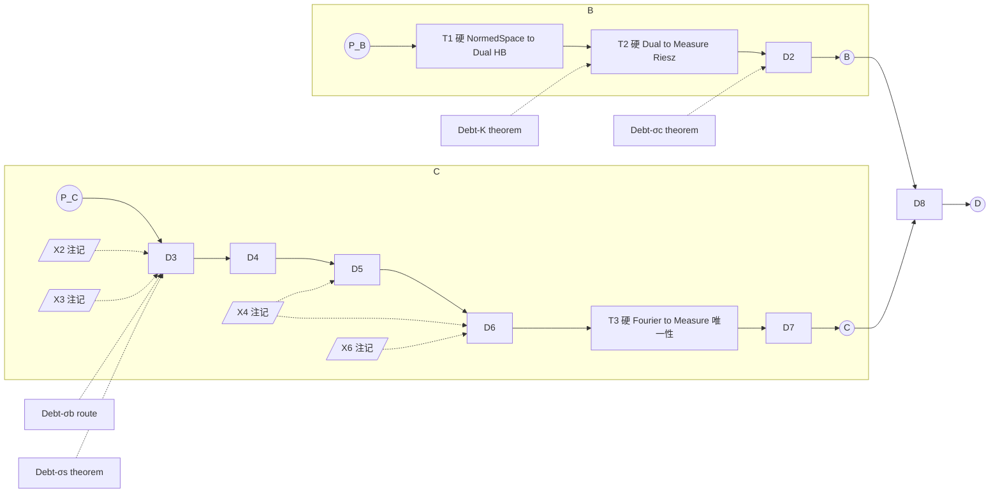

# T18 工作网 v1.2（round3 修正 C19 简图；round2 补丁 R2-1…R2-8，依据 Astra round2 推荐；v1 备份 work-net-v1.md，v0 备份 work-net-v0.md）

- object_ref: /workspace/rdtx-criteria/objects/T18-hahn-banach/object.md (v1)
- criteria_ref: /workspace/rdtx-criteria/criteria/v0.1.md
- 分支：A / B / C / D / opt
- 全局前提：标量域为 ℝ（object.md v1，见 P5）
- 本网**专门用来检验硬 T**：主链是 函数空间 → 对偶 → 测度 → Fourier → 测度。

## 符号约定
- $K=I_n$；$E=C(K)$；$S=S_\sigma$。
- 零延拓：$\mu\in M(K)$ 延拓为 $\tilde\mu\in M(\mathbb R^n)$，其中 $\tilde\mu(A)=\mu(A\cap K)$。Fourier 变换为 $\hat{\tilde\mu}(\xi)=\int_{\mathbb R^n}e^{-i\xi^Tx}d\tilde\mu=\int_K e^{-i\xi^Tx}d\mu$。
- $H_{y,\theta}=\{y^Tx+\theta>0\}$，$\Pi_{y,\theta}=\{y^Tx+\theta=0\}$。
- 推前测度：$\mu_y=(x\mapsto y^Tx)_\#\mu\in M(\mathbb R)$。

## R 节点（P2：carrier_type 与隐含载荷）
| id | 分支 | carrier_type | 隐含载荷 | 合法对象 | 合法算子 |
|---|---|---|---|---|---|
| R_fun | A, B, D | NormedSpace（A：一般实赋范空间 E；B/D：具体的 $C(K)$） | 无 | E、子空间 S、闭包 | 线性组合、范数估计、取闭包 |
| R_dual | A, B | DualFunctional | 无 | $E^*$ 中的元素，零化子 $S^\perp$ | 线性、连续性、求值 |
| R_meas | B, C | Measure，临时子类型（R2-7，C22）：Measure(K)=$M(K)$、Measure(ℝⁿ)=$M(\mathbb R^n)$（零延拓）、Measure(ℝ)=$M(\mathbb R)$（推前） | 无 | 有限带号正则 Borel 测度 | 积分、有界收敛（对 $|\mu|$）、推前、零延拓、π-λ |
| R_four | C | FourierFunction（$\mathbb R^n\to\mathbb C$） | **无**（不携带 μ，P1） | 函数 f，**并附显式关系 $f=\hat\nu$**，其中 ν∈Measure(ℝⁿ) 作为 T3 的显式输入（R2-1，C17） | 逐点求值、恒等于零的判定 |
| R_app | opt | — | — | 具体网络结构 | — |

## X 宏
| id | 分支 | 类型 | 展开 |
|---|---|---|---|
| X1 | B | 见证：反设 | 设 $\overline S\ne C(K)$ |
| X2 | C | 见证：缩放族 | $\sigma_\lambda(x)=\sigma(\lambda(y^Tx+\theta)+\varphi)=\sigma(y'^Tx+\theta')$，其中 $y'=\lambda y$，$\theta'=\lambda\theta+\varphi$（C02） |
| X3 | C | 定义：极限函数 | γ = 1（在 H 上），σ(φ)（在 Π 上），0（其它） |
| X4 | C | 定义：推前测度（P4，仍归 X） | 对每个 y，$\mu_y=(x\mapsto y^Tx)_\#\mu$，满足 $\int_K h(y^Tx)d\mu=\int_{\mathbb R}h\,d\mu_y$ |
| X5 | D | 定义：判别型 | 见 object.md |
| X6 | C | 定义性计算（原 T4，P1） | 零延拓 $\tilde\mu$，并定义 $\hat{\tilde\mu}(\xi):=\int_K\cos(\xi^Tx)d\mu-i\int_K\sin(\xi^Tx)d\mu$（实测度上的复值辅助量） |

## D 边
| id | 分支 | R | 前提 → 结论 |
|---|---|---|---|
| D1 | A(⇒) | R_dual | $\overline S=E$，$L\in E^*$，$L|_S=0$ ⇒ 由连续性得 $L|_{\overline S}=0$ ⇒ $L=0$ |
| D2 | B | R_meas | **前提**：X1；T1 给出 $L\ne0$，$L|_{\overline S}=0$；T2 给出 μ（$L=\int\cdot\,d\mu$，μ≠0，由 Riesz 等距）；Debt-σc。**推导**：$\sigma(y^T\cdot+\theta)\in S$ ⇒ 对所有 y、θ 有 $\int\sigma(y^Tx+\theta)d\mu=0$ ⇒ 由判别型得 μ=0，矛盾 ⇒ (B) |
| D3 | C | R_meas | **前提**：任意 $\mu\in M(K)$，且对所有 y′、θ′ 有 $\int\sigma(y'^Tx+\theta')d\mu=0$（C02/C14）。**推导**：固定 y、θ、φ（R2-5，C21），由 X2 的参数替换，对所有 λ>0 有 $\int\sigma_\lambda d\mu=0$；令 λ→+∞，sigmoidal 给出 $\sigma_\lambda\to\gamma$ 逐点成立，$|\sigma_\lambda|\le\|\sigma\|_\infty$，$|\mu|(K)<\infty$ ⇒ 由有界收敛得 $\mu(H)+\sigma(\varphi)\mu(\Pi)=0$ |
| D4 | C | R_meas | 固定 y、θ：D3 对每个 φ∈ℝ 成立（先取完 λ→∞，再动 φ）；令 φ→+∞ 得 $\mu(H)+\mu(\Pi)=0$，令 φ→−∞ 得 $\mu(H)=0$ ⇒ 对所有 y、θ 有 $\mu(\Pi)=0$ 且 $\mu(H)=0$ |
| D5 | C | R_meas | （P4）由 D4：对 y 固定、所有 t，$\mu_y((t,\infty))=\mu(H_{y,-t})=0$，$\mu_y(\{t\})=\mu(\Pi_{y,-t})=0$ ⇒ 所有区间 $(a,b]$、$(a,b)$、$[a,b]$ 及半无限区间的 $\mu_y$-测度都为 0（作差即可；y=0 时 $\mu_y=\mu(K)\delta_0$，而 $\mu(K)=\mu(H_{0,1})=0$）。区间族是 π 系，生成 $\mathcal B(\mathbb R)$；对有限带号测度 $\mu_y$ 用 Jordan 分解，正部与负部在 π 系上一致 ⇒ 由 π-λ 得 $\mu_y=0$ |
| D6 | C | R_meas | 由 D5、X4、X6（取 $\nu=\tilde\mu$，$f=\hat\nu$）：$\int_K\cos(y^Tx)d\mu=\int\cos d\mu_y=0$，sin 同理 ⇒ 对所有 y 有 $\hat{\tilde\mu}(y)=0$。即把 $(f\equiv0,\ f=\hat\nu,\ \nu=\tilde\mu)$ 交给 T3 |
| D7 | C | R_meas | 由 T3 得 $\tilde\mu=0$ ⇒ $\mu=\tilde\mu|_K=0$。μ 任意 ⇒ σ 判别型 ⇒ (C) |
| D8 | D | R_fun | 连续 + sigmoidal ⇒ 有界可测 ⇒ 由 (C) 得判别型 ⇒ 由 (B) 得稠密 ⇒ (D) |

## T 边（P2 typed certificate）
| id | 源载体 → 目标载体 | 保持引理（精确陈述） | 量词 | 分支 | 重建映射 | 端点 | 判定 |
|---|---|---|---|---|---|---|---|
| T1 | NormedSpace → DualFunctional | Hahn–Banach 零化子推论：实赋范空间 E 和子空间 S，若 $\overline S\ne E$，则存在 $L\in E^*$，$L\ne0$，$L|_{\overline S}=0$ | ∀E∀S；∃L | A(⇐)、B | 稠密性 ⟸ 零化子平凡 | 见端点表 | 硬 |
| T2 | DualFunctional → Measure | Riesz–Markov（K 紧 Hausdorff）：每个 $L\in C(K)^*$ 唯一对应 $\mu\in M(K)$，$L(h)=\int h\,d\mu$，$\|L\|=|\mu|(K)$ | ∀L；∃!μ | **仅 B**（E=C(K)，C08） | $L\mapsto\mu$，逆映射为积分 | 见端点表 | 硬 |
| T3 | FourierFunction(+显式 ν) → Measure(ℝⁿ) | 给定显式 $\nu\in M(\mathbb R^n)$ 且 $f=\hat\nu$：若 $f\equiv0$ 则 ν=0（带号情形：$\widehat{\nu^+}=\widehat{\nu^-}$，取 ξ=0 得总质量相等，由有限正测度唯一性得 $\nu^+=\nu^-$） | ∀ν∈M(ℝⁿ) | C | $\mu=\nu|_K$（R2-1） | 见端点表 | 硬 |
| ~~T4~~ | — | 降为 X6（定义性计算，被 D6 消费，所以不是 view）。round1b q1 | — | — | — | — | — |

规范化保持引理签名集合（P8，用于跨网比较）：{HB 零化子推论 (NormedSpace→DualFunctional)，Riesz–Markov (DualFunctional→Measure, C(K))，Fourier 唯一性 (FourierFunction→Measure, M(ℝⁿ))}。

## 非核心
| id | 类型 | 内容 |
|---|---|---|
| view-1 | view | 「判别型」⇔ 测度由它在半空间上的值（Radon 变换）决定。证明不消费它 |
| App-1 | App | 把 (D) 套用到单隐层 sigmoid 网络。App-Debt：激活取连续 sigmoidal（例如 logistic）。**不声称**：逼近速率、宽度界、ℝⁿ 全域逼近、训练可达性（R2-8，C24） |

## Debt 闭包（P3：debt_kind / failure_target）
| id | 分支 | 假设 | debt_kind | 消费者 | failure_target 与失败模式 |
|---|---|---|---|---|---|
| Debt-K | B, D | 定义域 K 紧 | theorem-Debt | T2，以及 sup 范数有限 | 失败的是定理结论（R2-2，C11 自包含反例）：n=1，把 $I_1$ 换成 ℝ，取 $C_b(\mathbb R)$ 的 sup 范数，**σ 连续且 sigmoidal（其余前提不变）**。每个 $g=\sum c_j\sigma(y_jx+\theta_j)$ 在 ±∞ 都有有限极限（$y_j>0$ 的项趋于 $c_j$ 或 0，$y_j<0$ 的反过来，$y_j=0$ 的是常数）。一致极限保持「±∞ 有极限」这一性质（Cauchy 判别），而 $\sin x$ 在 +∞ 没有极限 ⇒ $\sin\notin\overline{S_\sigma}$，稠密性失败。辅助说明：MO 316760 |
| Debt-σc | B | σ 连续 | theorem-Debt（陈述前提） | D2 | 失败的是陈述：σ 取 Heaviside 时 $S\not\subset C(K)$，(B) 失去意义 |
| Debt-σb | C | σ 有界、可测 | **route-Debt** | D3（有界收敛的控制函数） | 失败的是路线：去掉有界性（其余前提不变，仍可测且 sigmoidal）后 D3 失效。具体例子（R2-6，C23）：$\sigma(t)=\mathbf 1_{t>0}+|t|^{-1/2}\mathbf 1_{0<|t|<1}$（σ(0)=0）可测、sigmoidal，但无界，于是 $\{\sigma_\lambda\}$ 没有一致界，D3 的控制函数 $\|\sigma\|_\infty$ 不存在。**不声称** (C) 失败；ReLU 不满足 sigmoidal，不能作为同前提反例（C10） |
| Debt-σs | C | σ sigmoidal | theorem-Debt（对 (C) 的这一陈述） | D3、D4 | 失败的是定理结论：σ≡c 时，$\mu=\delta_0-\delta_{e_1}$ 满足 $\int c\,d\mu=0$ 但 μ≠0 |
| ~~Debt-R~~ | — | 实标量 | 全局前提（P5，object.md） | T1、T2、全部 R 节点 | 不再列为局部 Debt |
| （派生） | C | $|\mu|(K)<\infty$ | — | D3、D5 | 由 $M(K)$ 的定义得到，不算 Debt |

## 关键依赖偏序（R2-3/R2-4：X 不作偏序节点，起始前提单独成节点）
- 起始前提节点：P_A=「$\overline S\ne E$（反设）」；P_B=「σ 连续、判别型，且 X1 反设 $\overline S\ne C(K)$」；P_C=「任意 μ∈M(K)，对所有 y′、θ′ 有 $\int\sigma(y'^Tx+\theta')d\mu=0$；σ 有界可测且 sigmoidal」
- **A**：P_A ≺ T1 ≺ (A ⇐)；D1 ≺ (A ⇒)
- **B**：P_B ≺ T1 ≺ T2 ≺ D2。D2 消费：T1 给出的 $L\ne0$ 与 $L|_{\overline S}=0$、T2 给出的 μ≠0、Debt-σc
- **C**：P_C ≺ D3 ≺ D4 ≺ D5 ≺ D6 ≺ T3 ≺ D7。边注记：D3 用 X2、X3；D5 用 X4；D6 用 X4、X6
- **D**：(B)、(C) ≺ D8

## 证据端点（R2-? C20：每条只选一个定位，并写覆盖声明；未核对的标 partial·待核）
| 边 | 端点（唯一定位） | 覆盖声明 | 等级 | 来源 |
|---|---|---|---|---|
| T1、T2、D2 的调用 | Cybenko 1989 定理 1 原文 | 只覆盖调用顺序 | partial | 外部 |
| T1 保持引理 | Rudin《Functional Analysis》2nd ed. Thm 3.5 | 实或复赋范（局部凸）空间 X，子空间 M，$x_0\notin\overline M$ ⇒ ∃f∈X*，f|_M=0，$f(x_0)=1$。覆盖 A(⇐)、B，实标量 | partial·待核 | 外部 |
| T2 保持引理 | Rudin《Real and Complex Analysis》3rd ed. Thm 6.19 | 局部紧 Hausdorff X，$C_0(X)^*$ 等距同构于正则复 Borel 测度。紧 K 时 $C_0=C$；实泛函对应实测度。只覆盖 B | partial·待核 | 外部 |
| T3 保持引理 | Billingsley《Probability and Measure》3rd ed. §29（ℝᵏ 上特征函数唯一确定分布） | 覆盖 ℝⁿ 上的有限正测度（概率测度归一化后）；带号情形由 T3 证书中的 Jordan 论证补齐；只覆盖 C | partial·待核 | 外部 |
| D3、D4 | MSE 3821313 采纳答案 | σ_λ → 半空间指示，有界收敛 | complete | 外部 |
| D5、D6、D1、D7、D8 | 本网行内的证明 | 全部 | complete | 非外部·自包含 |
| Debt-K 的失败模式 | 本网 Debt-K 行内的证明（MO 316760 作辅助） | n=1，连续 sigmoidal，sin 反例 | complete | 非外部·自包含 |
| Debt-σb、Debt-σs 的失败模式 | 本网行内 | 具体函数和测度 | complete | 非外部·自包含 |

## 简图
（C19：图中只有实线箭头表示偏序；X 宏和 Debt 用虚线表示边注记，不参与可达关系）

## round1 争议处理索引
- 已修：C01、C02、C03、C04、C05、C06、C07、C08、C09、C10、C14、C15（复值辅助量见 object.md P5 / X6）
- 部分修复：C12（端点升为 partial·待核）、C13（D5/D6 改为自包含证明）
- 未结：C11（Debt-K 的反例前提）、C16（交给准则 v0.1 的 I3/P8；需要用等价变体网实测）

## round2 处理索引（v1.1）
- R2-1 C17：T3 证书显式加入 ν 和 f=ν̂，并写出带号情形的 Jordan 论证
- R2-2 C11：Debt-K 改用自包含 sin 反例，其余前提不变
- R2-3 C18、R2-4 C19：起始前提单独成节点 P_A/P_B/P_C；X 只作边注记
- R2-5 C21：D3/D4 写明固定参数和取极限次序
- R2-6 C23：Debt-σb 给出具体的无界可测 sigmoidal 函数
- R2-7 C22：Measure 采用临时子类型枚举（只在对象级使用；准则 §7 的最终枚举仍然暂缓）
- R2-8 C24：App-1 加上 App-Debt 和「不声称」
- C20：每条端点只选一个定位并写覆盖声明，仍标 partial·待核（教材原文未逐字核对）
- C16：仍需等价变体网实测（Layer C），未结
