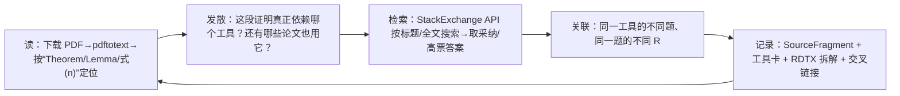
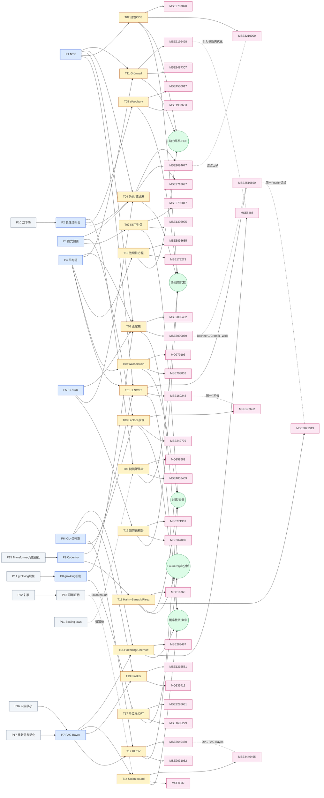

# 深度学习 / 大模型“为什么有效”的理论文献 × 数学工具 × 习题地图

> 面向 mathscape 的研究报告（R/D/T/X 视角） · 生成日期：2026-10-15（Asia/Shanghai）
>
> 关键词：NTK、良性过拟合、梯度下降的隐式偏置、平均场 / Wasserstein 梯度流、上下文学习（ICL）、PAC-Bayes、grokking、万能逼近

---

## 0. 一页摘要

**做了什么。** 按“读 → 发散 → 检索 → 关联 → 记录”的循环：

1. 收集了 **17 篇**“解释深度学习为何有效”的代表性论文（全部经 arXiv / Springer 页面核验题名、作者、年份）；其中 **9 篇深读**（NTK、良性过拟合、隐式偏置、平均场、ICL≈GD、ICL≈贝叶斯推断、非空 PAC-Bayes 界、grokking 的机制解释、Cybenko 万能逼近）。
2. 在深读论文中，**逐段摘录“重度依赖某个数学工具”的片段**（带章节 / 公式编号定位），归纳出 **18 个数学工具**（另列出 8 个“已识别但未配题”的工具）。
3. 每个工具在 Math.StackExchange / MathOverflow 上各选 **2 道主题**（共 **36 道主题**，另附 6 道延伸题，合计 42 个链接），依据**真实的采纳答案或高票答案**总结解法，并用附件中的 **R/D/T/X 解释正规形**拆解其方法。
4. 建立知识地图：论文 → 工具 → 理论族 → 习题 的 Mermaid 图，以及一节“交叉链接”，列出跨论文、跨习题反复出现的**可复用宏（X）与表示运输（T）**。

**核心发现（对 mathscape 最有用的 5 条）：**

| # | 发现 | 体现在 |
|---|---|---|
| 1 | “**和式被最大项支配**”（Laplace 原理 / log-sum-exp）是同一个 X 宏，横跨隐式偏置、贝叶斯 ICL、$L^p\to L^\infty$、Poisson-CLT 的解析证明 | Soudry 式(5)、Xie 式(6)、MSE 242779、197602、160248 |
| 2 | “**谱滤波**”是一个统一表示：梯度流 $e^{-t\lambda}$、岭回归 $\sigma^2/(\sigma^2+\alpha^2)$、截断 SVD、伪逆、MP 负矩，都是“对奇异值做一个函数” | NTK §5、Bartlett 定义 2 与引理 8、MSE 1084677、4052469 |
| 3 | “**Fourier 正性**”是一个跨领域的 T：核正定（Bochner）、Cramér–Wold 反例、Cybenko 引理 1、grokking 的模加法算法，都把问题运输到频域 | MSE 3090069、2516690、3821313；Nanda §3.1 |
| 4 | “**对偶 / 变分表示**”（KKT、Donsker–Varadhan、Hahn–Banach、Kantorovich）是从“难的原问题”到“可检验证书”的标准 T | Soudry 式(6)、Dziugaite 定理 2.3、Cybenko 定理 1 |
| 5 | “**LLN/集中 + Grönwall = 混沌传播**”是一条长链宏：NTK 定理 2 与平均场定理 3 用的是同一骨架 | Jacot 附录 A.2、Mei SI 引理 7.2 |

**附带的“对齐债务”（alignment debt）实例**：在阅读中发现两处原文笔误，正好是附件规范 §12.4 所说“形式/文字与原意不一致”的真实样例（见 §3.6、§3.8 与 §6.4）。

---

## 1. 方法：循环流程与 R/D/T/X 速记

### 1.1 循环流程（本报告实际执行的）

### 1.2 R/D/T/X 速记（取自附件《解释正规形 ENF》与《统一构建规范》）

| 符号 | 含义 | 本报告里的写法 |
|---|---|---|
| **R** | 表示：可见对象、合法状态、正规形、可用算子、代价 | `R_spec`（谱表示）、`R_prob`（概率表示）、`R_dual`（对偶表示）…… |
| **D** | 固定表示内的推理超边（AND 前提；证书方向：前提 ⇒ 结论） | “D：Jensen”“D：配方” |
| **T** | 跨表示运输，必须有“重建证书” $[\![t]\!]_{R'}\Rightarrow[\![s]\!]_R$ | “T：$R_{\text{sum}}\to R_{\text{prob}}$（把级数看成 Poisson 概率）” |
| **X** | 图扩展：引入定义 / 引理 / 见证 / 接口 / 桥 | “X(见证)：$v=(3,3,-2,-2,-2)$” |
| **Debt** | side debt：正性、非零、可积、可交换极限、支撑、对齐…… | “Debt：DCT 需要控制函数” |
| **L0 / L1** | L0 发现图（为什么这样想）；L1 证书图（隐藏义务） | 每题给 L0 主线 + L1 债务 |

**压缩节点**：附件 §6 的结论——“妙证明”通常 (i) 选一个让问题族增长率下降的 R/T；(ii) 创建少数 X，把剩余证明压成低维关系。每道题都标出它的“压缩节点”。

### 1.3 数据来源与核验

* 论文：arXiv PDF（`pdftotext -layout`）+ arXiv HTML 页面；Cybenko 1989 用 Springer DOI 页与公开镜像中的定理 1 证明片段。
* 习题：Stack Exchange API（`/search/advanced`、`/questions/{ids}`、`/answers?filter=withbody`）取原文；**每个题目链接均用 WebFetch 打开核验**（Math.SE 对盒子的 curl 返回 403，但 WebFetch 正常返回题面与答案）。
* 片段引用采用“意译 + 关键公式原样”的方式，并标注定位（节 / 式 / 定理编号）。

---

## 2. 论文清单（17 篇，均已核验）

> “深度”列：★★★ = 深读并逐段提取工具；★ = 列入地图、只做定位。

| # | 论文 | 作者 | 年 | 链接 | 主题 | 深度 |
|---|---|---|---|---|---|---|
| P1 | Neural Tangent Kernel: Convergence and Generalization in Neural Networks | A. Jacot, F. Gabriel, C. Hongler | 2018 | https://arxiv.org/abs/1806.07572 | 无限宽极限、核梯度流 | ★★★ |
| P2 | Benign Overfitting in Linear Regression | P. L. Bartlett, P. M. Long, G. Lugosi, A. Tsigler | 2019 | https://arxiv.org/abs/1906.11300 | 最小范数插值、有效秩 | ★★★ |
| P3 | The Implicit Bias of Gradient Descent on Separable Data | D. Soudry, E. Hoffer, M. S. Nacson, S. Gunasekar, N. Srebro | 2017 | https://arxiv.org/abs/1710.10345 | GD → 最大间隔方向 | ★★★ |
| P4 | A Mean Field View of the Landscape of Two-Layers Neural Networks | S. Mei, A. Montanari, P.-M. Nguyen | 2018 | https://arxiv.org/abs/1804.06561 | 分布动力学 PDE、Wasserstein 梯度流 | ★★★ |
| P5 | Transformers learn in-context by gradient descent | J. von Oswald 等 7 人 | 2022 | https://arxiv.org/abs/2212.07677 | 线性自注意力 = 一步 GD | ★★★ |
| P6 | An Explanation of In-context Learning as Implicit Bayesian Inference | S. M. Xie, A. Raghunathan, P. Liang, T. Ma | 2021 | https://arxiv.org/abs/2111.02080 | ICL = 潜概念后验集中 | ★★★ |
| P7 | Computing Nonvacuous Generalization Bounds for Deep (Stochastic) Neural Networks with Many More Parameters than Training Data | G. K. Dziugaite, D. M. Roy | 2017 | https://arxiv.org/abs/1703.11008 | 非空 PAC-Bayes 界、平坦极小 | ★★★ |
| P8 | Progress measures for grokking via mechanistic interpretability | N. Nanda, L. Chan, T. Lieberum, J. Smith, J. Steinhardt | 2023 | https://arxiv.org/abs/2301.05217 | grokking 的 Fourier 乘法算法 | ★★★ |
| P9 | Approximation by superpositions of a sigmoidal function | G. Cybenko | 1989 | https://link.springer.com/article/10.1007/BF02551274 （DOI 10.1007/BF02551274） | 万能逼近 | ★★★ |
| P10 | Reconciling modern machine learning practice and the bias-variance trade-off | M. Belkin, D. Hsu, S. Ma, S. Mandal | 2018 | https://arxiv.org/abs/1812.11118 | 双下降 | ★ |
| P11 | Scaling Laws for Neural Language Models | J. Kaplan 等 10 人 | 2020 | https://arxiv.org/abs/2001.08361 | 幂律缩放 | ★ |
| P12 | The Lottery Ticket Hypothesis: Finding Sparse, Trainable Neural Networks | J. Frankle, M. Carbin | 2018 | https://arxiv.org/abs/1803.03635 | 彩票假说（经验） | ★ |
| P13 | Proving the Lottery Ticket Hypothesis: Pruning is All You Need | E. Malach, G. Yehudai, S. Shalev-Shwartz, O. Shamir | 2020 | https://arxiv.org/abs/2002.00585 | 彩票假说（证明） | ★ |
| P14 | Grokking: Generalization Beyond Overfitting on Small Algorithmic Datasets | A. Power, Y. Burda, H. Edwards, I. Babuschkin, V. Misra | 2022 | https://arxiv.org/abs/2201.02177 | grokking 现象 | ★ |
| P15 | Are Transformers universal approximators of sequence-to-sequence functions? | C. Yun, S. Bhojanapalli, A. S. Rawat, S. J. Reddi, S. Kumar | 2019 | https://arxiv.org/abs/1912.10077 | Transformer 表达力 | ★ |
| P16 | On Large-Batch Training for Deep Learning: Generalization Gap and Sharp Minima | N. S. Keskar 等 5 人 | 2016 | https://arxiv.org/abs/1609.04836 | 尖锐 / 平坦极小 | ★ |
| P17 | Understanding deep learning requires rethinking generalization | C. Zhang, S. Bengio, M. Hardt, B. Recht, O. Vinyals | 2016 | https://arxiv.org/abs/1611.03530 | 随机标签实验、容量悖论 | ★ |

> 年份按 arXiv 首次提交日期（Cybenko 为期刊年份）。P10–P17 不做逐段工具提取，但在地图中标出与深读论文的关系（例如 P10/P17 是 P2/P7 的动机，P14 是 P8 的对象，P16 是 P7 的“平坦极小”背景）。

---

## 3. 深读：9 篇论文的“工具片段”提取

> 每篇给出：**一句话主张** → **工具片段表**（定位 / 片段 / 工具 / 背后理论）→ **全文论证的 R/D/T/X 骨架** → **隐藏债务**。工具编号 `T01…T18` 对应 §4 的工具卡。

### 3.1 P1 · Jacot–Gabriel–Hongler 2018：Neural Tangent Kernel

**一句话主张。** 无限宽极限下，参数空间里的非凸 GD 等价于**函数空间里的核梯度下降**，核（NTK）在初始化时确定且训练中不变；收敛性归结为 NTK 的正定性。

| 定位 | 片段（意译 / 原式） | 工具 | 背后理论 |
|---|---|---|---|
| §3.1 | 随机特征 $f^{\text{lin}}_\theta=\frac1{\sqrt P}\sum_p\theta_pf^{(p)}$ 上做 GD，等价于用切核 $\tilde K=\frac1P\sum_p f^{(p)}\otimes f^{(p)}$ 做核梯度下降；“**by the law of large numbers**, the (random) tangent kernel $\tilde K$ tends to the fixed kernel $K$” | T01 LLN；T16 链式法则 / 外积 | 大数定律、经验协方差收敛 |
| 命题 1 + 附录 A.1 | 条件于前层，输出协方差 $\tilde\Sigma^{(L+1)}=\frac1{n_L}\alpha^{(L)T}\alpha^{(L)}+\beta^2$，“by the law of large numbers” → $\mathbb E_{f\sim N(0,\Sigma^{(L)})}[\sigma(f(x))\sigma(f(x'))]+\beta^2$；于是输出趋于 GP | T01 LLN / CLT（条件高斯） | 随机网络的高斯过程极限 |
| §3 | $\partial_tC(f(t))=-\|d|_{f(t)}\|_K^2$：“Convergence to a critical point of $C$ is hence guaranteed if the kernel $K$ is positive definite” | T03 正定核 | Lyapunov 函数 + 核诱导的半范数 |
| §5 | 最小二乘时 $f_t=f^*+e^{-t\Pi}(f_0-f^*)$，沿核主成分分解：$f_t=f^*+\Delta^0_f+\sum_i e^{-t\lambda_i}\Delta^i_f$；“a motivation for the use of early stopping” | T02 线性 ODE / 矩阵指数 | 线性系统的谱分解、谱滤波 |
| §5 | 假设 Gram 矩阵可逆，$f_{\infty,k}(x)=\kappa^T_{x,k}\tilde K^{-1}y^*+(f_0(x)-\kappa^T_{x,k}\tilde K^{-1}y_0)$；均值 = 高斯先验下 MAP = “kernel ridge regression … as the regularization goes to zero ($\lambda\to0$)” | T04 伪逆 / 岭回归极限；T03 | 核插值、无岭（ridgeless）回归 |
| 附录 A.2、A.3 | 用 $A(t)$ 控制权重与激活的漂移：$\partial_tA\le\frac{C}{\sqrt{n_L}}\|d_t\|A(t)$，“**Applying Grönwall's Lemma**”得 $A(t)\le A(0)\exp(\cdots/\sqrt{n_L})$；A.3 用非线性 Grönwall | T11 Grönwall | 微分不等式比较原理 |
| 命题 2 + 附录 A.4 | 引理 2：对偶激活 $\hat\mu(\rho)=\sum a_i^2\rho^i$（Hermite 展开）；定理 3（Gneiting / Schoenberg）：$f(x^Tx')=\sum b_n\rho^n$ 在所有球面上正定 ⇔ 无穷多个偶数和奇数 $n$ 有 $b_n>0$；非多项式 σ ⇒ 无穷多个非零系数 ⇒ NTK 在球面上正定 | T03 Schoenberg 定理；（未配题）Hermite 展开 | 球面上的正定函数、调和分析 |

**论证骨架（R/D/T/X）。**

* `R_param`（参数空间，非凸）→ **T**：链式法则把 $\partial_t\theta$ 推到 $\partial_tf$，得到 `R_func`（函数空间，代价凸）。重建证书：$\partial_tf_\theta=-\nabla_{\Theta}C$ 对每个 $t$ 成立。
* **X(定义)**：NTK $\Theta^{(L)}=\sum_p\partial_{\theta_p}F\otimes\partial_{\theta_p}F$。
* **D**：LLN（初始化）+ Grönwall（训练期间漂移 $O(1/\sqrt n)$）⇒ $\Theta(t)\to\Theta_\infty$。
* **T**：`R_func` → `R_spec`（核主成分）：线性 ODE 在特征基下变成解耦标量 ODE $\dot c_i=-\lambda_ic_i$。
* **D**：正定性 ⇐ Schoenberg 判据 ⇐ Hermite 系数非零 ⇐ σ 非多项式。

**隐藏债务。** (i) 宽度逐层**依次**取极限（“sequentially”），而非同时；(ii) σ Lipschitz 且二阶可导、二阶导有界（脚注 1 说“似乎不严格需要”）；(iii) 正定性只在**球面**数据上证明；(iv) $\int_0^T\|d_t\|dt$ 需随机有界（最小二乘自动满足）。

---

### 3.2 P2 · Bartlett–Long–Lugosi–Tsigler 2019：良性过拟合

**一句话主张。** 线性回归中，最小范数插值的超额风险由协方差的两个“有效秩” $r_k,R_k$ 刻画；当且仅当低方差方向足够多（显著过参数化）时，把噪声“藏进”这些方向才是无害的。

| 定位 | 片段 | 工具 | 背后理论 |
|---|---|---|---|
| 定义 2 / 式(1) | “By the **projection theorem** … $\hat\theta=(X^TX)^\dagger X^Ty=X^T(XX^T)^{-1}y$” | T04 Moore–Penrose 伪逆 / 最小范数解 | Hilbert 空间投影定理 |
| 定义 3 | $r_k(\Sigma)=\frac{\sum_{i>k}\lambda_i}{\lambda_{k+1}}$，$R_k(\Sigma)=\frac{(\sum_{i>k}\lambda_i)^2}{\sum_{i>k}\lambda_i^2}$ | T06（谱统计量） | “稳定秩 / 数值秩”（附录 H） |
| 引理 7 | $R(\hat\theta)\le2\theta^{*T}B\theta^*+c\sigma^2\log\frac1\delta\operatorname{tr}(C)$，$C=(XX^T)^{-1}X\Sigma X^T(XX^T)^{-1}$；“The heart of the proof is controlling $\operatorname{tr}(C)$” | T04、T15（Hanson–Wright 型集中，引理 19） | 偏差-方差分解 |
| 引理 8 + 附录 B 引理 20 | $\operatorname{tr}(C)=\sum_i\lambda_i^2z_i^TA^{-2}z_i$，并 $=\frac{\lambda_i^2z_i^TA_{-i}^{-2}z_i}{(1+\lambda_iz_i^TA_{-i}^{-1}z_i)^2}$；“a consequence of the **Sherman–Woodbury–Morrison** formula”：$Z^T(ZZ^T+A)^{-2}Z=(I+Z^TA^{-1}Z)^{-1}Z^TA^{-2}Z(I+Z^TA^{-1}Z)^{-1}$ | T05 SMW | 秩一更新、留一法 |
| 引理 9、10 | 以 $1-2e^{-n/c}$ 概率：$\frac1c\sum_{i>k}\lambda_i-c\lambda_{k+1}n\le\mu_n(A_k)\le\mu_1(A_k)\le c(\sum_{i>k}\lambda_i+\lambda_{k+1}n)$（附录 C：ε-网 + Bernstein） | T06 随机矩阵谱集中；T15 | 非渐近随机矩阵理论 |
| 引理 10 证明 | “by the **Courant–Fischer–Weyl** Theorem, $\mu_j(A_{-i})\le\mu_j(A)$” | （未配题）Courant–Fischer | 特征值的极小极大刻画 |
| 引理 11 证明 | “apply Corollary 13 $l$ times, together with a **union bound**” | T14 联合界 | — |
| 第 3 节讨论 | “$p=n$ 且 $\Sigma=I$ … 由标准随机矩阵理论，$XX^T$ 的特征值都在 $n$ 的常数倍内 ⇒ $\operatorname{tr}(C)$ 有常数下界” | T06 | Marchenko–Pastur 边界 |

**论证骨架。**

* `R_estimator`（$\hat\theta$）→ **T**：投影定理把“最小范数插值”运输为闭式 $X^T(XX^T)^{-1}y$。
* **D**：风险 = 偏差项 $B$ + 方差项 $C$。
* **T**：`R_matrix` → `R_spec`：在 Σ 的特征基里写 $XX^T=\sum\lambda_iz_iz_i^T$。
* **X(桥)**：SMW 把“第 $i$ 个方向的贡献”拆成 **与 $z_i$ 独立的** $A_{-i}$ 上的二次型（独立性是后续集中不等式的关键前提）。
* **D**：随机矩阵谱集中 + 二次型集中 + 联合界 ⇒ $\operatorname{tr}(C)\asymp\frac{k^*}n+\frac n{R_{k^*}}$。

**隐藏债务。** (i) 协变量必须是“线性变换后的独立分量”（第 4 节明确说这排除了 NTK 情形）；(ii) 假设 5：去掉任一特征方向后数据仍张成 $n$ 维（保证 $A_{-i}$ 可逆，SMW 才能用）；(iii) 常数 $b,c$ 只依赖 $\sigma_x$。

---

### 3.3 P3 · Soudry 等 2017：可分数据上 GD 的隐式偏置

**一句话主张。** 指数尾损失（logistic / 交叉熵）在线性可分数据上做 GD，方向收敛到 **L2 最大间隔（硬间隔 SVM）解**，但速度只有 $O(1/\log t)$。

| 定位 | 片段 | 工具 | 背后理论 |
|---|---|---|---|
| 定理 3 / 式(3)(4) | $w(t)=\hat w\log t+\rho(t)$，$\hat w=\arg\min\|w\|^2$ s.t. $w^Tx_n\ge1$；$\|\rho(t)\|=O(\log\log t)$ | T07 KKT（SVM） | 凸二次规划 |
| 证明概要 / 式(5) | $-\nabla\mathcal L=\sum_n\exp(-g(t)w_\infty^Tx_n)\exp(-\rho^Tx_n)x_n$；“only those samples with the largest (i.e., least negative) exponents will contribute … the ‘support vectors’” | T08 Laplace 原理 / 最大项支配 | 指数和的渐近主导 |
| 式(6) | $\hat w=\sum\alpha_nx_n$，$(\alpha_n\ge0$ 且 $\hat w^Tx_n=1)$ 或 $(\alpha_n=0$ 且 $\hat w^Tx_n>1)$：“precisely the **KKT conditions** for the SVM problem” | T07 KKT / 互补松弛 | Lagrange 对偶 |
| 证明概要末段 | 残差增量被 $C_1t^{-\nu}$（$\nu>1$）控制，“a converging series”；$\hat w[\log(t+1)-\log t]\approx\hat wt^{-1}$ 抵消梯度里主导的 $t^{-1}$ 项 | T14（$\sum t^{-\nu}<\infty$，p 级数） | 级数收敛判别 |
| 附录 A.1 | 连续时间、$\ell=e^{-u}$ 情形：$\frac12\frac d{dt}\|r\|^2\le0+\frac{C}{t^\theta}$，因 $z(e^{-z}-1)\le0$ 与 $ze^{-z}\le1$；$\theta>1$ 故 $\|r\|$ 有界 | T11 型能量估计；T08 | Lyapunov / 能量法 |
| 附录 A 定义 | $P_1=X_SX_S^+$（Moore–Penrose 伪逆给出的投影） | T04 | — |

**论证骨架。**

* `R_dynamics`（GD 迭代）→ **T**：猜测拟设 $w=\hat w\log t+\tilde w+r(t)$（**X 见证**：$\tilde w$ 满足 $\eta e^{-x_n^T\tilde w}=\alpha_n$）。
* **D**：在拟设下，梯度中支持向量项 $\approx t^{-1}\hat w$、非支持向量项 $\le t^{-\theta}$（$\theta>1$）。
* **T**：`R_dynamics` → `R_opt`（SVM 的 KKT 系统）：渐近梯度方向是支持向量的非负组合 ⇔ KKT。
* **D**：$\|r(t)\|^2$ 的增量可和 ⇒ 有界。

**隐藏债务。** (i) 线性可分；(ii) 损失导数有“紧指数尾”；(iii) 步长 $\eta<2\beta^{-1}\sigma_{\max}^{-2}$；(iv) “几乎所有数据集”假设（退化数据需附录 C 的递归 $\log^{\circ m}t$ 结构）；(v) 多分类版本作者后来补加了“式(15)有解”的假设（原版误以为可从二分类推广——这是论文自己记录的**证明债务**）。

---

### 3.4 P4 · Mei–Montanari–Nguyen 2018：两层网络的平均场视角

**一句话主张。** 宽度 $N\to\infty$、步长 $\varepsilon\to0$ 时，SGD 的参数经验分布收敛到一个**非线性 PDE（分布动力学 DD）**，它是概率测度空间里关于 $W_2$ 度量的梯度流；风险在测度空间中是凸的。

| 定位 | 片段 | 工具 | 背后理论 |
|---|---|---|---|
| 式(4)(5) | $R_N(\theta)=R_\#+\frac2N\sum V(\theta_i)+\frac1{N^2}\sum U(\theta_i,\theta_j)$ 只依赖经验分布 ⇒ $R(\rho)=R_\#+2\int V\rho+\iint U\rho\rho$；“$U$ is a symmetric positive semidefinite kernel … the risk becomes convex” | T03 半正定核；T01 | 交换对称性 → 测度表示 |
| 式(7)(8) | $\partial_t\rho_t=2\xi(t)\nabla_\theta\cdot(\rho_t\nabla_\theta\Psi(\theta;\rho_t))$，$\Psi=V+\int U\rho$；“the dynamics conserves mass locally” | T10 连续性方程 | 输运方程、守恒律 |
| 式(9)(10) | $W_2$ 用耦合定义；梯度流等价于 JKO 一步：$\rho_{t+\tau}\approx\arg\min\{R(\rho)+\frac1{2\xi\tau}W_2(\rho,\rho_t)^2\}$ | T09 Wasserstein / 最优传输 | Otto 微积分、JKO 格式 |
| §1.1 | PDE “factors out the invariance … with respect to permutations”；数据有旋转对称时可约到径向 1 维 PDE（式 13） | （T 宏：对称性约化） | 群作用与商空间 |
| 定理 3 / SI 引理 7.2 | 误差 $\le Ce^{CT}\mathsf{err}_{N,D}(z)$；SI 式(7.29)–(7.30)：“**By Gronwall's inequality**” $\Delta(t)\le Ke^{Kt}\{\varepsilon+\frac1N+Q(t)\}$；“the error grows exponentially with the time horizon $T$” | T11 Grönwall | 混沌传播（propagation of chaos, Sznitman） |
| SI 式(7.21)–(7.25) | 鞅差 $Z^i_k$ 用 **Azuma–Hoeffding** + 对 $i\le N$、$k\le t/\varepsilon$ 的**联合界** | T15、T14 | 鞅集中 |
| 式(12)、定理 4 | 带噪 SGD ↔ 加扩散项的 PDE，自由能 $F_{\beta,\lambda}=\frac12R+\frac\lambda2\int\|\theta\|^2\rho-\beta^{-1}\mathrm{Ent}(\rho)$，唯一不动点 $\rho_*\propto e^{-\beta\Psi_\lambda}$ | T12（Gibbs 变分原理） | Fokker–Planck、熵正则 |

**论证骨架。**

* `R_particles`（$N$ 个参数）→ **T**：交换对称 ⇒ 只依赖经验测度 → `R_measure`。重建证书：$R_N(\theta)=R(\hat\rho^{(N)})$。
* **X(接口)**：非线性动力学 $\bar\theta^t$（McKean–Vlasov），作为 SGD 与 PDE 之间的“桥”。
* **D**：SGD vs 非线性动力学：鞅集中 + Lipschitz + Grönwall ⇒ 轨道差 $\le Ke^{KT}\sqrt{1/N\vee\varepsilon}\,(\cdots)$。
* **T**：`R_measure` → `R_OT`（$W_2$ 几何）：PDE = 梯度流；可用 OT 工具研究收敛。

**隐藏债务。** (i) 单遍（one-pass）假设：样本不重复；(ii) A1–A3：步长函数有界 Lipschitz、激活有界且梯度次高斯、$V,U$ 梯度有界 Lipschitz；(iii) $e^{CT}$ 意味着只对**快速收敛**的情形有用；(iv) 无噪情形无一般收敛定理，只有单点质量不动点的稳定性判据（定理 6、7）。

---

### 3.5 P5 · von Oswald 等 2022：Transformer 在上下文中做梯度下降

**一句话主张。** 构造线性自注意力（LSA）权重，使一层 LSA 对 token 的更新**恰好等于**对线性回归损失做一步 GD；训练出的 LSA 权重确实收敛到该构造（相差缩放）。

| 定位 | 片段 | 工具 | 背后理论 |
|---|---|---|---|
| 式(2)(3) | $L(W)=\frac1{2N}\sum\|Wx_i-y_i\|^2$，$\Delta W=-\eta\nabla_WL=-\frac\eta N\sum(Wx_i-y_i)x_i^T$ | T16 矩阵微积分 | Frobenius 内积下的梯度 |
| 式(4) | $L(W+\Delta W)=\frac1{2N}\sum\|Wx_i-(y_i-\Delta y_i)\|^2$，$\Delta y_i=\Delta Wx_i$：“**data, and not weights, are updated**” | （T 宏：参数更新 ↔ 数据更新） | 对偶视角 |
| 附录 A.1 式(6) | $e_j\leftarrow e_j+\sum_hP_hW_{h,V}\sum_ie_{h,i}\otimes e_{h,i}W_{h,K}^TW_{h,Q}e_j$；取 $W_K=W_Q=\begin{pmatrix}I_x&0\\0&0\end{pmatrix}$，$W_V=\begin{pmatrix}0&0\\W_0&-I_y\end{pmatrix}$，$P=\frac\eta NI$ | T16（外积 / 分块矩阵） | 快速权重（fast weights）= 线性注意力 |
| 命题 1 后 “Uniqueness” | 只需乘积 $PW_V$、$W_KW_Q$ 匹配；任意缩放 $s$：$PW_Vs$ 与 $W_KW_Q/s$ 等价 | （X：规范化 / 商掉对称） | 参数化冗余 |
| 附录 A.8 / 命题 2 | MLP + LSA ⇒ 核回归一步 GD，$\hat y=\sum_iy_im(x_i)^Tm(x_\text{test})=\sum_iy_ik(x_i,x_\text{test})$（Nadaraya–Watson 核平滑） | T03 正定核 | 核方法 |
| 附录 A.10 | GD++：$H(X)=I-\gamma XX^T$，Hessian $XX^T=U\Sigma U^T$ 变为 $U(\Sigma-2\gamma\Sigma^2+\gamma^2\Sigma^3)U^T$，降低条件数 | T04/T06（谱函数演算） | 预条件、条件数 |
| 附录 A.9 | softmax 一阶近似 $e^{k^Tq}\approx1+k^Tq$，两头相减抵消偏移 | （Taylor） | — |

**论证骨架。**

* `R_weights`（显式线性模型 $W$）→ **T**：式(4) 把“更新权重”运输为“更新目标 $y_i$”→ `R_tokens`。重建证书：两边损失值逐项相等。
* **X(见证)**：分块权重矩阵 $(W_K,W_Q,W_V,P)$。
* **D**：分块乘法展开 ⇒ $e_j\leftarrow(x_j,y_j)+(0,-\Delta Wx_j)$。
* **T**：`R_tokens` → `R_kernel`：加 MLP 后是核回归 / 核平滑。

**隐藏债务。** (i) 查询 token 不进入 K/V（“minor deviation from full self-attention”），或假设 $W_0\approx0$；(ii) token 格式 $(x_j,y_j)$ 需由前一层（softmax 复制机制）构造（命题 3）；(iii) 只在无噪声、线性回归任务上验证。

---

### 3.6 P6 · Xie–Raghunathan–Liang–Ma 2021：ICL 作为隐式贝叶斯推断

**一句话主张。** 预训练分布是 HMM 混合（潜“概念” θ）；提示中的示例虽与预训练分布不匹配，但若每个示例内部关于 $\theta^*$ 的 KL 信号大于分隔符造成的误差，则后验集中于 $\theta^*$，ICL 预测渐近最优。

| 定位 | 片段 | 工具 | 背后理论 |
|---|---|---|---|
| 式(1)、§3.1 式(5)(6) | $p(y|S_n,x_\text{test})\propto\int_\theta\sum_hp(y|x,h,\theta)p(h|S_n,x,\theta)\exp(n\cdot r_n(\theta))p(\theta)d\theta$，$r_n=\frac1n\log\frac{p(S_n,x_\text{test}|\theta)}{p(S_n,x_\text{test}|\theta^*)}$；“the prompt concept is ‘selected’ as a consequence of Bayesian inference” | T08 Laplace 原理（$e^{nr_n}$ 支配）；T01（$r_n$ 是平均） | 后验集中 / Bernstein–von Mises 的替代 |
| §3.2 式(8)–(10) | 用分隔符隐状态近似分解：$p(S_n,x_\text{test}|\theta)\approx\prod_iO(1)p(O_i|\theta)$ | （马尔可夫性） | HMM 条件独立 |
| 式(11) 及下文 | $r_n(\theta)\le O(1)+\mathbb E_{O\sim p_\text{prompt}}[\log\frac{p(O|\theta)}{p(O|\theta^*)}]$，“can be written as the **difference of two KL divergences**” | T12 KL | 信息论 |
| 式(12)–(14) 条件 1 | 链式法则把 KL 拆成逐 token：$\sum_{j=1}^kKL_j(\theta^*\|\theta)>\epsilon_\text{start}+\epsilon_\text{delim}$ | T12（KL 链式法则） | — |
| 附录 C 式(45)–(47) | 用 **TV 距离凸性** 控制 $\|Tv-u\|_1<\Delta/2$，从而 argmax 不变 | （TV / 凸性） | — |
| 定理 2 式(16)(17) | KL 的二阶 Taylor：$KL_j=\frac12(\theta-\theta^*)^TI_{j,\theta^*}(\theta-\theta^*)+O(\cdot)$（Fisher 信息） | （未配题）Fisher 信息 | 局部渐近正态 |
| 引理 2 | 校准函数 $g(\delta)=\frac12((1-\delta)\log(1-\delta)+(1+\delta)\log(1+\delta))$ 把 KL 界转成 0-1 风险界；注意 $g(\delta)$ 恰为 $\mathrm{KL}(\mathrm{Bern}(\frac{1+\delta}2)\|\mathrm{Bern}(\frac12))$，Pinsker 给出 $g(\delta)\ge\delta^2/2$ | T13 Pinsker（二元 KL ↔ 偏差） | 代理损失校准 |

**论证骨架。**

* `R_LM`（语言模型的条件概率）→ **T**：假设 LM 完美拟合预训练分布 ⇒ `R_Bayes`（对潜概念的后验预测积分）。
* **X(定义)**：$r_n(\theta)$，把后验权重写成 $e^{n r_n}$。
* **D**：分隔符结构 ⇒ 近似乘积分解；LLN ⇒ $r_n\to$ KL 差 + 误差常数。
* **D**：可区分性条件 ⇒ $r_n\to$ 负常数 ⇒ $e^{nr_n}\to0$（Laplace 型选择）⇒ 只剩 $\theta^*$。

**隐藏债务。** (i) 假设 LM **精确**拟合预训练分布；(ii) 分隔符隐状态 1–5 条正则性假设（下界 $c_1\ldots c_8$）；(iii) 实验中提示起始分布并不满足假设 3（作者明说“may not satisfy … but works empirically”）；(iv) 极限与积分交换需要有界性（文中脚注 4 指出用控制收敛）。

---

### 3.7 P7 · Dziugaite–Roy 2017：深度随机网络的非空泛化界

**一句话主张。** 从 SGD 解出发，直接**优化 PAC-Bayes 界**（对角高斯后验、以随机初始化为先验均值），在二分类 MNIST 上得到 16–22% 的**非空**测试误差上界，并与“平坦极小”联系。

| 定位 | 片段 | 工具 | 背后理论 |
|---|---|---|---|
| §2.1 式(1) | $\mathrm{KL}(N_q\|N_p)=\frac12(\mathrm{tr}(\Sigma_p^{-1}\Sigma_q)-k+(\mu_p-\mu_q)^T\Sigma_p^{-1}(\mu_p-\mu_q)+\ln\frac{\det\Sigma_p}{\det\Sigma_q})$ | T12 KL（高斯闭式） | 指数族 |
| §2.2 式(2) | $\mathrm{KL}^{-1}(q|c)=\sup\{p:\mathrm{KL}(q\|p)\le c\}$；用 “the well-known inequality $2(q-p)^2\le\mathrm{KL}(q\|p)$” 得 $\mathrm{KL}^{-1}(q|c)\le q+\sqrt{c/2}$；并指出 $q\approx0$ 时此界很松（真值 $\approx c$ 而界是 $\Theta(\sqrt c)$） | T13 Pinsker | 二元 KL 与 TV |
| 定理 2.2 | “derived from the **KL formulation of the Chernoff bound**”：$\mathrm{KL}(\frac1n\sum x_i\|p)\le\frac{\log(2/\delta)}n$ | T15 Chernoff | 大偏差 |
| 定理 2.3 | PAC-Bayes（McAllester / Langford–Seeger）：$\mathrm{KL}(\hat e(Q,S_m)\|e(Q))\le\frac{\mathrm{KL}(Q\|P)+\log\frac m\delta}{m-1}$ | T12（Donsker–Varadhan 变分式是其证明核心） | 变分不等式 + 集中 |
| §3.1 式(5) | 先验方差 $\lambda=c\exp\{-j/b\}$；每个 $j$ 分配概率 $\propto\frac6{\pi^2j^2}$，“by the **union bound**”一致成立；式(5) 中出现 $2\log(b\log\frac c\lambda)+\log\frac{\pi^2m}{6\delta}$ | T14 联合界 + $\sum1/j^2=\pi^2/6$ | 可数网格上的分层 |
| §3.2 | $\breve e(h_{w+\xi\odot\sqrt s},S_m)$，$\xi\sim N(0,I)$ 作为无偏梯度估计（重参数化） | （随机梯度） | — |
| 附录 B 引理 B.1 | 对称化 $Q^{\mathbb S}$：$\mathrm{KL}(Q^{\mathbb S}\|P)=\mathrm{KL}(Q\|P)-\mathrm{KL}(Q\|Q^{\mathbb S})$；改进上限 $\log|\mathbb S|$ | T12 | 群平均 |

> **对齐债务样例（D-1）**：§3.1 正文写“If the PAC-Bayes bound for each $j$ is designed to hold with probability at least $1-\frac{6}{\pi^2j^2}$ …… it will hold uniformly …… with probability at least $1-\delta$”。按字面，$\sum_j\frac6{\pi^2j^2}=1$，联合界只能给出平凡结论；与式(5)中的 $\log\frac{\pi^2m}{6\delta}+2\log j$ 一致的应是 $\delta_j=\frac{6\delta}{\pi^2j^2}$（$\log\frac m{\delta_j}=\log\frac{\pi^2m}{6\delta}+2\log j$）。即正文漏写了 δ，公式本身是对的。（PDF 的 pdftotext 抽取在此处也是乱码，HTML 版本可读。）

**论证骨架。**

* `R_network`（确定性网络，VC 界空洞）→ **T**：换成随机网络 $Q=N(w,\mathrm{diag}(s))$ → `R_PAC-Bayes`。重建证书：对有界损失，Fubini 给出“随机扰动网络”的期望误差界。
* **X(接口)**：先验 $P=N(w_0,\lambda I)$，均值放在**随机初始化**而非 0（附录 B 解释：打破对称）。
* **D**：Pinsker 松弛 ⇒ 可微目标 → SGD 优化 $(w,s,\lambda)$。
* **D**：最终界 = Chernoff（MC 估计 $\hat e(Q)$）+ PAC-Bayes + λ 网格联合界。

**隐藏债务。** (i) 界只针对**随机**网络；(ii) 优化时 λ 当连续变量，事后取整到网格点；(iii) $\delta+\delta'$ 两次联合界；(iv) Pinsker 松弛在 $q\approx0$ 处很松，只用于优化，最终报告用 Newton 法精确反演 $\mathrm{KL}^{-1}$。

---

### 3.8 P8 · Nanda 等 2023：grokking 的机制解释

**一句话主张。** 在模 $p=113$ 加法上训练的单层 Transformer 学到了一个“**Fourier 乘法算法**”：把 $a,b$ 嵌入到少数几个频率的 $\cos/\sin(w_ka)$，用三角恒等式算 $\cos(w_k(a+b))$，再用 $\cos(w_k(a+b-c))$ 在 $c=a+b\bmod p$ 处相长干涉；grokking 是“电路形成 → 清理记忆”的连续过程。

| 定位 | 片段 | 工具 | 背后理论 |
|---|---|---|---|
| §3.1 | 嵌入 $a\mapsto\sin(w_ka),\cos(w_ka)$，$w_k=\frac{2k\pi}{p}$，$k\in\mathbb N$ | T17 单位根 / DFT | $\mathbb Z_p$ 的特征 |
| §3.1 | 用三角恒等式计算 $\cos(w_k(a+b))=\cos(w_ka)\cos(w_kb)-\sin(w_ka)\sin(w_kb)$ 等 | T17（和角公式 = 特征的乘法性 $\chi(a+b)=\chi(a)\chi(b)$） | 群同态 |
| §3.1 式(1) | $\cos(w_k(a+b-c))=\cos(w_k(a+b))\cos(w_kc)+\sin(w_k(a+b))\sin(w_kc)$；对 $k$ 求和后在 $c^*=a+b\bmod p$ 处相长干涉 | T17 特征正交性 $\sum_k\chi_k(g)=0$（$g\ne0$） | 有限 Abel 群上的 Fourier 分析 |
| 图 1 | 关键频率 $k\in\{14,35,41,42,52\}$；嵌入矩阵在 Fourier 基下稀疏 | T17 | 稀疏谱 |

> **对齐债务样例（D-2）**：本次 pdftotext 抽取到的 §3.1 和角公式中出现 “$\cos(w_ka)\cos(w_ka)$”，应为 $\cos(w_ka)\cos(w_kb)$。这可能是论文排版笔误，也可能是抽取问题；无论哪种，都说明“片段 → 形式化”时需要一个**对齐检查**节点（附件规范 §12.4 的 AlignmentDebt）。

**论证骨架。**

* `R_tokens`（离散 token $0..p-1$）→ **T**：嵌入到单位圆 $e^{iw_ka}$ → `R_Fourier`。重建证书：$\mathbb Z_p\to S^1$ 是群同态，加法变旋转（乘法）。
* **D**：和角公式（同态性）计算 $a+b$ 的特征。
* **D**：特征正交 ⇒ 对 $k$ 求和只在 $c=a+b$ 处不消失 ⇒ argmax 即正确答案。
* 与附件中“log-sin 积分在仿射对称群下变成有限线性系统”是**同一种压缩**：选对对称群的表示，让问题族坍缩成少数几个谱分量。

---

### 3.9 P9 · Cybenko 1989：万能逼近定理

**一句话主张。** 若 σ 是“判别型”（discriminatory），则 $\{\sum_j\alpha_j\sigma(y_j^Tx+\theta_j)\}$ 在 $C(I_n)$ 中稠密；任意有界可测 sigmoidal σ 都是判别型。

| 定位 | 片段 | 工具 | 背后理论 |
|---|---|---|---|
| 定理 1 证明 | “Assume that the closure of $S$ is not all of $C(I_n)$ … By the **Hahn–Banach theorem**, there is a bounded linear functional $L$ … $L\ne0$ but $L(R)=L(S)=0$. By the **Riesz Representation Theorem** … $L(h)=\int h\,d\mu$ … since $\sigma(y^Tx+\theta)$ is in $R$ …” ⇒ 判别型 ⇒ $\mu=0$，矛盾 | T18 Hahn–Banach + Riesz 表示 | 对偶空间刻画稠密性 |
| 引理 1 | $\sigma_\lambda(x)=\sigma(\lambda(y^Tx+\theta)+\varphi)\to$ 半空间指示函数（λ→∞），用有界收敛定理把 $\int\sigma_\lambda d\mu=0$ 传到半空间测度为 0，再用 Fourier 论证 $\mu=0$ | T18；T03 型 Fourier 唯一性 | 测度由半空间（Radon 变换）决定 |

**论证骨架。**

* `R_approx`（构造逼近）**不直接做**——这是非构造性证明的典型：**T**：`R_C(I_n)` → `R_dual`（$C(I_n)^*$ = 正则带号 Borel 测度）。重建证书：Hahn–Banach 的推论“子空间稠密 ⇔ 零化它的有界线性泛函只有 0”。
* **X(定义)**：“判别型”σ——把“稠密性”需要的全部信息打包成一条接口性质。
* **D**：sigmoidal ⇒ 判别型（引理 1，极限 + 有界收敛 + 半空间唯一性）。

**隐藏债务。** (i) **紧集**（$I_n$）是必需的——见 §4 T18 第 2 题（MO 316760）：在整个 $\mathbb R^d$ 上一致逼近不可能；(ii) 有界收敛定理需要 σ 有界；(iii) 原文引理 1 证明有一处“漏写极限”（MSE 3821313 的提问者指出）。

---

### 3.10 未深读论文的定位（P10–P17）

| 论文 | 在地图中的位置 | 与深读论文的连接 |
|---|---|---|
| P10 Belkin 双下降 | 现象 | P2 给出线性情形的刻画；T06 中 MP 负矩 $m_{-1}=\frac1{1-\lambda}$ 在 $\lambda\to1$ 处发散，正是插值阈值处的“峰”（MSE 4052469） |
| P11 Kaplan 缩放律 | 现象（幂律） | 本报告未提取其工具；可接 T06（谱衰减 ⇒ 幂律）作为后续工作 |
| P12/P13 彩票假说 | 现象 / 证明 | P13 的证明依赖随机子集和逼近（subset-sum）与集中不等式（T15）；本报告未深读 |
| P14 Power grokking | 现象 | P8 的研究对象 |
| P15 Yun Transformer 万能逼近 | 表达力 | 是 P9 在序列到序列函数上的推广 |
| P16 Keskar 尖锐极小 | 现象 | P7 的“平坦极小 ↔ PAC-Bayes”背景 |
| P17 Zhang 重新思考泛化 | 悖论 | P2、P7 共同的动机（随机标签可拟合但真实标签可泛化） |

---

## 4. 工具卡：18 个工具 × 2 道题（R/D/T/X 拆解）

> 格式：**题意** → **真实答案摘要**（答主；“采纳”仅在确认时标注）→ **RDTX** → **练习化**（给 mathscape 的可做任务）。

### T01 · 大数定律 / 中心极限定理 / Cramér–Wold
**出现于**：P1 命题 1、§3.1（随机切核 → 固定核）；P4 式(4)–(6)（经验测度）；P6 $r_n$ 的平均。

**题 1｜MSE 160248：$\lim e^{-n}\sum_{k=0}^n n^k/k!=\tfrac12$** — https://math.stackexchange.com/questions/160248
* 答案：采纳答案（Sangchul Lee）把部分和写成 Γ 积分，换元后用 Stirling 与控制收敛（控制函数 $\le e^{-u^2/2}$）得极限 $\sqrt{\pi/2}$ 归一化后为 1/2；高票答案（Did）：和式 $=P[\text{Poisson}(n)\le n]$，Poisson(n) 是 n 个独立 Poisson(1) 之和，CLT 给出 $P(Z\le0)=1/2$；robjohn 给出更精细展开 $\frac12+\frac{2/3}{\sqrt{2\pi n}}$。
* RDTX：R₀=级数 → **T**：$R_{\text{sum}}\to R_{\text{prob}}$（把系数读成 Poisson 质量函数，重建证书：$e^{-n}n^k/k!=P(N=k)$）→ **X(见证)**：分解 $N=\sum_{i\le n}N_i$ → **D**：CLT。另一路线 **T**：$R_{\text{sum}}\to R_{\text{int}}$（不完全 Γ），**D**：Laplace / DCT。Debt：DCT 需控制函数；CLT 只给极限不给速率。压缩节点：认出“Poisson”。
* 练习化：给出 $e^{-n}\sum_{k\le n+c\sqrt n}n^k/k!$，要求学生选 R 再算极限 $\Phi(c)$。

**题 2｜MSE 2516690：Cramér–Wold 的锐性——有限多个方向的投影不够** — https://math.stackexchange.com/questions/2516690
* 答案（kimchi lover）：构造带号测度 $\nu=\ast_k\frac12(\delta_{\tau_k}-\delta_{-\tau_k})$，其 Fourier 变换为 $\prod_k\sin\langle u,\tau_k\rangle$（差一个常数因子），在给定方向 $\alpha_k$ 上消失；光滑化后取 $\gamma+\varepsilon\nu$（γ 为高斯），得到与 γ 在这些方向投影相同但不同的概率分布。
* RDTX：**T**：$R_{\text{measure}}\to R_{\text{Fourier}}$（投影的分布 ⇔ 特征函数在一条直线上的限制）；**X(见证)**：卷积乘积测度；**D**：零点构造；Debt：正性（加小倍数到高斯保证非负）、光滑化保持零点。压缩：“直线上为零”= 因子乘积。
* 练习化：先做 2 维、1 个方向的反例。

> 延伸：MSE 2591006（https://math.stackexchange.com/questions/2591006）（二项和的极限由 WLLN 给出）。

### T02 · 线性 ODE / 矩阵指数
**出现于**：P1 §5 $f_t=f^*+e^{-t\Pi}(f_0-f^*)$；早停 = 截断高频谱分量。

**题 1｜MSE 3219009：解 $\dot x=Ax+b$** — https://math.stackexchange.com/questions/3219009
* 答案（amd）：常数变易 $x(t)=e^{tA}x_0+\int_0^te^{(t-s)A}b\,ds$，$A$ 可逆时 $=e^{tA}x_0+(e^{tA}-I)A^{-1}b$；另一答（Kwin）：平移 $z=x+A^{-1}b$ 化为齐次，或增广为 $\begin{pmatrix}A&b\\0&0\end{pmatrix}$。
* RDTX：**T**（平移/增广）：非齐次 → 齐次（重建证书：$\dot z=Az$）；**D**：$e^{tA}$；Debt：$A$ 可逆（否则只能用积分式）。与 NTK 一致：$f^*$ 即平衡点平移。
* 练习化：对 $A=-K$（K 正定）解出并解释“哪个特征方向先收敛”。

**题 2｜MSE 2787870：若对所有解 $\|x(t)\|$ 守恒，则 $A$ 反对称** — https://math.stackexchange.com/questions/2787870
* 答案（Lutz Lehmann）：$\frac d{dt}\|x\|^2=x^T(A+A^T)x=0$ 对所有 $x$；取 $x=e_i$、$e_i+e_j$（极化）得 $A+A^T=0$。Robert Lewis 用对称部分对角化。
* RDTX：**D**：求导；**T**：二次型 ↔ 对称矩阵（极化恒等式）；**X(见证)**：测试向量 $e_i,e_i+e_j$。Debt：仅二次型为零只决定对称部分。
* 练习化：对照 NTK：$\partial_tC=-\|d\|_K^2\le0$ 何时等号恒成立？

### T03 · 正定核 / Bochner / Schoenberg
**出现于**：P1 A.4（Schoenberg–Gneiting 判据）；P4（U 为 PSD 核 ⇒ 风险凸）；P5 A.8 核平滑。

**题 1｜MSE 3090069：高斯核矩阵正定** — https://math.stackexchange.com/questions/3090069
* 答案（kimchi lover）：Bochner：$e^{-\|x\|^2}$ 是正函数 $g$ 的 Fourier 变换，故 $\sum c_ic_je^{-\|x_i-x_j\|^2}=\int|P(v)|^2g(v)dv$，$P(v)=\sum c_je^{i\langle x_j,v\rangle}$ 对不同点非零（指数和几乎处处非零）⇒ 严格正。
* RDTX：**T**：$R_{\text{matrix}}\to R_{\text{Fourier}}$（重建证书：Bochner 积分表示）；**D**：模平方 ≥0；**X(引理)**：不同频率指数函数线性无关 ⇒ 严格性。压缩：二次型变成积分的模平方。
* 练习化：用同法证明 Laplace 核 $e^{-|x-y|}$ 在 ℝ 上正定。

**题 2｜MSE 2885462：$e^{-d(x,y)}$ 在一般度量空间是否正定？** — https://math.stackexchange.com/questions/2885462
* 答案（user357151）：否；在 $\ell_\infty^3$ 取 5 点、系数 $v=(3,3,-2,-2,-2)$，二次型 $=30+42e^{-1/5}-72e^{-1/10}<0$。充分条件（Schoenberg）：$d$ 为条件负定型（例如 $(X,d^{1/2})$ 可等距嵌入 Hilbert 空间）。
* RDTX：**X(见证)**：反例点集与系数向量（L0 发现靠数值搜索）；**D**：数值验证；**T**：度量 → Hilbert 嵌入（Schoenberg）。Debt：反例是有限计算，可 L2 内核检验。
* 练习化：数值验证该不等式；说明为什么 NTK 要限制在球面上。

### T04 · Moore–Penrose 伪逆 / 最小范数解 / 谱滤波
**出现于**：P2 定义 2；P1 §5（λ→0 的岭回归）；P3 $P_1=X_SX_S^+$；P5 A.10。

**题 1｜MSE 2713697：$\min\|X\|$ s.t. $AXB=C$ 的解是 $A^\dagger CB^\dagger$** — https://math.stackexchange.com/questions/2713697
* 答案：copper.hat 对算子 $L(X)=AXB$ 做 SVD（奇异值 $\sigma_k(A)\sigma_l(B)$），得 $L^\dagger=A^\dagger(\cdot)B^\dagger$；user1551 用正交投影 $\pi_1,\pi_2$ 与勾股分解证明最小性。
* RDTX：**T**：矩阵方程 → 向量化线性算子（Kronecker）；**D**：SVD 求伪逆；另一路线 **D**：勾股定理（最小范数 = 落在行空间）。Debt：方程相容。
* 练习化：验证 $X^T(XX^T)^{-1}y$ 是 Bartlett 的 $\hat\theta$，并证其与 $\ker X$ 正交。

**题 2｜MSE 1084677：截断 SVD 与 Tikhonov 的关系** — https://math.stackexchange.com/questions/1084677
* 答案（Syed Alam Abbas）：两者都是谱滤波 $x=\sum_i\phi_i\frac{u_i^Tb}{\sigma_i}v_i$；TSVD 的 $\phi_i\in\{0,1\}$，Tikhonov 的 $\phi_i=\frac{\sigma_i^2}{\sigma_i^2+\alpha^2}$，α→0 回到伪逆。
* RDTX：**T**：$R_{\text{normal eq}}\to R_{\text{spec}}$；**X(宏)**：“滤波因子 φ(σ)”统一表示。这是本报告最重要的跨论文宏之一：NTK 梯度流的 $\phi_i(t)=1-e^{-t\lambda_i}$ 也是滤波因子。
* 练习化：写出 GD 走 t 步对应的 φ，并与 Tikhonov 的 α 对应。

### T05 · Sherman–Morrison–Woodbury
**出现于**：P2 引理 8、引理 20（留一分解，使 $z_i$ 与 $A_{-i}$ 独立）。

**题 1｜MSE 1937653：解 $(A+uv^T)x=b$** — https://math.stackexchange.com/questions/1937653
* 答案（Disintegrating By Parts）：两边与 $v$ 作内积（左乘 $v^TA^{-1}$）得关于标量 $\langle v,x\rangle$ 的一元方程，解出后回代，即 Sherman–Morrison 公式。
* RDTX：**T**：n 维问题 → 1 维标量（重建证书：回代）；**X(见证)**：未知标量 $s=v^Tx$。Debt：$1+v^TA^{-1}u\ne0$。压缩：秩一扰动只需一个标量。
* 练习化：用此法推出 Bartlett 引理 8 中 $(1+\lambda_iz_i^TA_{-i}^{-1}z_i)$ 分母。

**题 2｜MSE 4530017：证明 Woodbury 恒等式与可逆性** — https://math.stackexchange.com/questions/4530017
* 答案（user1551）：化归为 $(I+XY)^{-1}=I-X(I+YX)^{-1}Y$（直接乘验证）；$I+YX$ 可逆可由特征向量论证或 Sylvester $\det(I+XY)=\det(I+YX)$ 得到。
* RDTX：**T**：一般 Woodbury → 规范形 $(I+XY)^{-1}$；**D**：乘法验证；Debt（显式）：可逆性是独立义务——典型的 L1 债务节点。
* 练习化：证 $XY$ 与 $YX$ 非零特征值相同。

### T06 · 随机矩阵谱（Marchenko–Pastur 等）
**出现于**：P2 引理 9–10、§3 讨论；P10 双下降峰。

**题 1｜MSE 4052469：Marchenko–Pastur 分布的负矩** — https://math.stackexchange.com/questions/4052469
* 答案（charmd）：用 Gradshteyn–Ryzhik 积分递推得 $m_{-1}=\frac1{1-\lambda}$、$m_{-2}=\frac1{(1-\lambda)^3}$（λ=比例 p/n<1）。提问者把它用于最小二乘泛化误差 $\sigma^2\frac{\lambda}{1-\lambda}$ 型表达。
* RDTX：**T**：$\operatorname{tr}((X^TX)^{-1})$ → MP 积分（重建证书：经验谱分布收敛）；**D**：积分递推。Debt：λ<1（λ→1 发散 = 双下降峰）。
* 练习化：数值模拟 $\frac1p\operatorname{tr}((X^TX/n)^{-1})$ 对 λ 作图，观察插值阈值附近的峰。

**题 2｜MO 158582：随机矩阵奇异值何时快速衰减？** — https://mathoverflow.net/questions/158582
* 答案（Henry.L）：iid 高斯 $N\times n$ 矩阵的奇异值集中在 $[\sqrt N-\sqrt n,\sqrt N+\sqrt n]$，边缘为 Tracy–Widom 涨落，故不会快速衰减；评论指出快速衰减需要结构（spiked 模型、核矩阵）。
* RDTX：**D**：引用 MP 边界 + TW；**T**：问题 → “有无结构”二分。与 Bartlett 的结论呼应：良性过拟合要求谱“慢衰减但可和”。
* 练习化：比较 iid 矩阵与高斯核矩阵的谱，联系 $r_k,R_k$。

### T07 · KKT 条件 / 拉格朗日对偶 / 硬间隔 SVM
**出现于**：P3 式(4)–(6)（GD 方向 $\hat w$ 满足 $\hat w=\sum_{n\in S}\alpha_nx_n$，α≥0 只在支持向量上——即 SVM 的 KKT 条件）。

**题 1｜MSE 1305925：为什么 SVM 间隔是 $2/\|w\|$** — https://math.stackexchange.com/questions/1305925
* 答案：采纳答案（PSPACEhard）：取 $x_0$ 在 $w\cdot x-b=-1$ 上，沿单位法向 $w/\|w\|$ 走 r 到达另一超平面，代入得 $r\|w\|=2$；高票答案（Jacky Wang）：两侧支持向量之差在单位法向上的投影。
* RDTX：**R**：$R_{\text{geom}}$；**X(见证)**：单位法向量；**D**：代入线性方程。压缩：距离 = 法向投影。它为 T07 的 KKT 提供“为什么最小化 $\|w\|^2$”的 L0 动机。
* 练习化：给 3 个点手算最大间隔与支持向量。

**题 2｜MSE 2796817：硬间隔 SVM 为什么先 max 后 min 拉格朗日函数** — https://math.stackexchange.com/questions/2796817
* 答案：采纳答案（alexandrekow）：$\max_{\alpha\ge0}L(w,b,\alpha)$ 在约束违反时为 +∞、满足时等于 $\frac12\|w\|^2$，所以 $\min_{w,b}\max_\alpha L$ 就是原约束问题；高票答案（Kenny Wong）厘清拉格朗日函数与对偶函数的区别，并指向课程讲义。
* RDTX：**T**：约束问题 → 无约束 min-max（重建证书：max 是约束的指示函数）；**T**：交换 min/max（强对偶，Debt：Slater/凸性）；**D**：对 w 求导得 $w=\sum\alpha_iy_ix_i$（正是 Soudry 的 $\hat w$ 表示）。
* 练习化：从对偶解读出支持向量，与 GD 在逻辑损失上的长时间方向比较（数值实验）。

### T08 · Laplace 原理 / log-sum-exp（“和被最大项支配”）
**出现于**：P3 式(5)（$\nabla L\approx$ 被最小间隔样本主导，$e^{-\log t\cdot\gamma_n}$）；P6 式(6)（后验在真概念上集中：$\sum_\theta e^{n r_n(\theta)}$ 由最大指数项支配）。

**题 1｜MSE 242779：$\lim_{p\to\infty}\|f\|_p=\|f\|_\infty$** — https://math.stackexchange.com/questions/242779
* 答案：采纳答案（Davide Giraudo，高票）：下界取 $S_\delta=\{|f|\ge\|f\|_\infty-\delta\}$，$\|f\|_p\ge(\|f\|_\infty-\delta)\mu(S_\delta)^{1/p}$；上界对 $p>q$ 用 $|f|^p\le\|f\|_\infty^{p-q}|f|^q$。Eric Auld 给出类似的 ε 论证。
* RDTX：**X(见证)**：水平集 $S_\delta$（“最大项附近的集合”）；**D**：夹逼（liminf/limsup 两条证书）。Debt：$\mu(S_\delta)>0$ 有限、$f\in L^q$。这是 Laplace 原理的测度论版本：$(\int e^{p\log|f|})^{1/p}\to\operatorname{ess\,sup}$。
* 练习化：证明 $\frac1\beta\log\sum_ie^{\beta a_i}\to\max a_i$ 并给出误差 $\le\frac{\log n}\beta$——正是 Soudry 的 $\log t$ 收敛速率的来源。

**题 2｜MSE 197602：$\int_0^1\exp\{n(t+\log t)+\sqrt nwt\}dt$ 的渐近** — https://math.stackexchange.com/questions/197602
* 答案：采纳答案（Antonio Vargas）：换元 $t=1-s$，指数的最大值在端点 t=1，把积分分成端点附近与远离部分，端点附近做 Taylor 展开得到主项与一致误差估计（对 Re w 有下界即可一致）。另一答（user17762）指出可写成不完全 Γ 函数。
* RDTX：**T**：$R_{\text{int}}\to R_{\text{local}}$（只看最大点邻域）；**D**：Taylor + 尾部估计；Debt：一致性（w 复数）、端点最大值（不是内点 ⇒ 不是高斯积分而是指数积分）。与 T01 题 1 形成环：同一个 Γ 函数可以走 CLT 或 Laplace。
* 练习化：区分“内点最大值 → $\sqrt{2\pi/n}$”与“端点最大值 → $1/n$”两类正规形。

### T09 · Wasserstein 距离 / 最优运输
**出现于**：P4 定理 3（$W_2$ 意义下 PDE 是风险的梯度流）、混沌传播误差以 $W$ 计量。

**题 1｜MSE 793852：$W_1(\mu,\delta_{x_0})=\int d(x_0,y)\mu(dy)$** — https://math.stackexchange.com/questions/793852
* 答案：采纳答案（Davide Giraudo）：一般耦合不是乘积测度，但当一个边缘是 Dirac 时唯一耦合就是 $\mu\times\delta_{x_0}$；dohmatob 用随机变量写法：$Y\equiv a$，下确界退化为期望。
* RDTX：**R**：$R_{\text{coupling}}$；**D**：耦合集合是单点 ⇒ inf 平凡。压缩：识别“耦合唯一”。Debt：可测性/一阶矩有限。
* 练习化：计算 $W_2(\mathcal N(m_1,s_1^2),\mathcal N(m_2,s_2^2))$（单调耦合）。

**题 2｜MO 279193：能否用 Wasserstein 控制总变差？** — https://mathoverflow.net/questions/279193
* 答案：采纳答案（R W）：不能，两者度量不同拓扑；即使测度相互绝对连续、密度比有界，也可 $W\to0$ 而 TV→2（高频振荡密度）。高票补充（Minwoo Chae）：若两密度足够光滑，可先用高斯卷积光滑化，再由 W（甚至 Lévy–Prokhorov）控制 TV。
* RDTX：**X(见证)**：振荡反例；**T**：加正则性假设后 $R_W\to R_{TV}$（卷积桥）。Debt：光滑性常数进入界。对 mathscape：这是“度量选择决定能证什么”的好例子——P4 用 W，P7 用 KL，二者不可互换。
* 练习化：构造 $\mu_n$ 密度 $1+\sin(2\pi nx)$，计算 W 与 TV 的极限。

### T10 · 连续性方程 / 输运方程
**出现于**：P4 式(7)（$\partial_t\rho_t=2\xi(t)\nabla\cdot(\rho_t\nabla\Psi(\theta;\rho_t))$），即参数分布随梯度场的质量守恒流。

**题 1｜MSE 178273：流形上的连续性方程** — https://math.stackexchange.com/questions/178273
* 答案：采纳答案（agt）：给定体积形式 μ，连续性方程等价于体积形式 $\rho_t\mu$ 在时变流 $\mathrm{Fl}^{v}_{t,s}$ 下不变，即 $\frac d{dt}(\mathrm{Fl})^*(\rho_t\mu)=0$，用 Lie 导数写为 $\partial_t\rho+\operatorname{div}_\mu(\rho v)=0$。
* RDTX：**T**：$R_{\text{PDE}}\to R_{\text{flow}}$（Euler ↔ Lagrange；重建证书：拉回不变）；**X(定义)**：$\operatorname{div}_\mu$ 由 $L_v\mu=(\operatorname{div}v)\mu$ 定义。这正是平均场的核心 T：粒子 ODE（Lagrange）↔ 分布 PDE（Euler）。
* 练习化：验证经验测度 $\frac1N\sum\delta_{\theta_i(t)}$ 在弱意义下满足连续性方程。

**题 2｜MSE 3898685：用输运方程证连续性方程解唯一** — https://math.stackexchange.com/questions/3898685
* 答案：采纳答案（Tobsn，明说忽略正则性）：若两解，差 ν 满足 CE 且 ν(0)=0；取输运方程（对偶方程）解 f，则 $\frac d{dt}\int f_td\nu_t=0$，于是 $\int f_Td\nu_T=0$ 对所有终值 f，故 ν=0。
* RDTX：**T**：$R_{\text{primal}}\to R_{\text{dual}}$（Holmgren 型对偶，测试函数后向解）；**D**：线性性 + 求导为零。Debt（显式标出）：向量场 Lipschitz 才能解输运方程——L1 债务的样板。
* 练习化：说明为何 P4 定理需要 $\nabla\Psi$ 的 Lipschitz 假设。

> 延伸：MO 92726（https://mathoverflow.net/questions/92726）（Wasserstein 空间中的导数，Dirac 测度不够光滑，测地线满足连续性方程）——连接 T09 与 T10。

### T11 · Grönwall 不等式
**出现于**：P1 附录 A.2（宽度极限下扰动的累积）；P4 SI 引理 7.2（粒子系统与 PDE 的偏差在有限时间内被 $e^{Ct}$ 控制）。

**题 1｜MSE 1487307：Grönwall 引理的直觉** — https://math.stackexchange.com/questions/1487307
* 答案：采纳答案（Hans Lundmark）：满足不等式的 u 最多长到“取等号的方程”的解 y 那么大——y 把增长率用满了；先看微分形式（乘积分因子 $e^{-\int\beta}$，导数≤0）再推积分形式。另一答（Nick86）引 Tao 讲义：Grönwall 控制“非线性反馈”的最坏增长。
* RDTX：**L0**：比较原理（与极值解比）；**X(见证)**：积分因子 $e^{-\int\beta}$；**D**：单调性。压缩：把不等式变成 $(\cdot e^{-\int\beta})'\le0$。
* 练习化：用 Grönwall 证明 Lipschitz ODE 解对初值的连续依赖 $\|x(t)-y(t)\|\le e^{Lt}\|x_0-y_0\|$。

**题 2｜MSE 2196498：非线性 Grönwall：$x\le\alpha+\beta(\int_0^tx)^{1/2}$** — https://math.stackexchange.com/questions/2196498
* 答案：采纳答案（Hans Engler）：用 $\beta\sqrt u\le\varepsilon u+\frac{\beta^2}{4\varepsilon}$ 型 AM-GM 线性化，得到 $x\le\alpha+\varepsilon\int x+\frac{\beta^2}{4\varepsilon}$（原答写法略有不同），再用线性 Grönwall，最后选 $\varepsilon=1/t$ 优化，得线性增长界（乘常数 e）。另一答（Julián Aguirre）设 $u=\int x$ 直接解 $u'\le1+\sqrt u$。
* RDTX：**T**：非线性不等式 → 线性族（参数 ε，重建证书：AM-GM）；**D**：线性 Grönwall；**X(见证)**：最优 $\varepsilon=1/t$。压缩节点：“引入自由参数后再优化”——与 T15 Chernoff 的 $\inf_s$ 同构。
* 练习化：比较两种解法得到的常数。

### T12 · KL 散度（Jensen 与 Donsker–Varadhan 变分表示）
**出现于**：P7 定理 2.3（PAC-Bayes 界 $\mathrm{KL}(Q\|P)$）、§3 用 DV 不等式换测度；P6 $r_n(\theta)$ 收敛到 KL 差。

**题 1｜MSE 2031062：用 Jensen 证 KL ≥ 0 的细节** — https://math.stackexchange.com/questions/2031062
* 答案：采纳答案（leonbloy）：所需的是 $E[f(g(X))]\ge f(E[g(X)])$（f 凸，g 任意），即对 $Y=g(X)=q/p$ 用 Jensen，取 $f=-\log$；Zhun Liu 补充方向：log 凹故不等号方向相反，用 $-\log$ 即可。
* RDTX：**T**：换随机变量 $Y=q(X)/p(X)$；**D**：Jensen；Debt：$p>0$ 的支撑、$E[Y]\le1$（若 q 支撑更大则 <1）。
* 练习化：找出等号成立条件，并说明 PAC-Bayes 中“后验=先验”时 KL 项为 0。

**题 2｜MSE 3640450：Donsker–Varadhan 定义与通常 KL 定义的一致性** — https://math.stackexchange.com/questions/3640450
* 答案：采纳答案（Raghav）：Jensen 给出对任意有界可测 Φ，$\mathrm{KL}(\mu\|\lambda)\ge\int\Phi d\mu-\log\int e^\Phi d\lambda$；当 $d\mu/d\lambda$ 有界时取 $\Phi=\log\frac{d\mu}{d\lambda}$ 取等号，一般情况截断逼近。
* RDTX：**T**：$R_{\text{density}}\to R_{\text{dual}}$（变分表示）；**X(见证)**：最优 $\Phi=\log\frac{d\mu}{d\lambda}$；**D**：截断 + 单调收敛。Debt：μ 不绝对连续时两边都是 +∞。这是 PAC-Bayes 的引擎：取 $\Phi=\lambda\cdot(\text{泛化差})$ 再用 Markov。
* 练习化：用 DV 推出一个最简单的 PAC-Bayes 界（有限假设类 + 均匀先验）。

### T13 · Pinsker 不等式（KL ↔ 总变差）
**出现于**：P6 校准函数 $g(\delta)=\mathrm{KL}(\mathrm{Bern}(\frac{1+\delta}2)\|\mathrm{Bern}(\frac12))\ge\delta^2/2$；P7 把 KL 界转回错误率（通过二元 KL 反演，与 Pinsker 同族）。

**题 1｜MO 235412：特殊情形下更锐的 Pinsker** — https://mathoverflow.net/questions/235412
* 题意：$P_n=B(\frac12+\frac x2)^n,\ Q_n=B(\frac12-\frac x2)^n$，Pinsker 给 $\|P_n-Q_n\|_1\le2.1\sqrt n x$，猜更好的常数。
* 答案：采纳答案（Iosif Pinelis）：把 TV 写成显式二项和 $s(y)$（$y=x/2$），利用 $(n-j)\binom nj=n\binom{n-1}j$ 等恒等式求导，导数望远镜求和为 $2n\binom{n-1}m2^{2-n}(1-4y^2)^{n-m-1}$，关于 y 不增 ⇒ s 凹；于是 $s(y)\le s'(0)y$，常数由中心二项系数给出。
* RDTX：**T**：不等式 → 关于参数 y 的单变量函数（R_calc）；**D**：求导 + 望远镜；**X(引理)**：凹性 ⇒ 切线上界。压缩：导数的“伸缩相消”。启示：Pinsker 是通用 D，但对具体族直接计算可以更锐。
* 练习化：n=1,2 手算 TV 与 Pinsker 界的比值。

**题 2｜MSE 1215581：Pinsker 的“反方向”为什么不成立** — https://math.stackexchange.com/questions/1215581
* 答案：采纳答案（Batman）：取 P 在 {0,1}、Q 在 {0,2} 上，各以 ε 的概率取非零值；TV 很小但 P 不绝对连续于 Q，KL=∞。所以不存在 KL ≤ C·TV。
* RDTX：**X(见证)**：支撑不匹配的反例；Debt 显化：绝对连续性。对 PAC-Bayes：先验必须覆盖后验支撑（Dziugaite 用高斯先验/后验正是为此）。
* 练习化：在绝对连续且密度比有界的条件下，给出反向界 $\mathrm{KL}\le\chi^2$。

> 延伸：MSE 4363004（https://math.stackexchange.com/questions/4363004）（Pinsker 两种版本常数差 $\ln2$ 来自对数底；V 是 TV 的 2 倍）；MO 42667（https://mathoverflow.net/questions/42667 ；Pinsker 的多种证明：Pollard 短证明、Massart 书中 Hoeffding + Fenchel 对偶路线）。

### T14 · Union bound（以及加权 / 剥层版本）
**出现于**：P7 §3（对先验方差网格 $j$ 加权 $\delta_j=\frac{6\delta}{\pi^2j^2}$ 做并集界，$\sum\delta_j=\delta$）；P6 对有限概念集合的并。

**题 1｜MSE 8337：Basel 问题 $\sum1/k^2=\pi^2/6$ 的多种证明** — https://math.stackexchange.com/questions/8337
* 为什么选它：Dziugaite 的加权 union bound 能“免费”覆盖无穷多个超参数，正是因为 $\sum6/(\pi^2j^2)=1$。
* 答案：采纳答案（Hans Lundmark，406 票）：由 $0<\sin x<x<\tan x$ 得 $\cot^2x<1/x^2<\csc^2x$，在 $x=k\pi/(2m+1)$ 求和，用 $\sum\cot^2$ 的闭式（三角恒等式）夹逼。高票答案（Américo Tavares）：$x^2$ 的 Fourier 级数在 $x=\pi$ 取值。
* RDTX：路线 1 **D**：夹逼 + **X(见证)**：等分点；路线 2 **T**：$R_{\text{sum}}\to R_{\text{Fourier}}$（Parseval/逐点收敛，Debt：收敛性）。与 T03/T17 共享 Fourier 运输。
* 练习化：设计权重 $\delta_j$ 使对 $j\in\mathbb N$ 的并集界总失败率为 δ，比较 $1/j^2$ 与 $2^{-j}$ 对界的代价（$\log(1/\delta_j)$ 增长）。

**题 2｜MSE 4446465：能否在整条轨迹上控制经验均值偏差？** — https://math.stackexchange.com/questions/4446465
* 答案：采纳答案（Yuval Peres）：沿用 LIL 标准证明：把时间分成几何块 $[q^n,q^{n+1}]$，每块用停时 + Azuma–Hoeffding 得 $\exp(-\lambda^2/2q)$，再对 $N=\lceil\log T/\log q\rceil$ 个块做 union bound，故对 T 的依赖只是对数级，最后优化 q。另一答（mathworker21）给出较粗的直接界。
* RDTX：**X(宏)**：剥层（peeling）= 几何分块 + union bound；**D**：极大不等式（停时）；**X(见证)**：最优 $q=e^\beta$。压缩：T 个事件压成 $\log T$ 个块。这就是“并集界 + 网格”的升级版，和 P7 的超参数网格同构。
* 练习化：比较朴素 union bound（代价 log T 进入 λ²）与剥层的常数。

### T15 · Hoeffding / Chernoff（指数矩方法）
**出现于**：P7 定理 2.3 的 PAC-Bayes-kl 界（来自 Chernoff 型矩母函数界）、§3 对 SNN 误差的 Monte Carlo 估计用 Chernoff 置信区间；P6 有限样本集中。

**题 1｜MSE 8485：Hoeffding 证明中的 $\min_se^{-s\varepsilon}e^{ks^2}$** — https://math.stackexchange.com/questions/8485
* 答案：采纳答案（Yuval Filmus）：exp 单调，等价于最小化二次函数 $ks^2-\varepsilon s=k(s-\frac\varepsilon{2k})^2-\frac{\varepsilon^2}{4k}$，得 $e^{-\varepsilon^2/4k}$。
* RDTX：**T**：$\min e^{f}\to\min f$（单调运输）；**D**：配方。压缩：Chernoff 方法的“自由参数 s 再优化”（与 T11 题 2 的 ε 同构 ⇒ 交叉链接）。
* 练习化：对 Bernoulli 做精确 Chernoff 优化，得到二元 KL 形式的指数——即 P7 的 kl 界的来源。

**题 2｜MSE 283487：乘性 Chernoff 与加性 Chernoff 谁更强？** — https://math.stackexchange.com/questions/283487
* 答案：采纳答案（ivan）：都不更强；两者证明在何处用 $1+x<e^x$ 不同，导致在不同 p 区间各有优势。另一答（robit）认为乘性版可由加性版导出（此说与采纳答案相左，保留为争议）。
* RDTX：**D**：两条不同的松弛链（同一个 MGF 界的不同下界化）；Debt：p 小时加性界浪费（方差 p 而非 1/4）。对 mathscape：标出“两条证书的松弛点不同 ⇒ 不可比”，这是很好的比较类练习。
* 练习化：p=0.01、n=10⁴ 时数值比较两界。

### T16 · 矩阵微积分（迹技巧、Frobenius 范数）
**出现于**：P5 命题 1（线性自注意力的权重构造使输出 = 一步 GD：$\Delta W=-\eta\nabla_W\frac1{2N}\sum\|Wx_i-y_i\|^2$）；P1 Jacobian 记号；P2 正规方程。

**题 1｜MSE 967080：Frobenius 最小二乘的正规方程** — https://math.stackexchange.com/questions/967080
* 答案：采纳答案（littleO）：把偏置吸收进 W（x 末尾补 1），$f(W)=\frac12\|WX-Y\|_F^2$，用 $f(W+\Delta)$ 的一阶展开读出 $\nabla f=(WX-Y)X^T$，令其为 0 得 $WXX^T=YX^T$。
* RDTX：**X(定义)**：增广坐标；**D**：一阶展开读梯度（$\langle\nabla f,\Delta\rangle$）；Debt：$XX^T$ 可逆（否则回到 T04 伪逆）。这一个梯度正是 von Oswald 的 ΔW。
* 练习化：写出一步 GD 后的预测 $\hat y=(W_0-\eta\nabla f)x_{\text{query}}$，展开成 $\sum_iy_ix_i^Tx_{\text{query}}$ 型——即“注意力形式”。

**题 2｜MSE 271931：最优对称秩一逼近 $\min\|A-xx^T\|_F$** — https://math.stackexchange.com/questions/271931
* 答案：采纳答案（user1551）：纠正提问者的微分，用 $dY=-dx\,x^T-x\,dx^T$ 与迹的循环性得驻点方程 $(A+A^T)x=2\|x\|^2x$——x 是对称部分的特征向量；dineshdileep：$\|A-X\|_F^2=\|H-X\|_F^2+\|S\|_F^2$（H、S 为对称/反对称部分），化为对称情形。
* RDTX：**T**：A → 对称部分 H（正交分解，重建证书：勾股）；**D**：微分 + 迹循环；**X(见证)**：最大正特征值的特征向量。Debt：H 无正特征值时 x=0。
* 练习化：数值验证并联系 PCA/幂法。

### T17 · 单位根 / DFT / 有限 Abel 群特征
**出现于**：P8 §3.1、§4（模 p 加法被实现为 $\cos(w_k(a+b-c))$ 求和，$\sum_k\cos(w_k(a+b-c))$ 只在 $c\equiv a+b$ 时相长干涉；需用单位根和为零）。

**题 1｜MSE 1685279：交错单位根和 $\sum(-1)^k\omega^k$** — https://math.stackexchange.com/questions/1685279
* 答案：采纳答案（lab bhattacharjee）：$(-1)^k\omega^k=(-\omega)^k$，几何级数 $\frac{1-(-\omega)^n}{1+\omega}$：n 偶时为 0，n 奇时 $=\frac2{1+\omega}$，化为 $1-i\tan\frac\pi n$。nicomezi 给同样的几何级数思路。
* RDTX：**T**：交错和 → 换底数的几何级数（重建证书：$(-1)^k\omega^k=(-\omega)^k$）；**D**：等比求和；Debt：分母 $1+\omega\ne0$，即 ω≠−1（n≠2）。
* 练习化：证明 $\sum_{k=0}^{p-1}\cos(2\pi k m/p)=p\cdot[m\equiv0]$——grokking 算法的核心等式。

**题 2｜MSE 2295631：有限 Abel 群所有特征在 g≠e 处求和为 0** — https://math.stackexchange.com/questions/2295631
* 答案：采纳答案（anon）：特征集合 $G^*$ 在逐点乘法下成群；若存在 $\chi'(g)\ne1$，则 $\chi'(g)S=S$（重排求和）⇒ S=0；存在性另需论证（作者明确指出）。
* RDTX：**X(定义)**：对偶群结构；**D**：平移不变 ⇒ 和为 0（“乘一个 ≠1 的数不变”的经典论证）；Debt：存在分离 g 的特征（需结构定理）——显式的 L1 债务。
* 练习化：把 Nanda 的“频率 $w_k=2\pi k/p$”看成 $\mathbb Z_p$ 的特征，解释为什么网络只需少数几个 k。

> 延伸：MSE 1357865（https://math.stackexchange.com/questions/1357865）（DFT 矩阵列正交：复内积需取共轭，joriki）。

### T18 · Hahn–Banach / Riesz 表示（万能逼近的对偶证明）
**出现于**：P9 定理 1（若网络张成空间不稠密，Hahn–Banach 给出非零有界线性泛函，Riesz 表示为带号测度 μ；σ 的“判别性”迫使 μ=0，矛盾）、引理 1（Fourier 论证见 §3.9）。

**题 1｜MSE 3821313：Cybenko 引理 1 的一步** — https://math.stackexchange.com/questions/3821313
* 答案：采纳答案（travvytree）：所疑步骤是假设本身——“判别性”的定义中，对所有 y,b 积分为 0 是前提；再用 $\sigma_\lambda(x)=\sigma(\lambda(\langle x,y\rangle+b)+\varphi)$ 当 λ→∞ 逐点趋于半空间指示函数，由有界收敛得 μ 在半空间（及超平面）上为 0。
* RDTX：**X(见证)**：缩放族 $\sigma_\lambda$；**D**：有界收敛定理（Debt：σ 有界、μ 有限）；后续 **T**：$R_{\text{measure}}\to R_{\text{Fourier}}$（指示函数 → 简单函数 → sin/cos ⇒ $\hat\mu=0$）。与 T01 题 2 的 Cramér–Wold 同一个 T。
* 练习化：对 ReLU（无界）说明为何要改用 Leshno 等的论证。

**题 2｜MO 316760：万能逼近能否推广到整个 $\mathbb R^d$？** — https://mathoverflow.net/questions/316760
* 答案：高票答案（pcp，非采纳）：在一致范数下不可能：对“合理”激活，有限神经元网络在 [0,1] 上存在逼近误差 >1/4 的连续函数 $f_N$，把这些 $f_N$ 拼接到 ℝ 的不同区间上即得一个任何有限网络都逼近不了的连续函数；在 $L^p$（p<∞）下或许有希望。
* RDTX：**X(见证)**：对角化拼接构造；**D**：反证；**T**：一致范数 → $L^p$ 改变问题。Debt：紧性是 Cybenko 证明里 Riesz 表示（$C(K)^*=M(K)$）的前提——这正是题目问“能否去掉”的隐藏义务。
* 练习化：指出 Cybenko 证明中哪一步用到 K 紧。

> 延伸：MSE 4749136（https://math.stackexchange.com/questions/4749136）（另一本教材中万能逼近证明的细节：泛函作用于单个神经元非零 ⇒ 矛盾）。

---

## 5. 知识地图：论文 → 工具 → 理论族 → 习题

---

## 6. 交叉链接：可复用的 X 宏与 T 运输

### 6.1 跨论文共享的 5 个“宏”（X-schema）

| 宏 | 正规形 | 实例（论文） | 实例（习题） |
|---|---|---|---|
| **M1 谱滤波** | $x=\sum_i\phi(\sigma_i)\frac{u_i^Tb}{\sigma_i}v_i$ | P1 §5（$1-e^{-t\lambda}$）、P2 定义 2（伪逆）、P5（一步 GD = $\eta\lambda$） | MSE 1084677、2713697、3219009、4052469 |
| **M2 最大项支配** | $\frac1\beta\log\sum e^{\beta a_i}\to\max a_i$ | P3 式(5)、P6 式(6) | MSE 242779、197602、160248 |
| **M3 变分/对偶证书** | 原问题 = sup/inf over 见证 | P3（SVM 对偶）、P7（DV）、P9（Hahn–Banach） | MSE 2796817、3640450、3898685、3821313 |
| **M4 Fourier 正性 / 正交** | 二次型 = $\int|\hat c|^2\,d\mu$；$\sum\chi(g)=0$ | P1 A.4、P8 §3、P9 引理 1 | MSE 3090069、2516690、2295631、1685279 |
| **M5 自由参数再优化** | $\inf_s$ 或 $\inf_\varepsilon$ 一族线性界 | P6/P7 Chernoff、P4 Grönwall 常数 | MSE 8485、2196498、4446465 |

### 6.2 长链：LLN + Grönwall = 混沌传播（P1 ↔ P4）
D 链：(i) T01 让随机量收敛到确定极限 → (ii) T10/T02 写出极限动力学 → (iii) T11 控制有限 N 误差 $\le e^{Ct}\cdot\text{(初始误差+LLN误差)}$。NTK 的“核在训练中不变”与平均场的“经验测度跟随 PDE”是同一骨架，不同的是**缩放**（$1/\sqrt n$ vs $1/n$）——这是 mathscape 里“同一证明骨架、参数不同 ⇒ 结论不同”的好案例。

### 6.3 题与题之间的 T 边
* 160248 ↔ 197602：同一个不完全 Γ 积分，一个走 $R_{\text{prob}}$（CLT），一个走 $R_{\text{local}}$（Laplace）。
* 2516690 ↔ 3821313 ↔ 3090069：都把“测度/二次型”运输到 Fourier 侧。
* 2196498 ↔ 8485 ↔ 4446465：自由参数 + 优化（ε、s、q）。
* 1215581 ↔ 279193：都是“一个度量小 ⇏ 另一个度量小”的反例，债务都是正则性/支撑。
* 2713697 ↔ 967080：最小范数解 ↔ 正规方程；可逆性债务把两题连起来。

### 6.4 对齐债务（alignment debt）实例
1. **Nanda 等（P8）**：pdftotext 版本中出现 $\cos(w_ka)\cos(w_ka)$，按上下文应为 $\cos(w_ka)\cos(w_kb)$；疑为排版笔误（未与 arXiv 最新版逐字核对，措辞保留为“疑似”）。
2. **Dziugaite–Roy（P7）**：并集界写作“以概率 $1-\frac{6}{\pi^2j^2}$”时省略了 δ 因子；按证明应为 $1-\frac{6\delta}{\pi^2j^2}$。
这正是附件规范所说的“文字形式与意图不一致”——mathscape 若做形式化/题库，应把它们标为 `alignment_debt` 节点而非静默修正。

---

## 7. 对 mathscape 的产品启示（practice-first）

1. **以“宏”为课程单元，而不是以“学科”为单元。** 例如“谱滤波”一课同时覆盖线性代数（伪逆）、ODE（矩阵指数）、统计（岭回归）、深度学习（NTK/早停），每个都配一道可算题（§4 的“练习化”）。
2. **每道题拆成 L0 + L1 两层卡片。** L0：为什么想到这个 R（如“看到 $n^k/k!$ 就想 Poisson”）；L1：债务清单（DCT 控制函数、可逆性、支撑）。学生先做 L0 选择题（选表示），再做 L1 补债务。
3. **反例题是一等公民。** 2885462、1215581、279193、316760、2516690 都是“反例 = X(见证)”，非常适合“给出见证”型交互练习。
4. **从论文片段反向出题。** 每篇深读论文给出 2–3 个“片段 → 工具 → 题”路径（§3 + §4），可以做成“读论文一句 → 做一道题 → 回到论文”的闭环。
5. **数值实验题。** T06/T09/T15/T17 的练习化都可在浏览器里用几行代码验证（MP 峰、W vs TV、Chernoff 比较、$\sum\cos$ 相长干涉），符合 practice-first。

---

## 8. 注意事项（caveats）

* **答案摘要为意译**：依据 Stack Exchange API 拉取的原文与 WebFetch 页面，尽量保留关键公式；个别答案（如 2196498 的常数写法、197602 的最终渐近式）未完整复述，以原帖为准。“采纳答案”标注来自 API 的 `is_accepted` 字段；MO 316760、MO 158582、MSE 1357865 的高票答案未被采纳，已注明。
* **票数会变化**：文中个别票数（如 8337 的 406 票）为抓取时数值。
* **论文定位**：节/式编号取自 arXiv PDF 的 pdftotext 输出，不同版本（v1/v2…）的编号可能有出入。Cybenko 1989 为付费文献，证明细节依据公开镜像与 MSE 3821313 题面，仅核验了 Springer 摘要页。
* **P10–P17 未深读**：仅核验元数据与摘要并在地图中定位；其中 P11 与 T06 的连线是“谱幂律”的类比（heuristic_analogy 级别 T），不是论文中的严格论证。
* **争议答案**：MSE 283487 的两条答案结论相左，报告中保留两者。
* **链接核验**：42 个 SE 链接 + 17 个论文链接均已用 WebFetch 打开成功（Math.SE 对 curl 返回 403，但 WebFetch 正常）；未发现死链，无删除。
